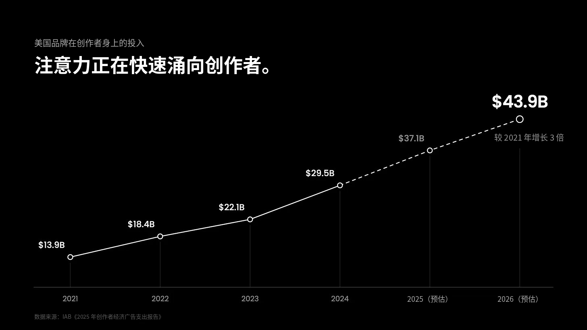
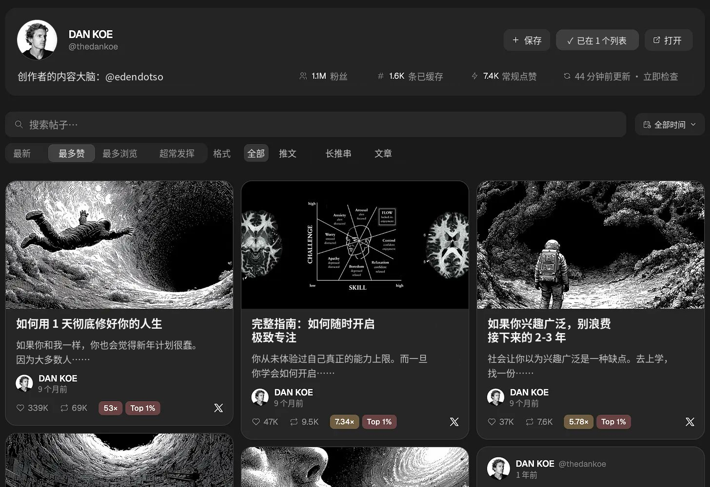
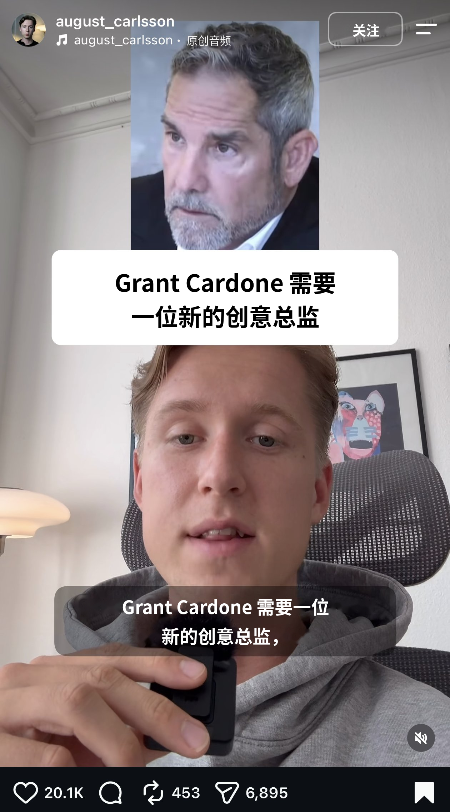

# 2027 年最赚钱的 AI 生意

> 原文作者：Dan Koe（[@thedankoe](https://x.com/thedankoe)）｜原文链接：[The most lucrative AI business to start in 2027](https://x.com/thedankoe/status/2117664712532123680)

最赚钱的技能，向来都是抓住注意力。

原因显而易见。

如果你的目标是多赚钱，那你做出来的软件有多好，并不重要。你花了 3 年、废掉无数稿子才写完一本书，也不重要。你拼命努力、不断提升自己，想换来更好的职业机会，同样不重要。

如果没人知道你是谁、你能提供什么，人家凭什么给你掏钱？

也就是说，不管你做什么工作、做什么生意，决定你成败的头号因素，都是能不能抓住注意力、能不能拿下客户。

做自己的生意是这样，帮别人做生意也是这样。

而且，别人愿意花大价钱请你替他们做这件事。

工作越来越没保障，摆在人们面前的只剩 3 条路：

1. 抱怨人生不公，然后什么也不做
2. 学新技能、重新充电，去找一份更好的工作
3. 开始做自己一直想做的那门生意

选第 3 条路的人会多到离谱。

你大概也猜到了，社交媒体上人人都在喊：他们做这门生意的方式，就是打造个人品牌。

为什么？

因为注意力是有限的资源，而且只会越来越稀缺。钱花了还能再赚，注意力花出去就再也回不来了。

在这封信里，我会教你怎么在社交媒体上把“抓注意力”这件事练到精通。这样一来，至少在未来几年里，赚钱对你都不会是问题。

学会之后，你可以借社交媒体的力，启动自己的生意；也可以成为一支“一人创意团队”，服务那些愿意为你这套本事付高价的公司。

---

**广告——“第二次文艺复兴”工作坊：**

我和 Hussain Ibarra（他把 Substack 订阅数从 2,600 做到了 20,100）联手，教你写出读者真正想看的 newsletter 和文章。

如果你一直想做 Substack，或者想把 X 文章写得更好，[点这里报名](https://eden.so/workshop)。价格 49 美元，但学到的本事能帮你赚回远不止这个数。

---

## I – 你要么成为创作者，要么花钱请创作者，要么拿钱替创作者干活。

数据摆在那里，想忽视都难。

高盛预测，创作者经济的规模将从 2023 年的 2500 亿美元涨到 2027 年的 4800 亿美元，几乎翻一番。

2025 年，创作者拿到了大约 1850 亿美元的广告收入——这是他们头一回超过传统媒体。

2021 年，美国品牌在创作者身上花了 139 亿美元；IAB 预计，到 2026 年这个数字会达到 439 亿美元，5 年涨了大约 3 倍。

离谱吧。

我自己是创作者，给创作者打过工，也花钱请过创作者，所以我很清楚：现在的报价高得吓人。大把风投的钱涌进来，一条 Reel、一段 60 秒的 YouTube 口播位，动辄几千美元（而且 90% 的时候根本没效果）。

关键在于，注意力如今在社交媒体上，不在广播、电视或新闻里了。不管你想做哪种生意——从聊聊个人爱好的小而美生意，到下一个独角兽公司——发内容几乎已经成了吸引受众、让他们为你买单的标配。

公司想扩张，就往联盟营销和合作推广里砸几百万美元。我老是刷到 Hormozi 的广告，说他们每个月付给创作者一百多万美元来推广 Skool。更别提 Hormozi 本人就是创作者，这对 Skool 的增长帮助巨大。

“创始人主导营销”（founder-led marketing）如今是创业圈的热词。说白了，眼下让创业公司增长最新、最好的办法就是……没错，做个人品牌、发内容（顺便说一句，大多数创始人这件事做得烂透了，你或许该[开始用 Eden](https://eden.so/) 来做调研、打造差异化、发布内容）。

这对你意味着什么？

不管你打算自己单干、已经有了生意，还是想给别人打工，最值钱的技能都是抓住注意力。放到数字世界里，这项技能就是做内容——做好内容，而不是没完没了的垃圾内容。

可惜的是，你精通了抓注意力的方法，不代表你真的抓住了注意力。

一条推文或 Reel 拿到一百万播放，可其他帖子每条只有一千，那也没什么用。这说明你的内容还行，但你的品牌压根不存在。两样都得有。

你可以天天追爆款，大多数人就是这么干的（这也是大多数人惨败的原因）；你也可以搭建一个内容世界，让人忍不住想进来逛逛。

我来教你怎么做。

## II – 一人创意团队

内容领域正在发生一场巨变。

我是 [Eden 的创始人](https://eden.so/features/creators/)。创作者和数字业务用 Eden 调研爆款选题、规划和排期内容、卖数字产品、运营邮件列表。

我不是在打广告，而是想说明：在这件事上，我们手里的数据几乎没人有。数十亿条帖子里，哪些话题、开头钩子和内容风格管用，我们一清二楚。

除此之外，很多[自由职业者和代理机构](https://eden.so/agencies)也用它来运营客户的个人品牌，从内容、邮件营销，到数字产品发布和搭建销售漏斗。

我们和这些内容代理公司、媒体团队聊过，他们说的话大同小异（大意如下）：

“我们还没裁人，但不用扩招就能多接很多活，因为每个人的产出都上去了。”

“创作者和创始人请我们，是因为他们连琢磨内容的时间都没有。他们要带团队、要经营公司，这些都需要专注。AI 能帮他们写内容，但他们心里清楚，还是得有一个比自己更会用 AI 的策略师或创意总监。这件事仍然需要创造力和思考。”

“AI 还是写不出最好的帖子，我觉得它永远也写不出来。但它能调研什么内容表现好、理解策略，然后起草出八九不离十的初稿。我现在的全部工作就是审稿、改稿。以前一天要干 12 个小时，现在 4 个小时就够了。”

在我看来，一个人能做的最赚钱的 AI 生意，有两种做法。

第一，你可以当自己的创意团队。做个人品牌，积累受众，开发数字产品，搭建邮件列表，诸如此类。这就是你唯一的重心。相信我，就算有 AI，这也是一份全职工作。如果你是创作者，没有团队的话，你多半不会去做软件。

第二，你可以当别人的创意团队。很多公司、创始人，甚至创作者，都没有足够的创意精力去产出不可替代的内容，你去帮他们。大多数创始人还在发“公告式”的内容，完全不知道在网上建立影响力需要付出什么。

换句话说，你要成为自己品牌或别人品牌的创意总监。

如果你能做到，完全可以按一整支团队成本的一部分来报价。服务 1 到 3 个客户，每月收 1 万到 7.5 万美元，并没有那么遥不可及（前提是你真的擅长、并且肯下功夫练——别让大脑骗你说，这又是一个快速致富的机会）。而那些往营销里砸几百万的老板，看到这个价格眼都不会眨一下。

这支一人创意团队长什么样？

你需要学哪些技能？

### 职位 1）品牌策略师

品牌策略师负责定位和认知。

他们会第一个站出来告诉你：别光追热点，别指望每条帖子都爆。增长和互动固然重要，但不能拿信任和权威去换。

顺便说一句，这些具体怎么做，下面我都会讲。

### 2）内容策略师

和品牌策略师不是一回事。

内容策略师负责摸清各个话题和细分领域里什么内容表现好，再给创作者提议下一条该发什么。他们会深入研究帖子格式、YouTube 缩略图和标题结构、留存率和传播性。

他们很会涨粉。但如果不考虑品牌策略，创作者一旦停更，根本没人会问他去哪儿了。

### 3）内容写手 / 社媒运营

负责起草推文、YouTube 或 Reels 脚本、X 文章和 Substack newsletter，并安排排期、负责发布。

他们拿着内容策略师的点子和品牌策略师定的方向，确保内容和两者对得上。

你大概能看出来，为什么大多数人用 AI 做不出任何长久的东西了。他们还是把它当成快速致富的门路，以为只要让 Claude 在没有方向、没有数据的情况下批量吐脚本，就能神奇地和受众建立连接。

几乎没人考虑品牌策略。

少数人会考虑内容策略。

大多数人只是把随手想到的点子写成帖子，然后祈祷它能火。

这就是你的竞争对手。想脱颖而出，并不难。

## III – 如果你是我的客户，我会这样帮你打造不可替代的个人品牌

我们来玩点有意思的。

我假装你是我刚签下的客户，带你走一遍入职流程。

这样一来，如果你想当创作者，可以自己照着流程做。如果你想帮别人做内容生意（代写推文、给品牌写 Substack 文章等），这就是你接客户的方式（后面我还会告诉你一个拿下第一个客户的绝佳策略）。

### 第 1 步）开一场入职通话，提炼客户的“思想签名”

想让对方的品牌和内容独一无二，你得从他们那里拿到大量背景信息。

签下客户之后，约一次通话，把你需要的信息全都采访出来。记得录下来，这样就能把文字稿存好，随时交给 AI 参考。

如果你是给自己做品牌，我已经准备好了一份测验 / 提示词，还附带一门 30 天创作者冲刺课程。它会结合当下正在爆的内容和你的独特之处，帮你把策略定下来。[点这里试试](https://eden.so/sprint)。

下面这些问题，你可以拿去问客户，也可以问自己。你还可以把它们粘贴进 Claude，让它一步步把信息从你脑子里挖出来，存成一份品牌文档，以后随时让 AI 参考。

这些问题都会塑造你的品牌。

每个问题都能延伸出一批内容选题，够你在 6 到 12 个月里持续输出。有人看到这些会问：“我怎么才能在一条帖子里把这些全讲清楚？”

不用讲清楚。这是一场长期游戏，也正是大多数人惨败的原因：他们想立刻拿到关注和权威。那就祝他们好运吧。

内容太长，我把这些问题和更多内容整理成了一份[完整的提示词](https://app.eden.so/w/dan-s-workspace/notes/bd8c9594-8ce6-4ae5-95a3-86fed3da148b?via=eden-f136db14df6d)，你可以收藏，或者复制到自己的工作区。

#### 你要帮助谁

- 你最想帮助的是谁？描述一个真实存在的人。
- 他们现在过得最糟的一天是什么样？
- 他们向朋友抱怨时会说什么？用他们的原话。
- 他们已经试过哪些办法，结果没用？

#### 你的故事

- 你经历过什么，正是你的受众现在正在经历的？
- 事情开始转变的那一刻是什么（再小都算）？
- 你做过、试过、搞砸过、想明白过哪些事？从大到小列出来，每一件都值得写。
- 你能拿出哪些成果，你自己的，或者你帮过的人的？

#### 谁塑造了你的思想

- 谁的书、帖子或视频你从不错过？写出真实的人名和作品名。
- 他们的哪个观点你总是反复回想？为什么？
- 谁改变了你的思考方式，哪怕你现在已经不认同他？

#### 内容支柱与独特视角

- 哪些话题你能滔滔不绝聊上几个小时？全部列出来，哪怕看起来毫不相干。
- 其中哪 2 到 3 个对你最重要？
- 在每个话题上，你的切入角度和别人有什么不同？（比如“从心理学切入”或“以前做过护士”）
- 别人最常向你请教什么？
- 你总是一遍又一遍地跟人解释什么？

#### 使命与信念

- 用一句话说，你想帮人们做成什么？
- 有什么是你相信、而你这个领域大多数人不信的？
- 你这个领域有哪些常见建议，你认为是错的？

#### 你反对什么

- 什么样的生活方式正在伤害你想帮助的人？
- 你想帮他们逃离什么样的生活？用你自己的话回答。
- 如果可以，你想消灭哪个迷思或习惯？（是习惯或观念，不是某个人或某家公司。）

#### 为什么是现在

- 世界上刚刚发生了什么变化，而大多数人还没察觉？

#### 你要带他们去哪儿

- 跟着你五年后，他们的日常生活是什么样？
- 他们会在自己的个人简介里，自豪地怎么介绍自己？
- 在他们的故事里，你是谁？（向导、记录旅程的人，还是那个走出去、又带着地图回来的人？）

#### 规则与术语

- 你的理想读者每天信奉什么、做什么？列出 5 到 12 条规则。
- 你有没有给自己的观点、方法或问题起过名字？把每个名字连同它的含义写下来。

把这些信息存在稳妥的地方，比如 Eden 里的品牌看板，这样构思选题时随时都能调出来参考。

### 第 2 步）如果客户已经在发内容，抓取他们最好的内容

我想大家都同意：AI 复制不了一个人的文风。

就算再像，也总有那么一点不对劲。

我们这么做，本来也不是为了这个。公司的语气 AI 完全能拿捏，但个人品牌之所以叫“个人”品牌，是有原因的——它需要那一点独一无二。

我们采访客户、整理他们最好的内容，不是为了把整个流程自动化，而是在搭一个知识库，把这个人身上所有独特、值得一提的东西都收进来。之后再用 AI 头脑风暴、起草或构思，比从零开始轻松太多。

想抓取他们在各个平台上的最佳内容，可以通过 MCP 把 Eden 接入 Claude 或 ChatGPT，让它拉取他们的帖子，或者别人正在爆的帖子。把他们的社交账号给它，再用类似这样的提示词：

> 抓取 [@handles] 的最佳内容，他们所在的每个平台各 10-20 条。然后记下让他们与众不同的核心观点、他们文风中有个性的地方，再推测一下他们的世界观或人生哲学——那种能把别人团结到身边的东西。总之，把所有促成他们增长的因素都记下来，整理成一份文档。

另外，也值得直接去翻翻他们在各个平台上表现最好的帖子，找出可以照搬的规律。

### 第 2.5 步）如果你还没开始发内容

对新手来说，这可以说是你能做的最好的事。

你得明白，你的思想是被对你影响最深的那些人塑造的。你最好的想法——那些能让你涨起来的想法——其实是你对从别人那里吸收来的观点的再诠释。

有点像《点子都是偷来的》（Steal Like an Artist）里说的那样，只不过大脑本来就是这么运转的。

接触到新观点时，敢把脑子里旧的信念和想法换掉，是聪明的核心标志。死守那些带不来好结果的信念和想法，则是愚蠢的标志。

我的思想，大部分是 Naval、Leo Gura、Mihaly C、Steven Kotler、Ken Wilber 等人的观点糅在一起形成的。这些观点在我脑子里相互碰撞，再加上我自己的人生经历，才让我的想法成了我自己的。

所以，如果你还没开始发内容，就列一份名单，写下对你影响最大的 5 到 10 个人。

如果他们本身就是创作者，那就更好了。把他们放进一个列表，这样你就能看到他们的全部内容，或者直接和这些内容对话。

然后用上面那个提示词，换成他们的社交账号就行。如果他们不玩社交媒体，就让 AI 从网上和他们的书里提炼出他们最好的观点。存成一份文档，放在稳妥的地方。

### 第 3 步）做一份有调研支撑的内容地图

到目前为止，我们已经：

- 掌握了足够的品牌背景信息，能做出独一无二的东西
- 记录下了可以复用、重新定位和照搬的最佳观点

现在，该戴上营销的帽子了。

其实也不是营销的帽子，而是艺术家的帽子。

大多数“创意人”一想到要研究爆款帖子、表现最好的 YouTube 标题，或者按“什么更可能火”来做内容，就浑身难受……可那只是因为你看问题的角度，挡住了你真正在做的事。

你是在收集参考。

艺术家就是这么干的。他们有灵感板，有各种参考，帮自己塑造作品。他们不会一比一照抄，而是从中提炼规律和原则，让自己的作品更有可能成功。

说实话，你也希望自己的作品成功。你只是觉得看数据很膈应，好像算不上创作的一部分。醒醒吧。

具体这么做。

（免责声明：这封信里我反复提到 Eden，坦白讲，是因为确实没有别的工具能干这个活。社交爬虫看不到跨账号的表现数据；GrokBot 这类应用很厉害，但只能用在 X 上。而想找到独特的选题，你最好去调研那些你自己不发内容的平台。）

做法很简单：用下面这个提示词，把你目前做好的 2 份文档放进去：

> 我想让你做一份有调研支撑的内容地图：3-4 个独特且宽泛的内容支柱，每个支柱分出 5-7 个话题。这些话题既要基于已被验证有效的观点，又要透过我独特的视角——依据 [@ 品牌文档] 和 [@ 内容文档]。每个话题再分出 5-10 个可能表现不错的点子，每个点子再分出 4-5 个切入角度。
>
> 通读我的品牌文档和内容文档，从中提炼可能的内容支柱和我的视角，然后用 Eden 调研这些话题在各平台上什么内容表现好。我们要的是一份独特的内容地图，但要和过去 6-12 个月里被验证有效的规律结合起来。
>
> 把结果整理成一份易读的文档。

现在，你手里大约有 6 个月的内容点子了。你可以让 Eve 或其他 AI 根据我们之前准备的背景资料来起草，再对照表现好的内容，检验帖子的结构。

我想很难否认，用这套流程一定能看到成效，而且能把那些不这么做的人甩开十万八千里。

前面提过，这里有一份包含完整流程的[文档 / 提示词，你可以直接复制](https://app.eden.so/w/dan-s-workspace/notes/bd8c9594-8ce6-4ae5-95a3-86fed3da148b?via=eden-f136db14df6d)。啃完要花点时间，但内容很全面。

## IV – 如何拿下第一个客户

几年前，我的朋友 JK Molina（基本上就是他带火了“当推特代笔人”这股风潮）给我发了一条私信。

大意是这样的：

“Dan，我知道你不想让别人替你写，但我还是给你写了 10 条帖子。你发发看，喜欢的话就让我接着写，或者给我写句推荐语也行。”

在做社交媒体之前，我是个自由职业者，主动去陌生开发客户简直是地狱。我恨透了这件事。

但收到这条私信时，我意识到：想以每月 2500 到 5000 美元拿下一个内容客户，这绝对是最好用的策略之一。你可以瞄准那些忙得脚不沾地的创作者、创始人，或者正苦于涨不动粉的人。

你可以用一个提示词，把上面讲的所有步骤替他们跑一遍，让 AI 起草 10 条帖子，你再润色一下，然后每天发 10 条私信。

如果你真这么做了，一个月内连一个客户都拿不下？我很难相信。

这就是“无需许可的学徒”（Permissionless Apprentice）打法。

你先免费给梦想客户干活，再想尽办法让他们看到。

如果私信不管用，那就像这样公开做——X、Substack，或者其他任何平台都行：

在那条 Reel 里，他开头一句话就把人钩住了：“Grant Cardone 需要一位新的创意总监，这是我的求职申请。他的内容好像还停留在 2016 年。”

Grant Cardone 亲自回复“来找我，我确实卡住了”，再加上这条帖子的互动量，我觉得已经证明了这封信里的大部分观点。眼下就是一个巨大的机会。拿下客户、带他们入门、为他们做出精彩内容，所需的工具你全都有了。

希望这些对你有帮助。

– Dan

再提醒一次：教你写出让人忍不住读下去的 newsletter / 文章的工作坊，将于 11 月 10 日举行。想把长文创作练成一项技能，[点这里报名](https://eden.so/workshop)。
