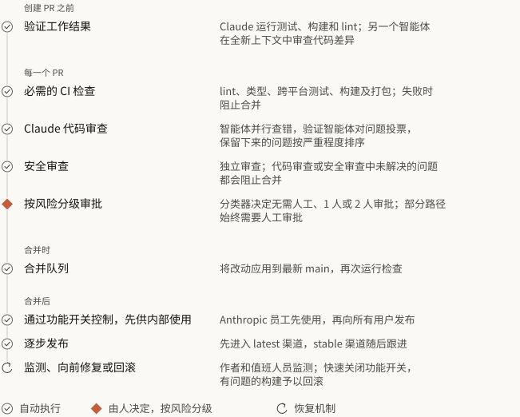
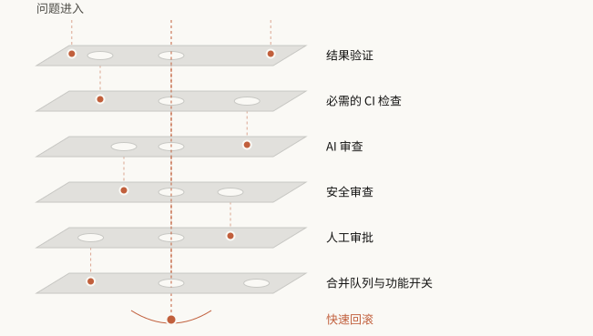
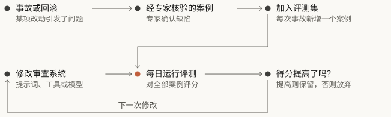
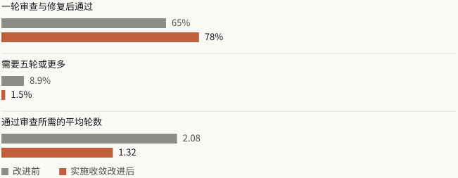
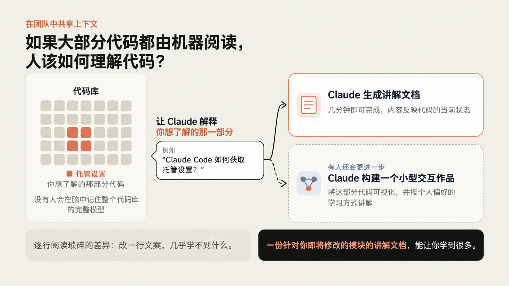

# Claude Code 团队如何做代码审查

> 作者：Addy Osmani（[@addyosmani](https://x.com/addyosmani)）  
> 原文参考：[How the Claude Code team does code review](https://claude.dev/blog/solving-code-review-at-anthropic/)  
> 翻译 Url：[https://github.com/samz406/local_wenzhang/blob/main/docs/ClaudeCode团队如何做代码审查/ClaudeCode团队如何做代码审查.md](https://github.com/samz406/local_wenzhang/blob/main/docs/ClaudeCode团队如何做代码审查/ClaudeCode团队如何做代码审查.md)  
> 版本：依据用户提供的 Addy Osmani 改写稿翻译；配图、风险分级表及引用链接参照原始文章补全。原始文章由 Addy Osmani、Morgan Westlee Lunt 与 Qing Wang 合著。

我们之前提到过，Claude Code 的代码大约有 90% 是 Claude 写的。那么，面对这样的规模，我们怎么做代码审查？到底还有谁在读代码？代码出问题了怎么办？

这篇文章介绍 Claude Code 团队的代码审查流程，以及我们如何改进这套流程。从 6 月到 9 月，合入 Claude Code 代码库的拉取请求（PR）数量增长了一倍多，而需要回滚的 PR 占比下降了 40% 以上。

我们并没有停止代码审查，而是把大部分代码阅读工作交给自动化系统，并围绕如何节省人的时间和精力来优化流程。同时，我们也投入了大量工作，让撤销错误变得更快、更容易。

## 重新思考代码审查的目标

有了智能体写代码，改动量会迅速增加。在我们的单体仓库中，[每天合入的改动从今年 5 月的大约 2,500 次，增长到 9 月的 30,000 次以上](https://www.anthropic.com/engineering/redesigning-source-control)。

Claude Code 虽然不在这个单体仓库里，也同样承受着巨大的压力。开发速度达到这个程度后，人工逐行审查代码即便并非完全不可能，也会变得越来越困难。

代码审查有两个目的：

- 在发布之前发现并修正缺陷。
- 让团队对代码库形成共同的理解。

本文主要关注第一个目标，第二个目标会在接近结尾时讨论。

我们认为，“有没有人读过代码？”只能粗略地反映真正需要回答的问题：“这项改动可能出什么问题？用哪一种检查——自动检查还是人工检查——最适合发现它？”

这个问题也改变了代码审查发生的时机。传统做法是在事后检查：代码写好了，PR 提交了，然后等另一个人来看。现在，我们把代码审查融入了工作流，更像写作时持续进行的拼写检查。

大多数改动在交给人审查之前，就已经至少经过 Claude 的一轮审查和修正。这样，常见缺陷大多能提前被发现，人的注意力则留给更高层次的问题。

## 人的时间与注意力

我们希望把人的时间和注意力留给只有人才能处理的事情，其余部分则由足够完善的自动化来覆盖。即使以目前的速度推进，仍然有大量工作需要人来做，我们的团队几乎每天都会遇到全新的挑战。

因此，人的时间成本要从两头算：既要计算花在代码审查上的时间，也要计算因糟糕代码引入缺陷后，人们花在修复上的时间。如果只减少前者，没有减少后者，就算不上真正节省了人的时间。

所以，我们的目标是：Claude Code 各个仓库中的大多数 PR——包括 CLI、桌面应用、Web 应用和移动应用——最多只需一个人参与，就能完成合并；这个人可以就是作者，同时回滚和事故不能增加。

我们会跟踪每个 PR 所需人工审批次数的中位数和第 95 百分位数、人工评论数量，以及 PR 等待人工处理的时长，以此衡量人的时间投入。回滚率和事故率是约束指标：如果它们上升了，我们就没有减少人的时间消耗，只是把它转移到了别处。

## 一项改动会经历什么？

无论来自工程师的笔记本电脑，还是 Slack 中的一次 Claude 会话，典型的改动都会经过多层审查。

上图展示了 Claude Code 中一项典型改动从作者的开发环境进入生产环境的过程。大部分流程是自动化的，人的注意力集中在风险较高的环节。

我们有六层检查，再加上一套回滚机制，处理那些仍然漏过去的问题。

每一层都能发现一些缺陷，也会漏掉另一些。很少有缺陷能穿过全部检查；即使穿过去了，我们也有回滚机制兜底。

### 1. 创建 PR 之前先验证

我们的大部分审查发生在创建 PR 之前。我们会让 Claude 做一些可以实际运行、检查的事情，例如运行测试、执行构建，或把截图与设计稿进行比较。我们要求它展示结果，而不只是说任务已经完成。然后，再让一个拥有全新上下文的子智能体审查代码差异。这两种做法都写进了我们的[最佳实践指南](https://code.claude.com/docs/en/best-practices)。

创建 PR 之前，我们很多人还会运行几项内部技能：查找缺陷、精简代码差异、端到端验证，以及依据设计规范检查 UI 改动。

Claude Code 的创建者 Boris Cherny 认为，让 Claude 拥有一套验证流程，[可能是获得更高质量结果的最重要因素](https://x.com/bcherny/status/2007179861115511237)。

他估计，验证流程可以让 Claude 的输出质量提高到原来的两到三倍。

不同领域的验证流程可能截然不同：

有时简单到只需执行一条 Bash 命令，有时要运行一套测试，有时则要在浏览器或手机模拟器中测试应用。

如果自动审查系统总是在指出同一个问题，我们就从源头解决：修改技能本身、加入一条 lint 规则，或更新下面这些说明文件：

- **`CLAUDE.md`：** 项目说明文件，用来向 Claude 提供技术栈、约定、目标以及明确不做什么等项目背景。Claude Code 每次审查都会加载这个文件，因此，代码库较大时，我们会让它保持简短，并在其中引用其他文档。代码违反了文件中的约定，或者某次更新让其中的内容过时，审查系统都会指出来。
- **`REVIEW.md`：** 代码负责人用这个文件告诉审查系统，在自己负责的代码中，什么最重要。我们还会单独验证审查系统是否真的遵守这些指南。好的指南应该简短，并聚焦以下几点：
  - 定义项目中的失败是什么，例如文档不能与事实不符，配置不能把请求路由到错误位置。
  - 限制对细枝末节的挑剔。
  - 明确哪些路径应当忽略。
  - 要求给出文件和行号作为依据，而不是猜测文件名。
  - 要求提供总体摘要，包含问题数量；没有问题时，明确说明“未发现问题”。

### 2. 每一个 PR 都接受 AI 审查

每个 PR 在人工审查之前，都会先经过 Claude 审查。

审查系统会结合整个代码库，以及作者在 PR 中说明的意图来分析代码差异，检查以下几点：改动是否真正解决了问题，是否适合整个系统，以及是否破坏了代码库的其他部分。

审查缺陷修复时，机器人会尝试找到根本原因。

我们的公开产品 [Code Review for Claude Code](https://code.claude.com/docs/en/code-review) 现已面向所有 Team 和 Enterprise 客户开放。本地也有一个更轻量的版本：`/code-review`。

自[研究预览版发布](https://claude.com/resources/articles/code-review)以来，内部 PR 收到实质性审查意见的比例从 16% 上升到了 54%。对于超过 1,000 行的 PR，Code Review 通常能发现问题；对于较小的 PR，大多数会得到未发现问题的结果。管理员可以为仓库配置 Quick、Standard 或 Deep 模式。如果漏掉一个缺陷的代价，高于额外花费的审查时间，Deep 模式就值得使用。

在交给人审查之前，发现的问题还会由其他多个智能体核验：

- 多个智能体并行寻找缺陷。
- 另设投票环节，判断某项发现是真问题还是误报；只有获得足够票数的问题，才会被确认。
- 仅涉及风格、诊断信息或清理的问题会被过滤掉。推出这些过滤规则之前，我们先在自己的 PR 上做过 A/B 测试。

剩下的问题会以行内评论的形式呈现，按严重程度排序，并标记为：

- **重要问题（Important）**。
- **细节问题（Nit）**。
- **既有问题（Pre-existing）**，避免把并非由本次 PR 引入的缺陷，不公平地算到作者头上。

每一项发现都必须得到处理：要么修复，要么说明理由并将讨论标记为已解决。很多时候，智能体会在夜间修好问题，作者回来时，PR 已经又经过了一轮审查。

### 3. 可以阻止合并的安全审查

我们还会运行自动安全审查。只要仍有未处理的问题，无论来自代码审查还是安全审查，PR 都不能合并。作者可以修复问题，也可以简要说明理由并关闭讨论——我们就是这样处理误报的。

如果后续提交解决了问题，对应的问题讨论会自动关闭。你也可以使用开源的安全审查 GitHub Action，或 `/security-review` 命令，搭建同样的机制。具体配置方法见 [Claude Code 自动安全审查指南](https://support.claude.com/en/articles/11932705-automated-security-reviews-in-claude-code)。

### 4. 可以阻止合并的自动检查

标准检查包括 lint、类型检查、所有平台上的测试和构建。我们也写过[如何扩展 CI 以应对这种规模](https://claude.com/resources/articles/agentic-coding-is-straining-ci-heres-how-we-scaled-test-impact-analysis-at-anthropic)。一个典型的 CLI PR 在交给任何人查看之前，可能已经运行了几十项检查。PR 模板还会询问改动如何测试、如何回滚。Claude 可以帮你填写，但作者有责任审核这些内容。

### 5. 根据风险调整人工审批强度

有些改动的风险比其他改动更高，例如修正文档和修改自动更新器，显然不是一回事，因此需要不同程度的审查。

**图 C：风险分级与人工审批要求。**

| 风险级别 | 示例 | 人工审批要求 |
| --- | --- | --- |
| 低风险 | 文档、文案、仅供内部使用的功能，以及通过功能开关隔离的增量改动 | 自动审查和安全检查全部通过后，无需人工审批 |
| 中风险 | 常规产品改动，以及涉及缓存、自动更新器、系统提示词等敏感区域的改动 | 1 人审批 |
| 高风险 | 风险最高的代码，以及少数始终要求两人审批的路径 | 2 人审批 |

风险等级由改动本身决定，而不是由作者决定。一个分类器根据改动判断风险等级；另一个分类器则进一步判断，即使该等级没有要求额外审批，这次具体改动是否仍然需要再找一个人批准。有些路径始终需要额外审批，包括负责人标记为敏感的内容，以及所有 CI 工作流文件。

只有在仓库信任名单上的作者，才能享受较宽松的审查要求；通常就是负责这个仓库的团队成员。其他人都需要第二个人批准。智能体的批准不算人工批准。自动审查可以让低风险改动过关，但只要规则要求人工审批，就不能用它代替人。

改动作者要对改动负责，因此，如果 PR 是由智能体编写的，操作这个智能体的人始终算作必需的审查者之一。一次 PR 批准只对一个具体提交有效。如果又加入了系统无法确认可信的新提交，例如智能体推送了内容，或者有人手动解决了合并冲突，PR 就必须重新获批。

### 6. 合并队列、功能开关与分阶段发布

合并队列确保所有检查都在应用了这项改动的 `main` 分支上运行，防止两个各自检查通过的 PR 合在一起，却把 `main` 弄坏。新功能通常通过功能开关控制，先向 Anthropic 员工开放。我们自己大量使用产品，因此经常能在用户之前发现回归问题。

公开发布时，改动先进入 `latest` 渠道，`stable` 渠道随后跟进。

### 7. 快速反馈与回滚

难免还是会有一些有问题的改动被合入。这是我们的最后一道防线，重点是尽快发现它们。由功能开关控制的改动，无需重新部署就能关闭。

Claude Code 采用每周轮换的值班制度，每次事故复盘都会回看：哪一层本应该发现这个问题？除了监测回滚和事故看板，作者和值班人员仍然有责任发现有问题的合并。我们还没有根据这些指标动态调整审批要求的熔断机制，但随着我们朝减少合并中的人工干预继续推进，这也是正在研究的方向。

一位团队成员指出，放慢速度、减少产出，确实可能提高准确率，但主要原因是整体做的事情变少了。我们真正优先考虑的，是提高快速发现和修正问题的能力。

## 我们如何改进审查系统

我们的代码审查流程处于持续改进的循环中：

我们把事故作为评测依据。团队收集了引发事故的 PR，以及相应的后续修复提交和回滚，再由熟悉代码库的工程师核实每个缺陷的位置，以及对缺陷的判断是否准确。审查系统每天都会在这个案例集上接受评测。

每一次事故都会为案例集增加内容，而审查系统的每一次修改，都要在整个案例集上接受评测。

为了衡量噪声，我们会观察人们如何回应审查评论。如果允许报告大量并非缺陷的问题，提高缺陷发现率并不难，因此必须对此加以约束。我们会根据 PR 中的人如何处理每条评论进行分类：修复了问题、否定了这条意见、澄清这是预期行为，或者认为无关紧要。此外，我们还会在已知没有问题的 PR 上运行审查系统，观察它多大概率会提出可能诱导人作出有害改动的问题。

我们明确写下的优先级是：第一，发现真正的缺陷；第二，减少审查轮数。

当作者是智能体时，处理一条审查意见的成本更高。人只需一秒就能忽略一个无关紧要的小问题，但智能体去处理它，就会产生一次新提交，再引发一轮审查。

审查流程必须收敛。写代码的智能体和审查代码的智能体，有可能永远循环下去。我们观察到，CLI 项目中的一个 PR，因为这两个智能体反复来回，一夜之间经历了五十多轮。后来有人手动终止了这个循环，否则它可能无限持续。

我们对审查系统反复指出的代码运行 `git blame`，发现约 59% 从第一轮审查时就已经存在。也就是说，审查系统很少是在发现新引入的缺陷，而是在每一轮里又找出几个原本就存在的问题。

我们自己的习惯还加剧了这个问题：因为每一轮都可能发现不同的缺陷，我们逐渐习惯默认运行好几轮审查。对高风险改动，多轮审查可能有价值，但并不是每个 PR 都需要。于是，除了召回率，团队也开始跟踪通过审查所需的轮数，并调整重新审查的方式：

- 限制轮数。三轮之后，审查系统会要求作者重新评估整体方案。
- 前几轮之后，重新审查只针对新产生的代码差异。
- 指明缺陷所属的类别，让作者修复所有同类问题，而不只是某一行。
- 避免重复报告已经指出的问题。
- 审查智能体也会在夜间检查当前代码库，帮助我们在历史缺陷扩散之前发现它们。

实施收敛改进后，内部每个 PR 所需的平均审查轮数下降了。

## 哪些地方仍然需要人参与

让一位资深工程师停下手头的工作，去审查一个常见错误，成本远高于把这个过程自动化。不过，有些任务仍然离不开人工审查：

- **这件事到底该不该做？** 决定是否构建某项功能，确定产品愿景、品味和目标。

一个声称已经解决代码审查瓶颈的团队，仍然会人工审查来自团队外部的改动，确保做的是正确的事情。

- 审核危险代码，例如计费、自动更新器和 CI 工作流。
- 审查架构，因为这些选择会成为其他人沿用的约定。
- 核验实际证据，包括测试输出、运行过的命令、截图和审查意见。如果你说不清这些检查可能漏掉什么，就别只求一个 👍，你需要的是一次真正的审查！
- 承担责任。无论代码是谁敲出来的，每一项发布的改动，都有一个人要为它负责。

## 团队如何理解代码库

代码审查一直还有一个作用：让团队了解代码库发生了什么变化。阅读同事提交的代码差异，通常是人们了解改动、理解代码库工作方式的途径。如果大部分阅读工作都由机器完成，人又该通过什么方式学习代码库？

我们并没有为此建立正式机制。团队里没有谁在脑中装着整个 Claude Code 的完整模型，我们也不认为有人需要这样做。相反，谁想了解代码库的某一部分，就让 Claude 专门为那部分代码生成一份讲解文档。只需几分钟，而且讲解内容始终反映最新代码。

我们当中有些人还会更进一步，让 Claude 生成一个小型交互作品，把这部分代码可视化，并用自己偏好的方式来讲解。

与逐行阅读琐碎的代码差异相比，这样分配人的注意力更划算。逐行看一个改动，例如只改一行文案，几乎学不到什么；但为自己即将修改的模块生成一份讲解文档，却能学到很多。

此外，我们默认开放协作，在公开的 Slack 频道中工作，能实时看到其他人正在构建什么。

## “谁合并，谁负责”

如果你合并了一项小型或中型改动，结果还是出了问题，团队通常期望由你自己来修复。之所以不会因此失控，有几个原因：

- 改动足够小，容易审查、调试和回滚。
- 所有东西都可以撤回。功能开关、回滚和分阶段发布，能在几分钟内撤销大多数错误。
- 影响范围决定检查标准。出错代价越高的代码，就需要更多人查看、更多验证。
- 遥测和内部使用能快速暴露回归问题。
- 这不是追责游戏。由你负责修复，是因为你掌握最多上下文；事故复盘关注的是系统。

而且，团队里的很多人通过在[公开频道](https://claude.com/product/tag)中工作来共同分担责任。任何人都能看到其他人在做什么，加入讨论，或者让 Claude 查找遗漏。反馈也会来自并不负责这段代码的人。正是这种开放，让我们不必对每一行代码都设置人工关卡，也能保持较高质量。

## 改变方向

有了智能体，启动一项新工作的成本很低，但有时这件事本来就不该做。常见情况是，频道里有人指出拟议改动走错了路——可能引用此前的决策，也可能建议更好的做法——于是作者关闭 PR，或调整实现。

因为代码一开始就写得很容易，关闭 PR 也不会让人觉得损失很大。关键是在线程讨论早期就转向，而不是等 PR 已经定稿，才在最后给出阻止合并的意见。

## 如何落地

这套方法中的大多数组件，你的团队已经可以直接使用。

### 创建 PR 之前

- 给智能体一份它能实际运行的检查清单，把这些检查写进一份简短的 `CLAUDE.md`。
- 配置钩子，让智能体调用格式化工具和 lint 工具。
- 在本地运行 `/code-review` 和 `/security-review`，或者让一个拥有全新上下文的子智能体审查改动。
- 创建 `REVIEW.md`，用它记录反复出现的审查问题。

### 每一个 PR

- 强制执行 CI。
- 在 PR 模板中加入“测试”“风险”和“如何回滚”。
- 先在一个仓库中接入 AI 审查系统，例如 Code Review for Claude Code，或 Claude Code GitHub Action；持续迭代 `REVIEW.md` 几周后，再推广到更多仓库。
- 加入自动安全审查。
- 要求合并之前解决所有审查讨论。
- 根据风险决定审查强度：常规改动快速过一遍，高风险区域——也就是缺陷代价高的地方——做深入审查。Code Review 提供 Quick、Standard 和 Deep 三个级别。
- 限制审查轮数，几轮之后只检查新产生的代码差异。

### 审批

- 定义风险等级，依据改动本身，而不是依据作者分级。起初严格一些，随着证据积累再逐步放宽。
- 只为可信作者保留较宽松的审批路径。
- 机器人批准不能满足必需的人工审批要求。推送新提交后，撤销原有批准。
- 对涉及身份验证、计费、CI、发布工作流和安装程序的代码及策略，明确指定人工审批者，并通过 `CODEOWNERS` 和分支保护落实。

### 合并及合并之后

- 建立合并队列。
- 尝试使用功能开关。
- 先向内部用户发布。
- 分阶段推出。
- 建立一步回滚机制。
- 记录事故和回滚，构建一套评测。
- 每次调整审查系统的提示词、工具或模型，都重新评分。
- 跟踪人的投入，并以回滚率和事故率作为约束指标。

## 接下来会走向哪里

Code Review [发布时](https://claude.com/resources/articles/code-review)的设想是，最终批准仍由人来决定，产品本身只发布发现的问题。但在我们自己的仓库里，我们走得更远：由负责人决定，哪些低风险改动可以在自动检查通过后自动合并。而这条边界还会继续变化。

所以，每当审查系统漏掉什么，我们都会问：模型的上下文里缺了什么？然后把缺失的内容补进 `CLAUDE.md`、一项技能或一项新检查。我们的目标没有改变：减少每项改动消耗的人力，同时让回滚率不高于当前水平。

如果你也允许智能体创建 PR，欢迎告诉我们：你们自动化了哪些检查？哪些环节仍然需要人？我们又有哪些地方做错了？

本文改写自我们原来的文章，并经 Pangram 检查。
