# Codex 是怎样诞生的

> 作者：[Dan Shipper](https://every.to/@danshipper)  
> 原文：[How Codex Happened](https://every.to/p/how-codex-happened)  
> 翻译 Url：[https://github.com/samz406/local_wenzhang/blob/main/docs/Codex是怎样诞生的/Codex是怎样诞生的.md](https://github.com/samz406/local_wenzhang/blob/main/docs/Codex是怎样诞生的/Codex是怎样诞生的.md)

*走进 OpenAI 在编程领域的翻身仗：从一次失利的发布，到接管 ChatGPT 的应用。*

## 发布前夜

我清楚地记得，自己是从什么时候开始觉得，OpenAI 可能要失去“天命”了——自 ChatGPT 横空出世以来，它在 AI 编程领域建立的那种看似无法撼动的领先地位，可能保不住了。那是 2025 年夏天，[GPT-5](https://every.to/vibe-check/gpt-5) 发布的前一晚，我正在他们位于旧金山米慎湾的办公室里。

整栋楼都透着一股兴奋。头顶的灯亮得像舞台灯，人们穿行在铁锈红与棕色暖调的走廊里，脚步似乎也比平时快了一点。连重力都仿佛变强了，好像第二天那场发布的体量太大，已经把整个世界吸进了它的轨道。

[于是，我专程来讲的那些话，就显得有点不合时宜。](https://every.to/p/how-codex-happened/interviews/alex/#final-20261015-0003)

我经营的公司 Every，开始因一件事小有名气：把新 AI 模型放进真实工作里测试，说明白它们能做什么、不能做什么。OpenAI 在发布前大约一个月，就把 GPT-5 的访问权限交给我们，希望我们帮助他们了解模型的长处和短板，并在发布当天推出详细评测，也就是我们的 Vibe Check。

### 向 Codex 的创造者取经

为写这篇报道，我采访了 Greg Brockman、Alexander Embiricos、Thibault “Tibo” Sottiaux、Amelia Glaese、Andrew Ambrosino 和 Ed Bayes。这六个人分别从研究、工程、产品和设计的角度参与了 Codex 的构建。每份采访，都提供了一个不同的视角，讲述它是怎样走到一起的。

获取这六份完整采访实录。你可以自己阅读，也可以和智能体一起探索，从中寻找值得带进自己工作的想法。

[开始免费试用](https://every.to/subscribe/regwall)

我们十个人曾在纽约州北部的一栋房子里，做了为期一周的团队闭门活动。大家围着一张长木桌吃饭、工作，也会聚到大屏幕前的沙发上，测试这个期待已久的模型。我们尤其想试试编程，那是 AI 进步最快的领域。日常使用时，我们挺喜欢它；可放进 Codex 里，大家的反应却不冷不热。

如今，Codex 已是 OpenAI 卷土重来的核心：它从内部吞下了 ChatGPT，成为这家公司下一步所有建设的基础。但在那个夏天，它还只是一个拼劲十足、想做出 AI 软件工程师的项目。几个月前推出的[云端版本](https://every.to/vibe-check/vibe-check-codex-openai-s-new-coding-agent)，没能找到产品与市场的契合点；团队正在转向一个新版本，让它运行在开发者自己的计算机上，进入终端和代码编辑器。

在 Codex 里，GPT-5 很快，看起来也很聪明。我们技术最强的工程师之一 [Naveen Naidu](https://every.to/@naveen_6804)，用它找到了语音输入应用 [Monologue](https://monologue.to/) 中一个诡异的卡死问题，这个问题此前已经困扰他好几天。但它似乎也总是过早收手，像是格外害怕越过许可范围。感觉上，它是按“结对编程搭档”来设计的。

而我们整个团队，已经开始走出与 AI 模型一步步协作的阶段。在 [Kieran Klaassen](https://every.to/@kieran_1355) 带领下，我们中的一些人开始用 Anthropic 的终端智能体 Claude Code，把完整任务交给 Opus 4，然后离开，等它交回一个完成的功能，有时甚至是一整个应用。撰稿人 [Katie Parrott](https://every.to/@katie.parrott12) 只得到了工程师很少的帮助，就在几天内做出并部署了自己的 AI 内容管理系统。它有些缺陷，但放在以前，这根本不是她能够完成的事。

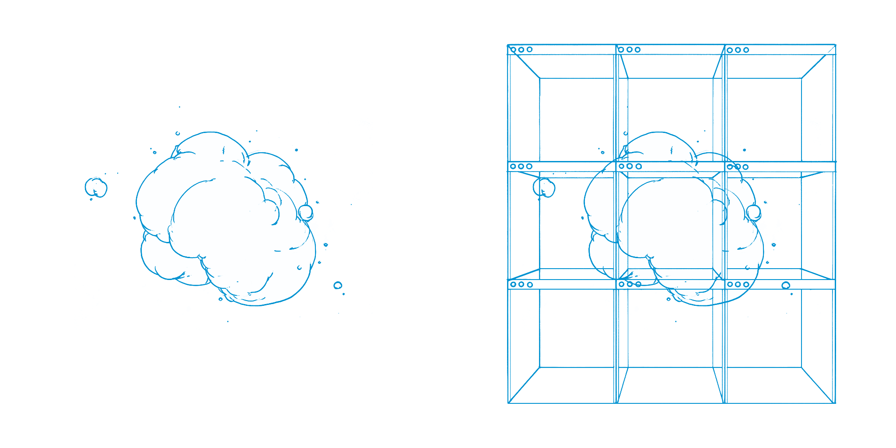

与 Claude Code 里的 Opus 4 一比，Codex 里的 GPT-5 像是被关在了笼子里。

为了分享测试发现，我来到了 OpenAI 办公室的一间会议室，坐在公关团队的 Lindsay McCallum 和 Codex 团队的 Alexander Embiricos 面前。我感觉，这次谈话是 McCallum 特意安排的。她对市场风向的变化嗅觉敏锐，希望我能向 Embiricos 讲讲，为什么我突然对这种新的工作方式念念不忘。

McCallum 坐在会议桌对面，聚精会神地敲着笔记本电脑。Embiricos 坐在我旁边，一边说话一边写代码，我觉得这是个好兆头。他正赶着完成 GPT-5 发布的一项功能：让智能体在需要访问沙箱之外的文件或运行命令时，能停下来，向人请求许可。

“用 Claude Code，你直接放手让它干就行，”我对 Embiricos 说，“GPT-5 感觉有点胆怯，好像被沙箱拽住了，不敢使出自己的力气。”

McCallum 的键盘声慢了下来。我记得，她没有抬头，只说了一句：“跟 Alexander 讲讲你们现在那套新的工程工作流。”

Embiricos 转过椅子，把注意力完全放到了我身上。

“我们现在其实已经不怎么看代码了。”我开了口，话一出口，脸却红了。偏偏向 Embiricos 解释如何把任务委派给智能体，我觉得有点可笑：做一个自主编程智能体，本来就是他的工作。而且那时候，我自己也不确定，我们这套工程方法离开这个小团队之后，还能不能奏效。

一声 Slack 提示音亮起了 Embiricos 的屏幕，打破会议室里骤然降下的安静。他把电脑调成静音，再把屏幕合上四分之三，只留下足够让 Codex 智能体继续思考的一道缝。

---

那晚离开米慎湾时，我不禁想，OpenAI 是不是正在为一套行将消亡的工作方式，打造一件完美工具。云端智能体失利，让它吃过一次苦头；现在，这家公司看起来正在退回代码编辑器，让 AI 帮程序员一步一步地工作。与此同时，Claude Code 正在另一群人中迅速流行：他们把整个任务交出去，然后就走开了。

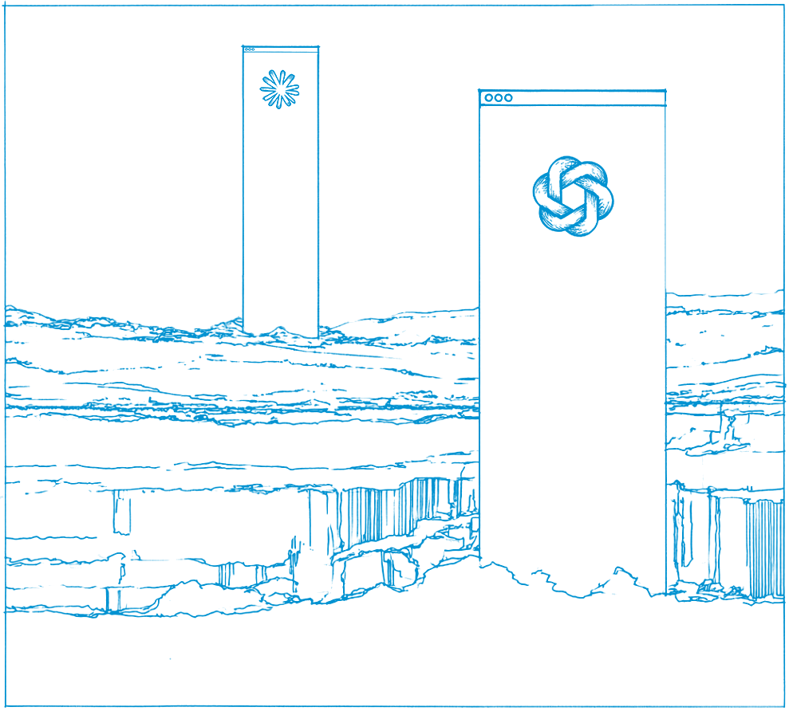

留在编辑器里，确实有充分的理由。GPT-5 发布后，Codex 团队推出了一个扩展，把 Codex 放进微软 Visual Studio Code（VS Code）和 Cursor 这类代码编辑器的侧边栏。程序员就在这些地方编写、运行和调试代码。到去年 10 月，使用量已经增长了十倍以上，编辑器扩展很快超过终端，成为 Codex 使用最多的入口。[1](https://every.to/p/how-codex-happened/interviews/alex/#final-20261015-0153)

在大多数公司，这本该是值得加码的业务。但 Embiricos，以及 OpenAI 内部一小群工程师、设计师和研究人员，想得更远。

此后的几个月里，Codex 团队训练了一条独立于 ChatGPT 所用模型的专门编程模型产品线，并迅速改进它；他们还做出一个桌面应用，用来同时管理多个智能体。到 2026 年 6 月，Codex 的周活跃用户超过 500 万，并开始从编程走向其他知识工作。

到 2026 年 7 月，Codex 已经并入旗舰产品 ChatGPT 桌面应用。它的负责人 Thibault Sottiaux 也被提拔，统管 OpenAI 所有核心产品和平台，包括 ChatGPT、Codex 和 API。如今，Codex 与 ChatGPT for Work 合计拥有 4,000 万周活跃用户。

不到一年，Codex 团队从一次失败的云端发布，走到了 OpenAI 旗舰产品的基础位置，也在这个过程中，帮助重塑了整家公司。

这就是 Codex 诞生的故事。

## 思考中……

> 思考中……

> 有点不对。一年前的领先优势，没有体现在现在的结果里……

> 看来，问题比我以为的更早就开始了……

> 回到起点看看……

OpenAI 的翻身仗，始于简单的一行字：“思考中……”

到了 2026 年，只要你向 AI 模型提出稍微复杂一点的请求，就会在即将出现回答的位置，看到“思考中”这几个字闪动。

它看起来可能微不足道：不过是用一个词，替换了 macOS 上旋转的彩色沙滩球，或 Windows 光标旁转动的蓝色圆环。它们都在表示，计算机正忙，暂时无法回应。

但在这里，“思考中”标志着一种全新的计算方式。没有它，就不会有 Codex。

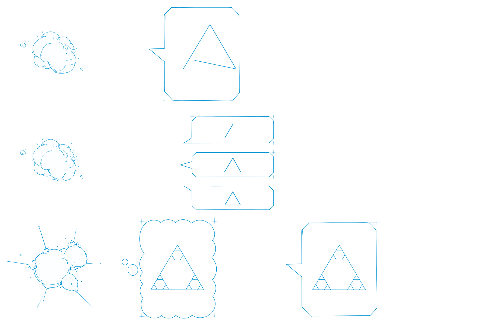

*三笔画出了一个没有闭合的三角形，直接呈现在公开回答中；把步骤公开展开后，先画一笔，再画两笔，最后正确闭合三角形；模型在思考气泡中处理分形图案，再在对话气泡中给出同样的分形。这是对不同代际模型的三种做法的示意，并非同一场对话，也不是真实、经过验证的模型推理记录。*

第一代大语言模型是“边说边想”的。它们没有闪动的状态标签来表示内部推理，而是直接在回答你的过程中完成思考。无论你让它写一封邮件，还是一行代码，它都必须[一个词一个词地](https://every.to/chain-of-thought/how-language-models-work)想出答案，既没有机会提前规划，也不能写完后再回头修改。

从这个意义上说，早期聊天模型就像即兴演员：观众给一个提示，它就得当场编出一幕戏。边编边演，结果有时令人惊艳，有时也会无意间闹出笑话。比如，它们会坚持说[“strawberry”](https://every.to/chain-of-thought/openai-s-new-model-strawberry-explained)里只有两个 r，还会把单词逐字母拼出来，以此“证明”自己，最后再夸自己一番。

早期用户发现，如果先让模型一步步写出推理，再给答案，它往往就能答得更好。这种做法，其实和小学数学老师教学生的办法一样，被称为“[思维链提示](https://every.to/also-true-for-humans/7-22)”。

思维链提示催生了第二代 AI 模型，以及闪动的“思考中”界面。OpenAI 不再要求用户主动让模型一步步解题，而是把这种行为训练进模型本身。回答之前，推理模型会先在一个称为“推理轨迹”的草稿空间里工作：从不同角度切入，走进死胡同就回头，再选择一条更有可能成功的路径。只有确定答案之后，它才会回应。

OpenAI 把第一个这样的模型命名为 [o1](https://every.to/chain-of-thought/openai-s-o1-model-explained)，并在 2024 年 9 月发布了预览版。在那之前，进步主要依赖于训练更大的模型、训练更长时间。通过 o1，OpenAI 发现，同一个模型只要在困难问题上多花一些时间，就能给出更好的答案。

有一种工作尤其能从中受益：编程。编程特别适合推理模型，因为它能形成闭环：模型可以修改代码、运行代码，几秒内就知道改动有没有奏效。因此，它能自己测试、修正方案，不必找人检查。

从理论上说，只要给它足够长的思考时间，推理模型就能独立完成任何编程任务。

## 不止一次起步

构建 AI 程序员，是 OpenAI 追逐了很久的目标。因此，Codex 有过不止一次起步，连这个名字本身也是如此。[2](https://every.to/p/how-codex-happened/interviews/tibo/#final-20261015-0010)

第一个 Codex 发布于 2021 年，是在公开代码上微调的 [GPT-3](https://every.to/chain-of-thought/gpt-3-is-the-best-journal-you-ve-ever-used) 版本，最初的 [GitHub Copilot](https://every.to/chain-of-thought/i-spent-24-hours-with-github-copilot-workspaces) 就由它驱动。三年后，o1 预览版展示了推理模型的能力。在随后的几周里，管理层的一声号召，让 OpenAI 内部的几个团队再次从不同方向追逐这个梦想。

其中一个起点，来自 2024 年末的 Embiricos。

“我第一次真正、强烈地‘感受到 AGI’，是看到有人把推理模型接到了终端上运行。”[3](https://every.to/p/how-codex-happened/interviews/alex/#final-20261015-0034)他告诉我。所谓“感受到 AGI”，指的是 AI 不再像一件工具，而开始像一台能够像人一样思考和行动的机器。“我知道，现在这听起来没什么稀奇。”但看到它自己读文件、运行命令、处理错误，“真他妈酷”。

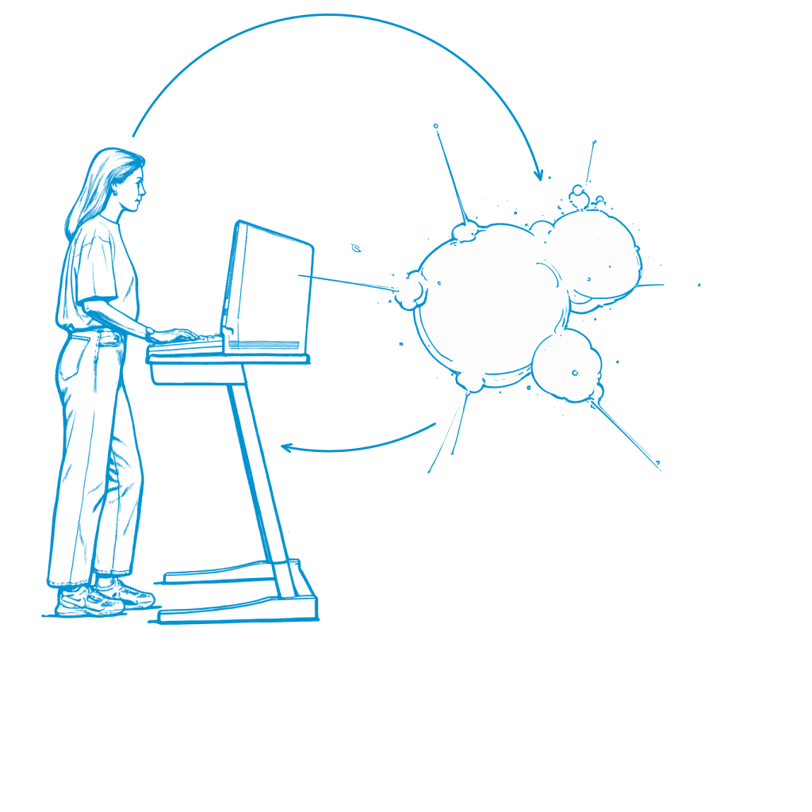

Embiricos 就是我在 GPT-5 发布前夜见到的那位产品负责人。他在同年稍早加入 OpenAI：公司收购了他共同创办的 Multi，一款面向程序员的多人屏幕共享工具。在 OpenAI，他继续探索一个相关的想法：让人和智能体在他们使用的应用中一起工作。他先在 ChatGPT 桌面应用上追逐这个愿景，后来又转向 AI 浏览器 [Atlas](https://every.to/vibe-check/vibe-check-openai-s-new-ai-browser-atlas)。[4](https://every.to/p/how-codex-happened/interviews/alex/#final-20261015-0028)但[当时的模型看用户屏幕时，既慢又笨](https://every.to/p/how-codex-happened/interviews/alex/#final-20261015-0010)，根本不够实用。

可在终端里，模型不必看屏幕，它们能直接处理文本和代码。看过早期推理模型在终端里的表现，Embiricos 确信，这些模型足以支撑一个真正的编程产品。编程当时还不是他的全职工作，但他立刻开始勾勒产品。他认为，要让产品成立，用户每隔 30 秒，最多一分钟，就得看到模型正在做什么。

### 线上活动：看看 Codex 能为你的写作做什么

Dan Shipper、Kate Lee 和 Jack Cheng 将分享，这篇报道是怎样借助 Codex 完成采访整理与写作的。10 月 16 日，星期五，美国东部时间中午 12 点至下午 1 点，线上举行。

[订阅](https://every.to/subscribe/regwall)，Every 付费会员可参加。

速度再次成了问题。那时，大多数 AI 编程产品都围绕 VS Code 生长。GitHub Copilot 通过扩展加入 AI 自动补全；Cursor 和 Windsurf 则基于 VS Code 的开源代码做自己的编辑器，在程序员工作的旁边加上 AI 聊天。

这些工具依赖紧密的反馈回路：Copilot 补全你正在输入的那一行，Cursor 和 Windsurf 在几秒内回答问题。它们都不会要求模型长时间独立工作，因为模型做不到。而 OpenAI 早期的推理模型正好相反：速度慢，一旦压缩思考时间，能力也会变弱。

他能不能把这个缺点——等到回应所花的时间——变成优势？

## 为构建者打造工具

与此同时，在 OpenAI 的另一个角落，大家称为 Tibo 的 Sottiaux，正试着让推理模型把能力用回自身：帮助研究人员构建下一代模型。

“我大约在 2024 年 12 月开始参与编程智能体的工作。”[5](https://every.to/p/how-codex-happened/interviews/tibo/#final-20261015-0012)他告诉我。那时，我们坐在 OpenAI 的食堂里。他亮泽的棕发偏向一侧，细金属框眼镜映着午后的光。如果只看鼻子以上，他像个建筑师；鼻子以下则全是程序员的样子：棕色胡茬，深棕色连帽衫，衣服上印着“研究与部署公司”，手里还拿着一片意式辣香肠披萨。

他一边吃披萨，一边告诉我，目标“是帮我们更快地编写基础设施代码、开展研究”。[6](https://every.to/p/how-codex-happened/interviews/tibo/#final-20261015-0030)

Sottiaux 职业生涯中的很大一部分时间，都在为研究人员构建基础设施，先在 DeepMind，后来在 OpenAI。所谓研究基础设施，是 AI 研究人员运行、评估、复现和部署实验时依赖的共享代码。对于一个最终将领导 Codex 的人来说，这样的起点似乎有些出人意料。说起基础设施，你可能会想到服务器和海底光缆，就像技术世界里的水管：不可或缺，却只有漏水时才会被人看见。

但在 AI 世界里，很多关键的事情恰恰发生在基础设施中，尤其是研究基础设施。只要缩短一次实验所需的时间，你就能做更多实验，更早得到更好的模型。

“你们是在什么时候把模型产品线独立出来的？”我问，“这个决定是怎么做的？”我想快进到关键情节。拥有独立的模型产品线，似乎是 Codex 魔力的核心。我脑中浮现了一场 OpenAI 内部会议：Sottiaux、总裁兼联合创始人 Greg Brockman，或者 CEO Sam Altman，做出一个深谋远虑的决定，让 Codex 从 ChatGPT 的其余部分中独立出来，给团队自由，让他们快速发布，从内部改写整家公司。

“[并没有一个把模型产品线拆出去的决定](https://every.to/p/how-codex-happened/interviews/tibo/#final-20261015-0028)。”Sottiaux 平静地说。他说，一开始，“这是一项研究探索，也是为了加快我们的速度”。

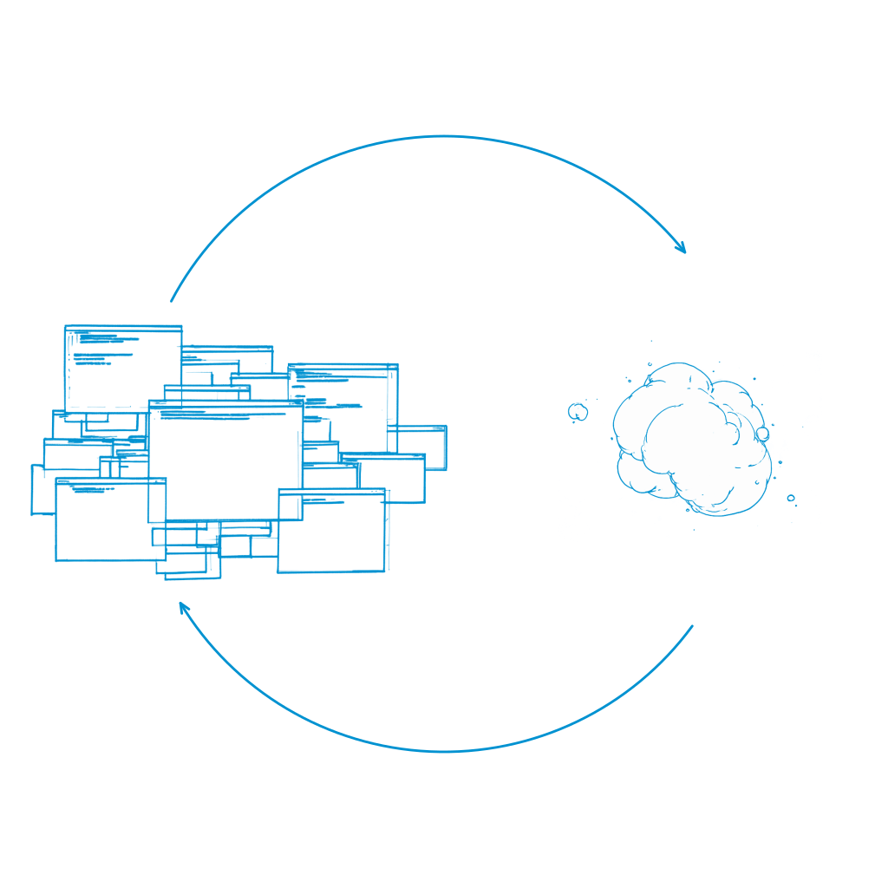

Sottiaux 的团队并没有为公众打造模型，而是用 OpenAI 的单体代码库训练内部编程智能体。[7](https://every.to/p/how-codex-happened/interviews/tibo/#final-20261015-0012)整个组织的代码都放在这一个仓库里。智能体编写研究人员所需的 Python 代码，帮助他们运行、改进那些用来构建新模型的系统。研究人员每天都用这些智能体，给团队形成了一条紧密的反馈回路。

“我们看到编程能力提升得很快。”Sottiaux 说。他的团队频繁训练模型，所用技术与公司为公众训练模型的方式不同，而且有一段时间，两者很难兼容。

和 AI 实验室里的其他人一样，Sottiaux 对这些训练技术守口如瓶。但它们奏效了，这一点越来越清楚：他的团队成功地让模型回过头来参与创造自身的研究过程，研究人员正用这些模型构建下一代模型。[8](https://every.to/p/how-codex-happened/interviews/tibo/#final-20261015-0030)

工程师把这叫作“自举”：做出一个擅长帮助研究人员运行实验的模型，研究人员就能用它构建更强的模型；更强的模型能支持更好的实验，进而带来更好的模型，如此循环。

这项工作提供了后来 Codex 的一半：能够改进新模型构建[基础设施](https://every.to/p/openai-infrastructure)的智能体。要成为公司其他人也能使用的产品，最终走出 OpenAI，它还需要另一半：Embiricos 关于人应该如何与这些智能体共同工作的设想。

## 汇流

> 思考中……

> 到目前为止，有三种办法……

> 其中两种有重叠……

> 把它们合起来，沿着有效的方向继续……

探索之后，就是汇流。

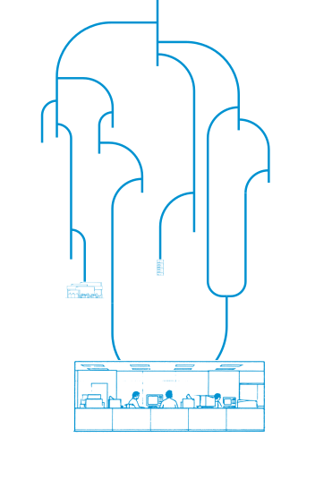

我们不妨从上空俯瞰 2024 年末到 2025 年初的 OpenAI。编程成为公司最高层级的目标之一后，[9](https://every.to/p/how-codex-happened/interviews/greg/#final-20261015-0002)包括 Sottiaux 和 Embiricos 在内的几个团队，已经开始从不同角度研究同一个问题。

Brockman 告诉我，悬而未决的是，正确的“产品形态”究竟是什么：[10](https://every.to/p/how-codex-happened/interviews/greg/#final-20261015-0006)智能体应该待在开发者执行命令的终端里，待在他们写代码的编辑器里，还是待在云端，在自己的计算机上工作？其中有些路径通向死胡同，但那时谁也不知道是哪几条。

Altman 在 [2025 年接受 Ben Thompson 采访](https://stratechery.com/2025/an-interview-with-openai-ceo-sam-altman-about-devday-and-the-ai-buildout/#the-investor-mindset)时说：“从某种意义上说，OpenAI 是在押注一系列创业公司，只不过它们全都在公司内部。”我采访过的几位内部人士觉得，这种并行探索[有时显得混乱、浪费](https://every.to/p/how-codex-happened/interviews/andrew/#final-20261015-0049)。[谁愿意待在一个做出了 OpenAI 内部第三好智能体产品的团队里？](https://every.to/p/how-codex-happened/interviews/greg/#final-20261015-0018)我自己也在公司用过类似策略，所以我知道，给探索留出空间，和把事情搞成一团乱麻，往往只有一线之隔。

不过，观察 OpenAI 的过程中，尽管听到过内部抱怨，我也逐渐觉得：只要技术前沿还在不断移动，这种做法就是必要的。借用已故哈佛教授 Clayton Christensen 的术语，AI 模型层面迅速发生的[“延续性”](https://www.christenseninstitute.org/graphic/disruptive-vs-sustaining-innovations/)进步，让新类型的应用成为可能，也不断颠覆此前的应用。

一个能补完一行代码的模型，很适合做自动补全工具；一个能思考 30 秒的模型，可以在聊天侧边栏里回答问题；一个能独立工作一小时的模型，则需要完全不同的形态。围绕上一代模型做出成功产品，不意味着你知道下一步该怎么走。你需要几个团队尝试不同想法，等看清哪些有用，再把它们的工作汇集起来。

到 2025 年初，OpenAI 准备这么做了。“后来，我们觉得应该与另一个叫 Scientist Assistant 的项目合力。”[11](https://every.to/p/how-codex-happened/interviews/tibo/#final-20261015-0020)Sottiaux 告诉我。这次合并让他和 Embiricos 走到了一起。谈到内部各种编程项目时，Brockman 说：“最后，我们先把其中两个合了起来，又把另外两个合了起来。”[12](https://every.to/p/how-codex-happened/interviews/greg/#final-20261015-0006)合并后的团队不大，却横跨多个领域：有 Embiricos 这样的技术型产品思考者，Sottiaux 这样的基础设施与工程高手，以及 Mia Glaese 这样的研究人员。

> **把不同工作中的努力合到一起，你能做出什么？** [问问智能体](https://every.to/p/how-codex-happened#module-entry-combine-experiments)

Glaese 从 DeepMind 来到 OpenAI，此前研究 Gemini 和模型对齐。在 OpenAI，她负责模型训练与对齐所用的数据，[13](https://every.to/p/how-codex-happened/interviews/mia/#final-20261015-0008)也就是专门获取、利用数据，塑造模型的具体行为。

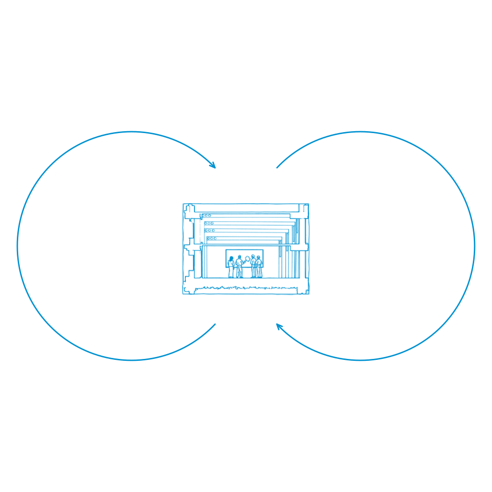

从某个角度说，她是个极其冷静、不讲情面的实证主义者。采访时，她毫不掩饰自己对量化的坚持：“做研究，光凭感觉没什么用。”但一谈到制作模型的过程，她又很容易笑起来，因为其中有那么多地方，都像纵身跳进未知。

“每次训练模型，我们都像踏上一场魔法冒险，一边走一边想：‘这事到底要怎么做？’”她说。

这种让产品人员和研究人员并肩工作的跨职能团队，在 AI 领域有些特别。这个领域历来由研究驱动，顶尖研究人员能拿到数百万美元、堪比勒布朗·詹姆斯的明星合约，其他人却拿着行业标准的工程师薪酬。（AI 实验室一直试图淡化这种明星至上的氛围，因此不管是不是研究人员，大多数技术员工都统一使用“技术成员”这个头衔。）

与产品团队一起工作，让 Glaese 和其他研究人员能直接看到模型是怎么被使用的，也能听到人们希望它下一步做到什么。产品人员可以问：“[如果模型能做这件事，岂不是太棒了？](https://every.to/p/how-codex-happened/interviews/mia/#final-20261015-0077)”然后，研究人员把它变成现实。这又是 Sottiaux 的自举循环，只不过这一次，循环发生在模型和基于它构建的产品之间。

OpenAI 终于有了一支真正的 Codex 团队：产品、设计和研究，大家一起工作。现在，只剩一个问题：到底做什么。

## 云端，以及它的局限

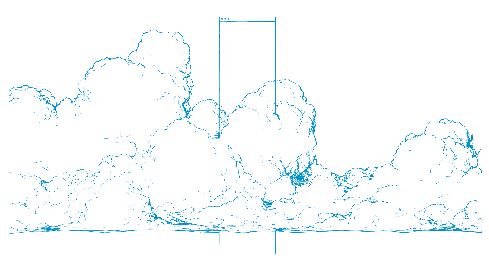

> 思考中……  
> 我可以试试终端、编辑器，或者云端……

> 哪条路适合我手头的模型？

> 我们的研究人员在云端工作。其他开发者是不是也可以？

在 Anthropic，一条颇有前景的路径已经开始跑通。

2025 年 2 月 24 日，Anthropic 发布 [Claude 3.7 Sonnet](https://www.anthropic.com/news/claude-3-7-sonnet)，同时推出了 [Claude Code 的研究预览版](https://every.to/vibe-check/vibe-check-claude-3-7-sonnet-and-claude-code)。与 Cursor 等工具不同，Claude Code 没有内置代码编辑器。它运行在终端里，直接处理你自己计算机上的文件：你告诉它想要什么，它就读代码、做修改，再运行。

因为就在你自己的计算机上运行，它改的是你正在处理的同一批文件，用的是你已经装好的工具，也带着你们此前共同工作的全部上下文。任务做到一半，你可以打断它。你还可以把一次会话中学到的经验带到下一次，让整个系统随着时间不断改进、积累收益。而 Codex Cloud 使用的是用完即弃的云端计算机，做不到这些。

开发者很快就喜欢上了 Claude Code。比如，Every 的 Edmar Ferreira 在 2025 年 3 月的一篇 [Vibe Check](https://every.to/vibe-check/vibe-check-claude-3-7-sonnet-and-claude-code) 中写道：“在智能体这方面，Claude Code 比我用过的任何东西都好。”团队里的其他人，也开始认同这个判断。

到了 2025 年春天，合并后的 Codex 团队——Embiricos、Sottiaux、Glaese，还有其他几个人——却把目光投向另一种软件工程未来：Codex Cloud。他们设想，在云端放一个智能体，给它一台自己的计算机，专门处理异步工作，让用户无论在电脑还是手机上，都能把编程任务委派给它。他们给自己大约七周时间，把产品做出来并发布。[14](https://every.to/p/how-codex-happened/interviews/tibo/#final-20261015-0020)

你可以在 ChatGPT 侧边栏点击 Codex，打开工作区，描述任务，再点“编写代码”。任务随即进入队列，输入框清空，等你提交下一个。Codex 会把代码库复制到一台隔离的云端机器，编辑文件，运行测试和 lint 工具，后者用来扫描代码中的常见错误。最后，它会返回总结、代码改动对比，以及一个创建拉取请求的按钮。

Codex Cloud 于 2025 年 5 月 16 日发布，距离我在米慎湾见到 McCallum 和 Embiricos 的那个夜晚，还差不多有三个月。Sottiaux 告诉我，它“在内部非常成功”。[15](https://every.to/p/how-codex-happened/interviews/tibo/#final-20261015-0024)但在 OpenAI 之外，发布时虽然引来关注，持续使用的人却不多。[16](https://every.to/p/how-codex-happened/interviews/alex/#final-20261015-0108)

要让它跑起来，开发者必须在云端重建自己笔记本上的软件、权限和设置。[17](https://every.to/p/how-codex-happened/interviews/tibo/#final-20261015-0024)这个过程可能耗上好几个小时，因为你得复制凭据、安装关键软件包。配置好以后，遇到描述清楚的任务，它可以完成交付。但你不能中途打断、纠正方向；哪怕只是补充一句提示，也会重新启动一台云端计算机。

我在发布当天的 [Vibe Check](https://every.to/vibe-check/vibe-check-codex-openai-s-new-coding-agent) 中写道：“如果你是技术负责人，想给现有代码库添功能、修缺陷，你会用到它。但如果你想靠氛围编程，做出一家新的一人十亿美元 SaaS 公司，那就去别处找吧。”

在 OpenAI 内部，标准化的开发环境让配置自动完成，研究人员也有定义清晰的工作可以交出去。团队自己的工作环境，掩盖了他们实际上给外界提出了多高的要求。

拖住 Codex Cloud 的，也不只是产品。“还是太早了，因为模型不够聪明。”[18](https://every.to/p/how-codex-happened/interviews/alex/#final-20261015-0052)Embiricos 说。

“[我们带着一种更面向未来的愿景来做这件事](https://every.to/p/how-codex-happened/interviews/mia/#final-20261015-0040)。”Glaese 告诉我，“我们没有说，‘先到用户现在所在的地方去。’”而用户当时所在的地方，就是“他们自己的笔记本电脑”。

那么，既然终端形态已经开始在 Anthropic 奏效，OpenAI 为什么[跳过了它](https://every.to/p/how-codex-happened/asides/codex-cli/)？

“我们没有跳过。”在食堂的那次谈话中，Sottiaux 告诉我。他指的是一个从未发布的内部原型。“[我们做过一个这样的版本，一个月后把它放弃了，转去做完整的云端版本](https://every.to/p/how-codex-happened/interviews/tibo/#final-20261015-0022)。”

“为什么？”我问。四周都是巨大的落地窗，我知道，如果真往外仔细找，说不定就能在远处看到 Anthropic 的办公室。走过去肯定也费不了多少事。旧金山其实是个小地方。

“因为我们愿意在配置上投入很多，所以我们优先优化的是：在这个前提下，什么最能让自己受益。”[19](https://every.to/p/how-codex-happened/interviews/tibo/#final-20261015-0024)他说。

这个回答背后，是我反复从 OpenAI 内部人士口中听到的一个信念：在他们心里，AI 智能体最理想的形态，一直是能够在云端自主替你工作，你合上电脑盖，它也不会停止响应。Brockman 在采访中也说过同样的话：“如果把目光投向未来，正确的形态，就是一个待在云端、拥有自己笔记本电脑的 AI。所以，我们真的把它做了出来。”[20](https://every.to/p/how-codex-happened/interviews/greg/#final-20261015-0006)

> **要让智能体从头到尾接手一项任务，还需要什么？** [问问智能体](https://every.to/p/how-codex-happened#module-entry-first-principles)

这个选择，也是与模型局限的一次妥协。团队围绕那些能花更长时间处理任务的模型，构建了第一款云端产品，[21](https://every.to/p/how-codex-happened/interviews/alex/#final-20261015-0047)而没有要求它们时时刻刻回应程序员。

问题在于，它没有奏效。云端产品没能找到产品与市场的契合点。团队的工程经理去了 Cursor，当时 AI 编程领域的领跑者，估值达 90 亿美元。也是在这一时期，据报道，OpenAI 达成了一项 30 亿美元的协议，准备收购 Cursor 最接近的竞争对手 Windsurf。但这笔交易在 7 月告吹。

“最难的时候，是我们觉得不知道该怎么办。或者明明知道该做什么，却很难真正看到进展发生。”Embiricos 告诉我。

Codex 团队第一次迷失在了荒野里。某种程度上，OpenAI 更大的编程雄心，也一并迷了路。

## 换一条路

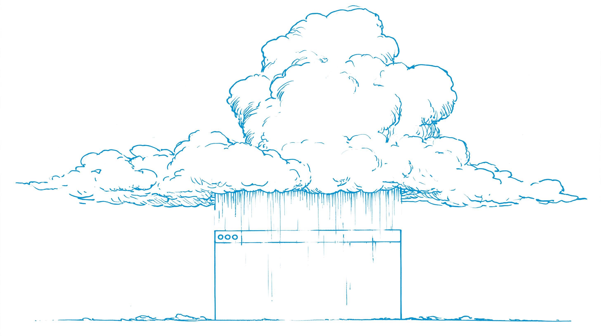

> 思考中……

> 嗯，在我们的环境里明明有效，为什么到了用户那里就不行？

> 也许，我一直在解决错误的问题……

> 回去看看被我搁置的本地方案……

> 有点意思。不过，得重做……

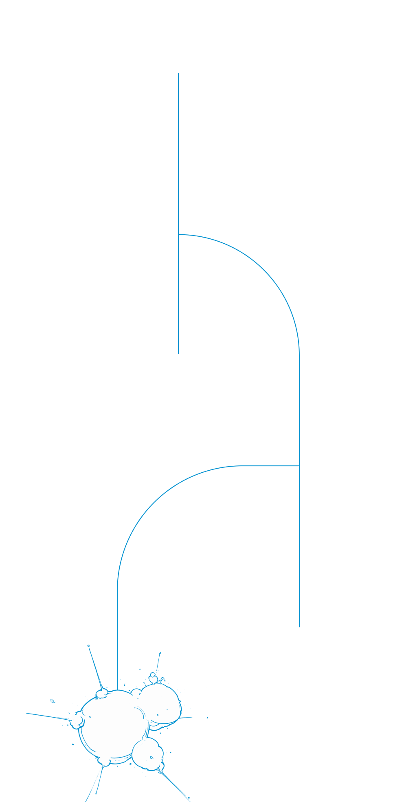

推理模型之所以强大，在于它能回溯。如果它认为某个缺陷出在代码的某个部分，重写后却发现问题还在，通常不会继续自信地沿着错误方向走下去。它能重新审视假设，扩大寻找方案的范围，再根据新学到的信息，选择另一条更有希望的路。

正是这种利用错误纠正方向的能力，让推理模型能找到一开始并不显而易见的答案。

云端产品发布后，在 2025 年春末和夏天，Codex 团队准备尝试另一条路。那时，这个项目在 OpenAI 的位置，用刚加入不久的设计师 Ed Bayes 的话说，就是“边缘地带”。“如果你想做个风光的设计师，”他告诉我，“你就去做 ChatGPT。”

就在这块被忽视的边陲，Sottiaux 接任了团队的工程经理。“我接手团队，然后把方向改了不少。”[22](https://every.to/p/how-codex-happened/interviews/tibo/#final-20261015-0030)他告诉我，“我们转向了本地。”

“本地”意味着，让智能体像 Claude Code 一样，运行在开发者自己的计算机上，而不是云端。他们从[本地 Codex CLI](https://every.to/p/how-codex-happened/asides/codex-cli/) 开始。正如 Embiricos 提到的，那是两个人作为副业项目，“英勇地”做出来的。马上往里面加功能，本可以很快形成势头，但 Sottiaux 采取了另一种办法：他决定重写智能体。[23](https://every.to/p/how-codex-happened/interviews/tibo/#final-20261015-0032)

“我们在把 CLI 功能做好这件事上，动作有点慢。”[24](https://every.to/p/how-codex-happened/interviews/tibo/#final-20261015-0032)他告诉我，“因为我们都在忙着开发智能体本身。”

CLI 是用户打交道的界面，但 Sottiaux 优先考虑的是底下那套机制：读取文件、执行命令，以及完成其他操作的智能体。他想把它做好，再从终端界面中分离出来，让它能去任何地方：代码编辑器、桌面或移动应用、云端，乃至 ChatGPT 自己里面。

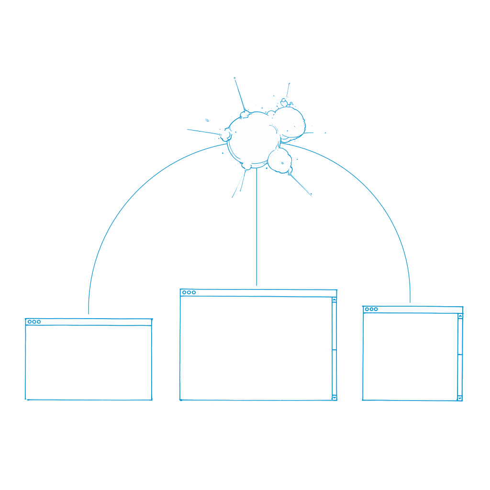

团队用 Rust 重写了智能体。[25](https://every.to/p/how-codex-happened/interviews/tibo/#final-20261015-0032)这门语言面向速度和安全都很重要的系统。有了这套共用底座，终端 CLI 和后来的编辑器扩展，都可以由它驱动。

> **为智能体构建产品，意味着什么？** [问问智能体](https://every.to/p/how-codex-happened#module-entry-agent-first)

不过，他们仍然缺少一个足够好、能够驱动它的模型。

当 Codex 团队在 Sottiaux 带领下重建智能体时，Michelle Pokrass 正在努力让 GPT-5 更擅长真实世界的编程。

Pokrass 曾领导 [GPT-4.1](https://every.to/vibe-check/vibe-check-openai-s-o3-gpt-4-1-and-o4-mini) 的研究。这一次，她负责后训练：调整已经完成训练的模型的行为，让它能够处理真实的编程工作。重点则是那些希望获得更好交互式编程体验的客户。[26](https://every.to/p/how-codex-happened/interviews/alex/#final-20261015-0157)

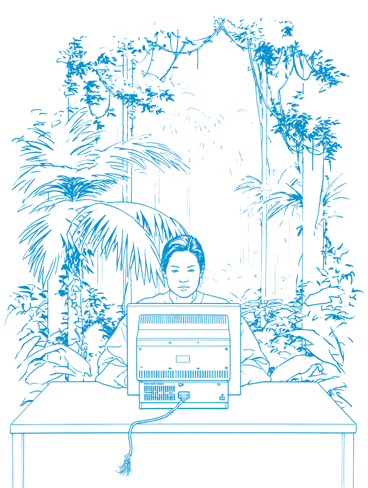

一个编程模型，可能就像 SAT 考了满分、却从没上过班的学生。OpenAI 的模型在编程竞赛里表现出色，可这些成绩没有转化成日常工程能力。“[它们从没见过乱七八糟的代码库，也没见过程序员会怎样在半路打断它](https://every.to/p/how-codex-happened/interviews/greg/#final-20261015-0002)。”Brockman 告诉我。

为了让这些只会读书的模型积累现实经验，Pokrass 和团队坐到程序员身边，看他们工作，观察模型在哪些地方掉链子，再把这些失败变成可重复的训练任务。

OpenAI 就这样走到了那个模型，也走到了那个时刻：2025 年 8 月，我因为它，坐进了米慎湾的会议室。

如果从 Codex 团队那个动荡夏天的内部视角看，我那晚在 GPT-5 身上感到的谨慎，就说得通了。试图借 Codex Cloud 一步跨向完全自主，让 OpenAI 吃过苦头；客户又在要求一个更好的交互式搭档。两者共同作用，让 OpenAI 做出了一个擅长与人类程序员一步步协作的模型。它能理解复杂杂乱的代码库各部分怎样拼在一起，解释计划，调查缺陷，在越界之前停下来先问一句。

和 Claude Code 相比，Codex CLI 里的 GPT-5 在我们 Every 看来，仍然落后。Kieran 在[发布当天的 Vibe Check](https://every.to/vibe-check/gpt-5) 里写道：“GPT-5 是 Sonnet 3.5 杀手，却不是向未来的一跃。”但对当时绝大多数软件工程师来说，一个谨慎的搭档，正是他们想要的。把生产代码交给自主智能体，在习惯了亲手写下每一行代码的程序员中，仍然普遍受到嗤笑。

“我不让它主导我的代码。”Ruby on Rails 的创造者、工程师社区中颇有影响力的 David Heinemeier Hansson，在 GPT-5 发布前后说，“程序员的乐趣，至少我作为程序员的乐趣，就是亲手把代码敲出来。”而且，他说，智能体一旦接手，“我真的能感觉到，自己的能力正从指尖流走”。

GPT-5 发布后，Codex 团队在 8 月下旬又推出了 VS Code 和 Cursor 扩展，这些开发者蜂拥而至。他们的热情，让 OpenAI 有充分理由继续改进扩展。每多一个用户、多一条功能需求，团队就被进一步拉向“帮助程序员一步步工作”，也离“让智能体接手完整任务”更远一点。

但对 Embiricos 而言，同一次发布意味着，他们终于可以追求更大的雄心。迷失了几个月之后，重建的本地智能体终于有了一个能够驱动它的模型。

他告诉我，当他们把 GPT-5 和改造后的 CLI 一起发布时，“一个能够自我强化的飞轮，就此转了起来”。

他记得当时自己在想：“这下，我们终于有得打了。”

## 押注桌面

> 思考中……  
> CLI 和编辑器扩展终于起势了……

> 客户喜欢侧边栏，而终端里要击败的对手是 Claude Code……

> 那就加码编辑器扩展，同时在终端上追赶……

> 被 Tibo 打断。

Codex CLI 和 VS Code 扩展的热度正在爆发，顺理成章的选择，是继续投资这两者。

但 Codex 团队做了一件出人意料的事。

“[我们决定继续维护 CLI，但眼下下一笔最大的投入，应该是一款原生桌面应用](https://every.to/p/how-codex-happened/interviews/tibo/#final-20261015-0038)。”Sottiaux 告诉我。

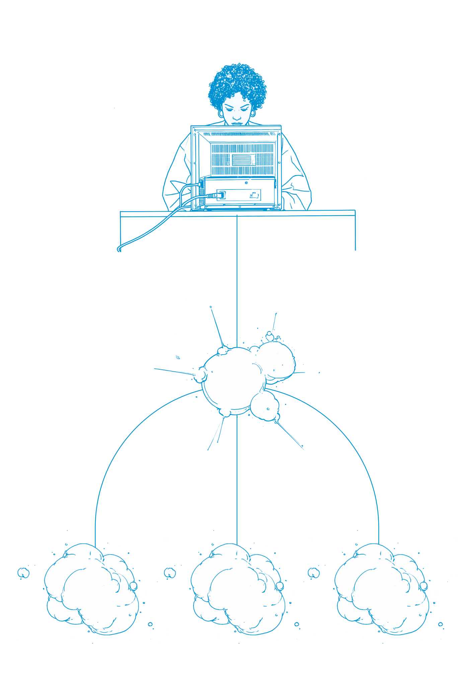

在 OpenAI 内部，他已经看到模型完成越来越长的任务，并利用代码库之外的信息，语音和图像能力也即将到来。很快，人们就会同时运行好几个智能体，整天与它们打交道。“如果你要把所有时间都花在里面，它就必须是一个非常丰富的界面。”他说。在一个诞生于 20 世纪 70 年代、只能显示文本的窗口里，来回管理五六个通过文本、图像、语音和视频沟通的智能体，在他看来实在有点荒唐。

对 Embiricos 来说，本地桌面应用还指向了他们没能用 Codex Cloud 实现的工作流：当时，用户不能在任务执行到一半时打断智能体。他想，如果应用就在自己的计算机上，人们就可以先与智能体紧密合作，再像带一位新同事入职一样，逐渐摸清哪些任务可以放心交给它。[27](https://every.to/p/how-codex-happened/interviews/alex/#final-20261015-0122)同一套界面最终还能让 Codex 走出开发者群体，服务那些永远不会打开终端的人。

为了帮助设计和构建这款产品，Sottiaux 找来了 Andrew Ambrosino。他既是设计师，也是程序员，还创办过创业公司。

Ambrosino 让我想起 B.J. Novak 在《办公室》里演的那个角色：深色头发、浓眉，嘴角抿着一丝浅笑。不管在线下还是网上，他都给人一种[随时在心里偷着乐](https://every.to/p/how-codex-happened/interviews/andrew/#final-20261015-0063)的感觉。别人愿不愿意一起笑，他也会考虑，但看上去常常没那么重要。

如果你关注他，是想了解 AI 的未来，翻他的动态时，可能会刷到一条获赞 617 次的帖子，内容只有一个词：“ai”。另一条则神秘地只写了[“tibo”](https://every.to/p/how-codex-happened/asides/tibo/)，获赞超过 1,000 次。

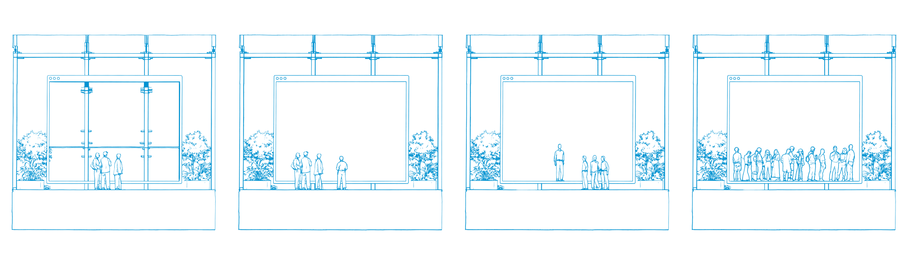

*团队站在透明的应用窗口轮廓前。四个人审视他们做出的窗口；接着，一个人走进去，其他人站在旁边；最后，一群人聚到窗口里面。这是风格化插画，人物并非肖像，也不是对会议现场的真实记录。*

Ambrosino 加入这个应用小组时，他们知道自己要做一款桌面应用，却不知道它该长什么样。[28](https://every.to/p/how-codex-happened/interviews/andrew/#final-20261015-0022)团队唯一确定的是，要做一个自己会用的东西。

Ambrosino 告诉我，他们的第一个硬性要求，是把这款应用变成自己每天工作的主力工具。[29](https://every.to/p/how-codex-happened/interviews/andrew/#final-20261015-0031)“我们知道，要做一个可以天天用、但比 IDE 更轻巧的工作界面。”他说。

随着 Claude Code 走红，一些应用开始试验：离开终端之后，编程智能体的“家”应该是什么样。Conductor 是一款运行编程智能体的 Mac 应用，它有一个任务侧边栏，每项任务都配有自己的智能体和聊天窗口，你可以在里面下指令、跟进工作。ChatGPT 则提供了另一个参照：一侧是对话列表，中间是一条对话。谈到设计过程，Ambrosino 说，Codex 应用“从聊天里得到的灵感，比从 VS Code 里得到的更多”。[30](https://every.to/p/how-codex-happened/interviews/andrew/#final-20261015-0091)而当时，Anthropic 也已经有了 Claude 桌面应用。

团队推进得很快，陆续回答了一些基本问题：用户如何跟进工作？每个任务对应一段与智能体的独立对话。[侧边栏如何组织](https://every.to/p/how-codex-happened/interviews/ed/#final-20261015-0009)？按项目给对话分组。基础界面如何布局？一边是任务侧边栏，旁边是选中的对话。

接着，一个更难的问题来了：智能体做错了，你能不能在 Codex 里亲手改代码？团队给出了一个冒险的答案：不内置代码编辑器。只要想改代码，你就必须让智能体来做。

“我们就是希望，它和代码编辑器是两种不同的东西。”Ambrosino 告诉我。如果允许开发者在应用里输入代码，他们就会期待编辑器里的其他功能也一样不少：撤销、搜索、键盘快捷键。于是，Codex 缺什么，就全都显出来了。他们只有四个人，要满足这些预期，就已经需要投入巨大精力，更别说超越预期。

做一个差劲的代码编辑器，Codex 赢不了。用智能体编程的体验，必须好到让开发者不再想念编辑器。

唯一的问题是：他们还在用 VS Code，做一个 VS Code 的替代品。

“Alexander 每天都会过来，像这样说：‘我们挨个问一圈。你把这个应用当主力了吗？你呢，把它当主力了吗？’”[31](https://every.to/p/how-codex-happened/interviews/andrew/#final-20261015-0031)Ambrosino 说。

一开始，答案全是“没有”。他们没有一个人把 Codex 当成主要编程工具。没有代码编辑器，哪怕改一点小地方，也得跟智能体聊一轮。负责开发者体验的 Dominik Kundel 在早期一条 Slack 消息里写道，只是替换一句话，“都得给 Codex 写提示，感觉太麻烦了”。

连 Ambrosino 都在怀疑。11 月，他在团队里写道：“首发范围里，最让我拿不准的，就是‘不能编辑文件’这一点。”

外部市场的变化，让“不做代码编辑器”显得更加冒险。2025 年 11 月，Google [发布了 Antigravity](https://codelabs.developers.google.com/next26/kcc-ops-skill-antigravity)，又一款[基于 VS Code 构建](https://every.to/p/how-codex-happened/asides/forking/)的编程工具，把 AI 智能体和完整的编辑器放在一起。

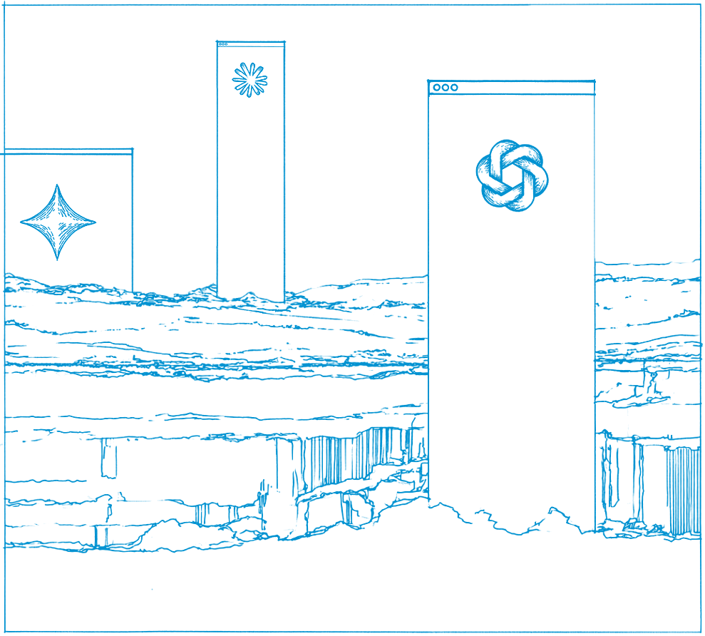

“我们就这么面面相觑。”Ambrosino 回忆道，“[没去 fork VS Code，是不是犯了个大错？](https://every.to/p/how-codex-happened/interviews/andrew/#final-20261015-0024)我们非常纠结，我觉得团队内部都没有达成一致。”

驱动应用的模型，也是个问题。OpenAI 在 9 月推出了专门的 Codex 模型产品线，但到了 11 月，它仍然撑不起团队正在做的桌面产品。Ambrosino 告诉我，就算应用功能齐全，“以当时模型的质量，也根本没法发布”。[32](https://every.to/p/how-codex-happened/interviews/andrew/#final-20261015-0018)

> **模型还没准备好时，什么值得先做？** [问问智能体](https://every.to/p/how-codex-happened#module-entry-next-model)

接下来的几周，情况开始变化。11 月 19 日，OpenAI 发布 GPT-5.1 Codex Max，可以连续编程数小时。12 月 18 日，[GPT-5.2 Codex](https://every.to/vibe-check/vibe-check-gpt-5-2-is-an-incremental-upgrade) 紧随其后，在大型代码库中进行修改的能力进一步提升。

Glaese 直接与 Codex 团队的其他人合作，进一步缩短开发者反馈与模型改进之间的回路。关键在于，[他们关注的是让 Codex 对实际使用它的人更好用](https://every.to/p/how-codex-happened/interviews/mia/#final-20261015-0091)，而不只是提高热门基准测试上的分数。又因为 Codex 模型产品线独立于 ChatGPT 的主模型，他们可以走得更快，不必担心这些改动会如何影响 ChatGPT 的 8 亿用户。

到了 12 月，团队里越来越多的人开始舍弃代码编辑器，转用 Codex 应用。“我一开始特别想要一个代码编辑器。”Kundel 在 Slack 上写道，“现在，大多数改动我只要留行内评论，快得很。”Ambrosino 发现，自己仍然需要引导模型，却已经不必再亲手改代码。[33](https://every.to/p/how-codex-happened/interviews/andrew/#final-20261015-0041)Glaese 也察觉到，内部的情绪变了。“5.2 是个转折点，我当时就觉得：‘哇，我真的很期待它能帮我做什么。’”[34](https://every.to/p/how-codex-happened/interviews/mia/#final-20261015-0048)她说。

放眼整个行业，那个假期成了一个[拐点](https://every.to/context-window/claude-code-in-a-trenchcoat)。开发者利用圣诞假期，用 Anthropic 的 [Opus 4.5](https://every.to/vibe-check/vibe-check-opus-4-5-is-the-coding-model-we-ve-been-waiting-for) 和 OpenAI 的 GPT-5.2，从头到尾做出完整应用，一行代码都不用碰。

到 1 月初，整个团队都在用 Codex 应用了。现在，他们需要知道，OpenAI 的其他人会不会也用。如果不会，Ambrosino 说，那就“回去重新设计”。[35](https://every.to/p/how-codex-happened/interviews/andrew/#final-20261015-0034)

到 2 月，Codex 桌面应用已经在工程和研究团队里广泛采用。OpenAI 研究员 Noam Brown 说，自己已经“完全切换”过去了；一直钟爱终端和 Emacs 编辑器的 Brockman，也一样。他说，回到旧工作流，“感觉就像穿越回了过去”。Altman [后来称它](https://venturebeat.com/orchestration/openai-launches-a-codex-desktop-app-for-macos-to-run-multiple-ai-coding)为“我们有史以来最受喜爱的内部产品”。

Codex 团队做出了一个 OpenAI 内部开发者非常喜欢的产品。但 Codex Cloud 当年也曾在内部广受欢迎，发布出去后却失败了。这次会不一样吗？

## Codex 应用

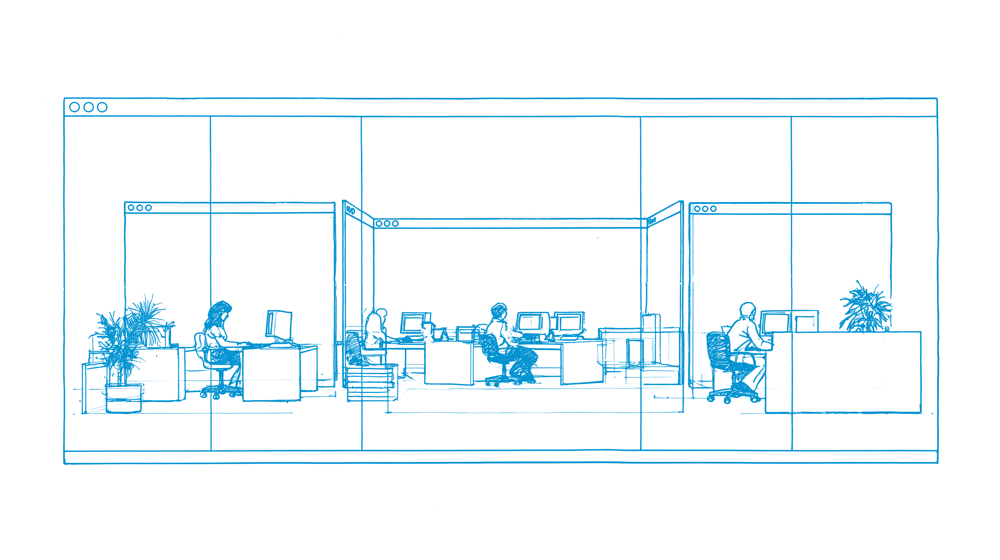

> 思考中……

> 这里已经有很多人在用了……

> 但我以前也把这当成过成功……

> 这一次，它就在用户原本工作的地方运行……

> 该拿到外面试试了……

Codex 的 macOS 桌面应用于 2026 年 2 月 2 日向公众发布。它看上去更像聊天应用，而非代码编辑器：侧边栏列着进行中和过去的任务，点开一个，就能看到智能体做了什么，并继续给它发指令。

你可以让一个智能体修缺陷，派另一个去开发功能，然后在它们之间切换，回答问题或审查改动。每个智能体都能在自己的代码副本上工作，不会覆盖别人的修改。你可以紧盯着、随时引导，也可以同时放着几项任务运行，等它们需要你时再回来。

放在当时，这些并没有多么开天辟地。比如，Claude 桌面应用已经让技术和非技术用户这样做了好几个月。但 Claude 桌面应用是一步步加出来的：先有 Chat，再加 Code，然后加 [Cowork](https://every.to/vibe-check/vibe-check-claude-cowork-is-claude-code-for-the-rest-of-us)。界面因此显得混乱，像是东拼西凑起来的。用户很难弄明白，什么任务该用哪个标签页，各个标签页又有哪些功能、哪些权限。

Codex 应用[没有这些历史包袱](https://every.to/p/how-codex-happened/asides/late-comer/)。我第一次使用它时，同时用上了几天后发布的新模型 [GPT-5.3 Codex](https://every.to/vibe-check/gpt-5-3-codex)。它快速、简洁，[完全围绕智能体构建](https://every.to/guides/agent-native)。整个体验有一种流畅感：当产品每个细节都做对时，你就会有这种感觉。因为团队很早就坚持不放代码编辑器，他们就必须确保，用户在应用里能做的事情，Codex 智能体几乎也都能做。比如，接入一个新工具，你不必钻进设置里翻找，[直接让智能体去做就行](https://every.to/p/how-codex-happened/interviews/andrew/#final-20261015-0074)。

> **如果今天重新设计你的工作流，你会舍弃什么？** [问问智能体](https://every.to/p/how-codex-happened#module-entry-start-today)

GPT-5.3 Codex 也是 OpenAI 模型能力的一个转折点。Glaese 说，这是他们第一次开始让 Codex 产品线走出专门针对编程的训练。他们仍然把它叫作 Codex，她也没有宣称它什么都更强。但团队已经开始问：[要对各种知识工作都有用，一个编程智能体还需要知道什么？](https://every.to/p/how-codex-happened/interviews/mia/#final-20261015-0024)

它立刻改变了我的工作流：我从几乎只用 Claude，变成把大量工作[转交给 Codex](https://every.to/vibe-check/gpt-5-3-codex)。在我正在开发的文档编辑器 [Proof](https://proofeditor.ai/) 上，我看着 Codex 在很少干预的情况下，自主修复[复杂缺陷](https://every.to/chain-of-thought/when-your-vibe-coded-app-goes-viral-and-then-goes-down)。很快，我开始让它整夜处理难题；每当遇到特别棘手的任务，首先想到的就是 Codex。

3 月初 [GPT-5.4](https://every.to/vibe-check/gpt-5-4-openai-is-back) 到来后，Codex 作为我日常主力工具的地位就稳了。它仍然是编程高手，但现在能把自己的思路解释清楚，也更懂我想要什么。而且，Codex 应用界面干净、响应迅速，我开始把所有工作都搬进去。

那时，Every 的很多人也已经每天使用 OpenAI 的工具和模型。就在几个月前，Claude 还遥遥领先，是大家的首选，如今局面完全反转。正如我们在 [GPT-5.4 的 Vibe Check](https://every.to/vibe-check/gpt-5-4-openai-is-back) 里写的：OpenAI 回来了。

同样的变化，远不只发生在 Every。到 3 月 19 日，OpenAI 表示，Codex 的周用户数已突破 [200 万](https://openai.com/index/openai-to-acquire-astral/)，总体使用量比年初增长了五倍。4 月，OpenAI 加入应用内浏览器，让智能体可以查资料，在真实网页上检查自己的工作。它还能跨其他 Mac 应用工作，展示文档、幻灯片和电子表格的预览。即使从来没写过代码，也可以让它做一份演示文稿或预算报告，不离开应用就能看到成果。

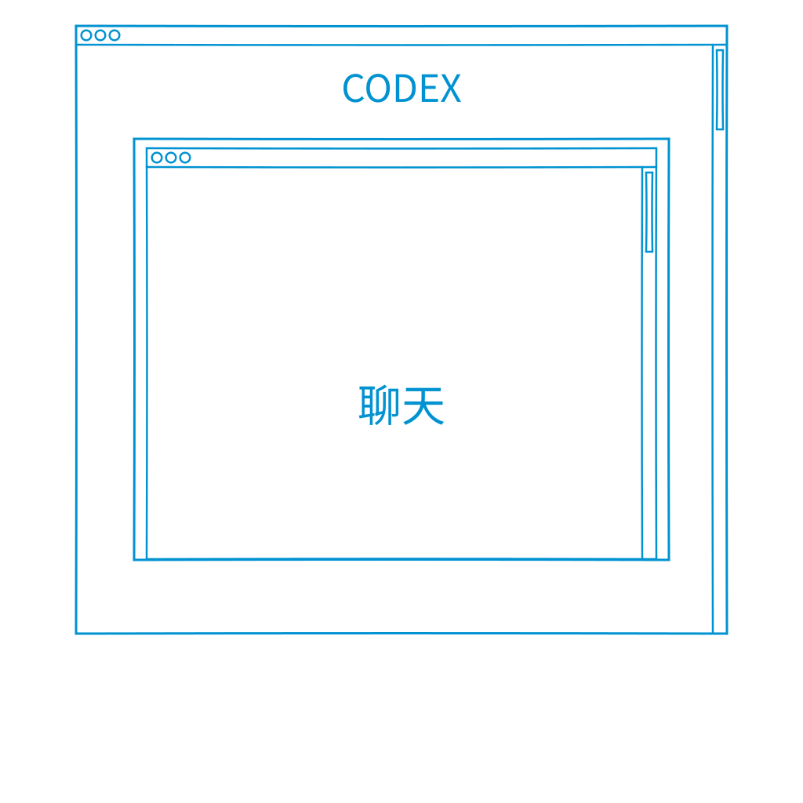

*聊天 · CODEX*

到 6 月，Codex 的周用户数超过 500 万，其中[大约五分之一是知识工作者](https://openai.com/index/codex-for-knowledge-work/)。7 月 9 日，OpenAI 把 Codex 桌面应用变成[新的 ChatGPT 桌面应用](https://every.to/context-window/the-urge-to-merge-chatgpt-and-codex)，将聊天功能放进其中。[36](https://every.to/p/how-codex-happened/interviews/tibo/#final-20261015-0122)在底层，新 ChatGPT 告诉你的 Mac 的名字，仍然是 `com.openai.codex`。

Codex Cloud 刚发布时，是 ChatGPT 里面的一个标签页。如今，ChatGPT 运行在 Codex 之上。

Ed Bayes 记得，在宣布合并的那场全员大会结束后，他一边走出来，一边想着团队已经走了多远。起初只是“角落里的几个人”，如今已经成了“[ChatGPT 的未来](https://every.to/p/how-codex-happened/interviews/ed/#final-20261015-0001)”。

“这简直是美国企业史上的一幕。”他告诉我。

## 下一条曲线

GPT-5 发布十个月后，我再次和 Alexander Embiricos 坐进了会议室。

“那我就完全实话实说了，好吧？”Embiricos 问。

“请吧。”我说。

那是 6 月初，距离当时已经炙手可热的 Codex 并入 ChatGPT，还有一个月。我们坐在 OpenAI 位于曼哈顿下城的办公室。他穿着灰色拉链外套，袖子挽起。最近，他的角色刚从 Codex 智能体产品负责人，变为 OpenAI 企业产品负责人。他身后是一块白板。

我来是想问，他们的团队如何从 Codex Cloud 的失败，走到做出 ChatGPT 未来的基础，又是怎样避开了我在米慎湾担心的那个“结对编程陷阱”。大多数团队都会围绕已经奏效的东西继续做下去，Codex 团队却没有。是什么让他们一直往前走？

Embiricos 拿起黑色记号笔，在白板上画出 Codex 的增长。他先给 Codex Cloud 画了一条短短的上升曲线。起势不错，却很快变平了。[37](https://every.to/p/how-codex-happened/interviews/alex/#final-20261015-0108)

接着，他画出 GPT-5 发布后 CLI 的曲线，更陡，也更大；再往上，是编辑器扩展的曲线。最后，是 5.3 Codex 和桌面应用，那条曲线把其他所有曲线都比了下去。[38](https://every.to/p/how-codex-happened/interviews/alex/#final-20261015-0116)最开始那一笔，如今看起来就像白板底部的一道小划痕。

他画的那些曲线，像是 Christensen《创新者的窘境》里的一张图。

Christensen 曾以著名的研究说明，硬盘和处理器持续进步，怎样推动计算机从大型机走向小型机，再走向台式个人电脑、笔记本，最终走向手机。底层硬件每一次跃升，都能让更简单的产品形态成为可能，打开一个更大、技术门槛更低的市场，并超过上一代产品。

在传统计算领域，这个过程跨越半个世纪，接力发生在一家又一家新公司里；而在 OpenAI 内部，一个只有几个人的团队，用十个月就把它缩小重演了一遍。模型一轮轮跃升，不断超出围绕它们搭建的界面所能承载的范围，迫使 Codex 团队从代码编辑器侧边栏，走到终端，再走到一款干脆去掉代码编辑器的轻量桌面应用。

在 Christensen 的书里，骑上了一条成功曲线的团队，几乎从来骑不上下一条；现有产品的成功，会把后来的东西窒息掉。Codex 团队能避开这个命运，部分原因在于，OpenAI 的高管成长于创业圈，研究过的恰恰就是这个陷阱。公司的组织方式，像是一组并行下注的投资组合；Codex 团队也因此获得空间，能在 ChatGPT 庞大的规模和用户群所带来的约束之外，独立迭代产品和模型产品线。

用 AI 构建 AI，还改变了产品开发的基本规律。在传统公司，要做一个新产品，得花几个月开会，争预算、争工程师；这类争论，几乎总是已经蓬勃发展的现有产品获胜。但在 OpenAI，因为团队在用 Codex 构建 Codex，几个人就能在几周内做出一个新的产品界面。[39](https://every.to/p/how-codex-happened/interviews/tibo/#final-20261015-0046)

“现在，要说服别人，不用再费那么多口舌了。”[40](https://every.to/p/how-codex-happened/interviews/tibo/#final-20261015-0048)Sottiaux 曾这样告诉我。

> **白板上的哪个想法，你可以做出来，让大家亲手试一试？** [问问智能体](https://every.to/p/how-codex-happened#module-entry-show-an-idea)

看着白板，Embiricos 还有一条新曲线要画。如今，数百万人已经信任自己计算机上的智能体。下一步，是回到前一年春天失败的那个愿景：你离开很久之后，智能体仍然继续工作。

“我们要转向异步。”他说，“也就是说，得重新把它搬到云端。”

这一次，我忍不住注意到，他的笔记本电脑就放在会议桌上，盖子合得严严实实。

---

[Dan Shipper](https://every.to/@danshipper) 是 Every 的联合创始人兼 CEO，在那里撰写[《思维链》](https://every.to/chain-of-thought)专栏，并共同主持[《Every 播客》](https://every.to/podcast)。
