作者：Andrew Mager、Jason Varbedian、Uday Kiran Medisetty
原文：[How Uber Evals 1 Million Agent Skill Invocations a Month](https://x.com/UberEng/status/2125008806249930999)
翻译 Url：https://github.com/samz406/local_wenzhang/blob/main/docs/Uber如何每月评估一百万次智能体技能调用/Uber如何每月评估一百万次智能体技能调用.md

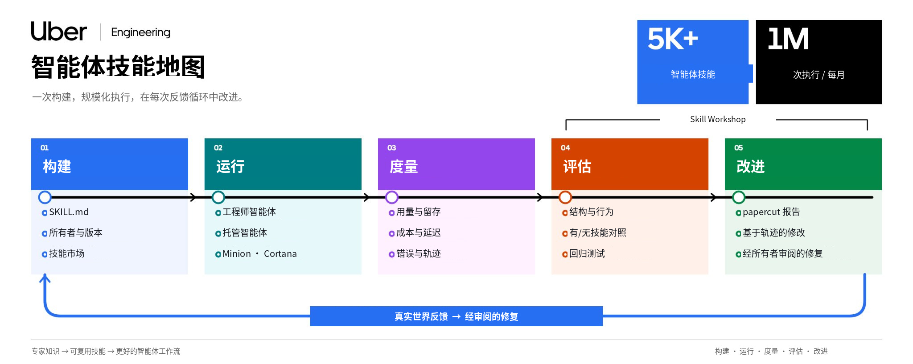

# Uber 如何每月评估一百万次智能体技能调用

**Andrew Mager**（[@Mager](https://x.com/Mager)），Staff Engineer

**Jason Varbedian**（[@JasonVarbedian](https://x.com/JasonVarbedian)），Sr Staff Engineer

**Uday Kiran Medisetty**（[@udaykiran](https://x.com/udaykiran)），VP, Distinguished Engineer

于 2026 年 11 月 23 日星期一 23:29:14 UTC（2026 年 11 月 24 日星期二 07:29:14 Asia/Shanghai）作为 X Article 由 [Uber Engineering](https://x.com/UberEng)（[@UberEng](https://x.com/UberEng)）发布。同期亦刊于 [Uber Engineering 博客](https://www.uber.com/us/en/blog/optimizing-ubers-agent-skills/)。

## 企业规模下的技能

技能是一个 Markdown 文件，用来教会 AI 智能体把一件事做好，比如创建拉取请求、查询指标库，或为每周的销售演示列提纲。技能是 [Uber 软件工厂](https://www.uber.com/us/en/blog/efficient-software-factory/) 的基础构件之一。Uber 的共享技能市场从 2025 年 10 月的 1 个技能，在短短一年内增长到 5,000 多个。已有数千人编写过技能，而智能体在仅仅一个月内就调用了技能超过 100 万次。

在企业规模下，技能的管理、质量、效率和分发会带来许多挑战，也充满机会。这篇文章面向那些正在全公司推广智能体的团队。我们会分享如何改进 AI 赋能，以及如何借助智能体来完成这件事。

### 什么是技能

技能就是工作流，而"企业的原子单元是工作流。"[1] 一个技能封装一条工作流：一份运行手册、一个团队的流程，或专家手工完成的一项任务。短可以是编辑一个 Linear® 工单，长可以是一次完整的根因分析。

在磁盘上，技能是一个目录。其中的 SKILL.md 文件包含名称、描述和一段说明正文。目录里还可以放脚本和参考文件。智能体会分三个阶段加载它，因此即便有数千个技能，每个技能平时也只占用一小段描述：

- 始终加载：名称和描述，约 100 个 token。智能体根据描述判断该技能是否适用。
- 技能运行时加载：正文，控制在 500 行以内。
- 按需加载：脚本和参考文件，只由需要它们的步骤读取。

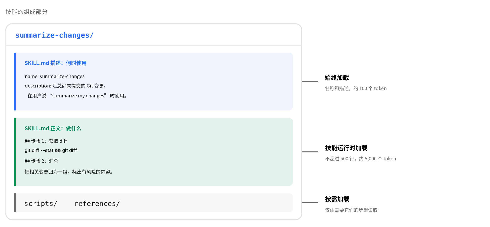

*图 1：一个技能文件夹，以及智能体何时加载其中各部分。*

[Agent Skills 规范](https://agentskills.io/) 详细说明了这一开放格式。

### 分发技能

我们为所有人建了一个存放技能的地方，让技能在人们使用智能体的任何场合都能轻松加载。事实证明，最好的地方是一个 Git® 仓库，因为版本控制本身就已经为每个技能提供了所有者、评审和历史记录。

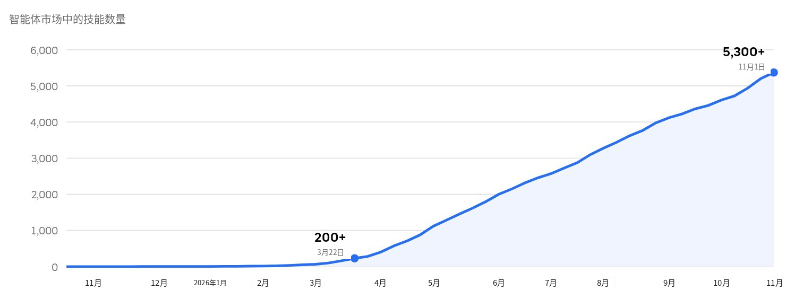

*图 2：13 个月内每周末智能体市场中的技能数量，按仓库的 Git 历史统计。原图是动画 GIF；动画文件见 `images/fig02.mp4`（上方为海报帧）。*

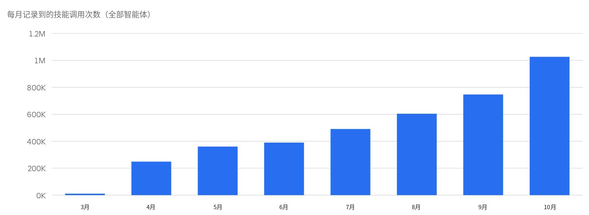

*图 3：2026 年 3 月至 10 月记录到的每月技能调用次数，覆盖 Claude Code™、OpenCode™、Codex™ 以及 Uber 内部智能体。原图是动画 GIF；动画文件见 `images/fig03.mp4`（上方为海报帧）。*

#### 理出头绪：常开、核心与领域

目标是让团队易于编写技能，同时默认向他们提供一套经过筛选的技能。为了又快又高质量地开发，我们把市场分成三个层级，技能每晋升一级，对质量和效率的要求就更高。要晋升一个技能，我们会运行评估系统，并做一组质量和有用性检查。

- 领域。任何团队都可以开辟自己的分区。每个分区指定自己的评审人，因此团队只需一次同行批准和一次 CI 检查即可发布，不必等待中央团队。
- 核心。被广泛使用的技能会进入这一层。它们会得到推荐，由一个团队测试和维护，并且每一次变更都要经过平台团队评审。
- 常开。约 100 个广泛有用的技能会对所有人默认开启，因此新员工第一次运行时就已具备这些技能。它们覆盖拉取请求、代码评审、工具访问、数据分析和聊天。

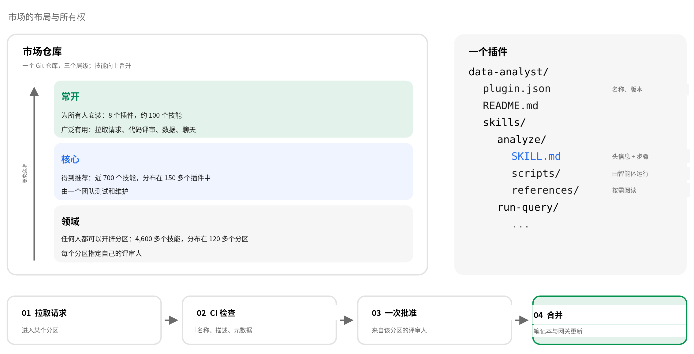

*图 4：三个层级、一个插件包含什么，以及从拉取请求到发布的路径。*

#### 所有智能体，一次安装

支持多种不同的智能体是我们策略的一部分。这是机会，因为人们会选择适合当前任务的智能体；这也是挑战，因为每种智能体对技能的定义和安装方式都不一样。

我们做了一个名为 aifx 的 CLI，用来启动各类智能体并存储配置。后来又把它扩展到技能管理、MCP 调用、可观测性，以及更高级的配置。aifx 会处理各平台在技能定义和安装上的差异。无论是人还是智能体，都可以运行 aifx plugin add data-analyst 来安装一组技能（称为插件），或运行 aifx skill add analyze 来安装单个技能。aifx 把这一选择记录在一份配置文件里，并应用到接下来启动的无论哪一种智能体上。在 Claude Code™、Codex™ 和 OpenCode™ 之间切换的工程师，会一直带着同一套技能。

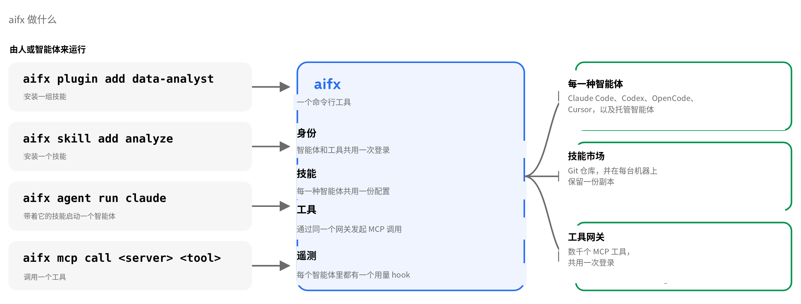

*图 5：aifx 做什么。一个命令行工具，让每个智能体都获得相同的登录、技能和工具。*

aifx 按层合并配置：公司默认、团队或项目、仓库、工作目录、用户，以及本地覆盖。后一层只会追加插件，绝不会移除，因此一个仓库可以声明所有在其中工作的人都需要的插件。

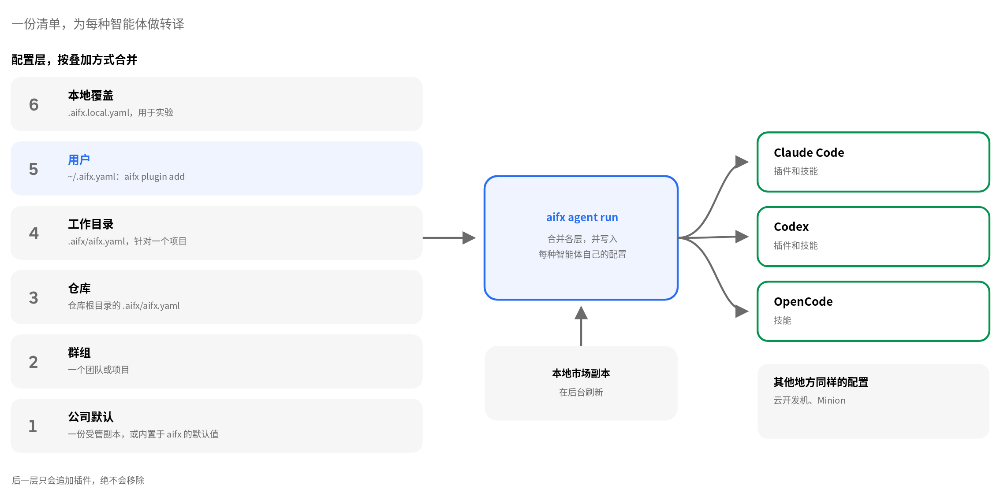

*图 6：aifx 合并六层配置，并把结果写入每种智能体自己的配置。*

aifx 还管理面向工程师、数据科学家和其他角色的 persona。它会设定默认技能和配置。

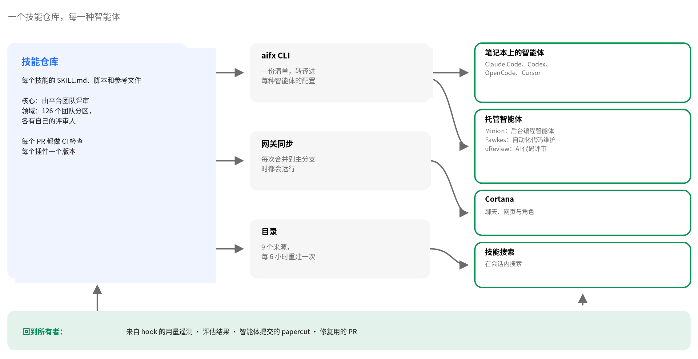

*图 7：一个技能仓库供给笔记本上的智能体、托管智能体以及搜索。遥测、评估和 papercut 再回到技能的所有者那里。*

### 技能发现

面对数千个技能，帮助用户为一条工作流找到合适的技能至关重要。我们有一个 find-skills 技能，可以找到并下载一个高质量技能，在特定工作流中运行它。为了支持发现，我们用评估和运行次数对技能做了分类和排序，并形成技能质量分。

借助内部的上下文图谱，任何员工都可以问：「给我那些同事在用、而我还没用的技能。」

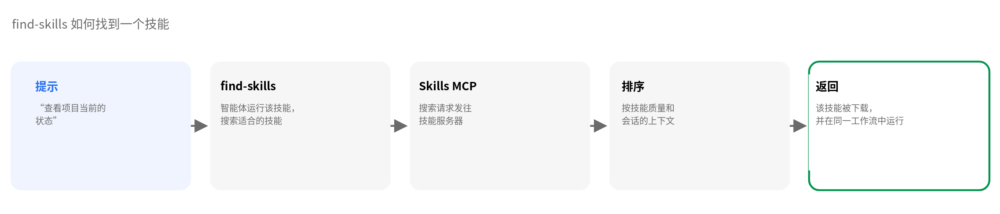

*图 8：find-skills 技能如何为一条提示找到技能。*

### 衡量技能用量

我们通过 hook 里的 OpenTelemetry，从智能体收集用量统计。这些 hook 会发送会话开始或工具调用之类的事件，这样我们就能记录技能的使用及其上下文。当工具是一个技能时，事件会记录该技能、它的版本，以及是智能体自行选择了它，还是用户键入了它的命令。事件不携带提示文本，也不携带文件内容。

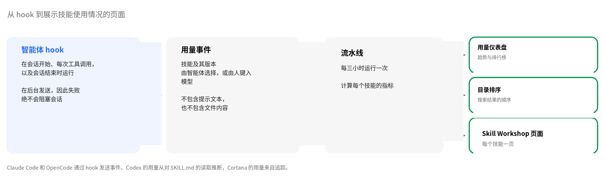

*图 9：一次用量事件从智能体 hook 到展示技能使用情况的页面所走的路径。*

根据这些事件，我们为每个技能计算 12 项指标，其中包括用户数、留存、成本、延迟和错误。作者可以在 Skill Workshop（我们的编写工具）里该技能的页面上看到这些指标。

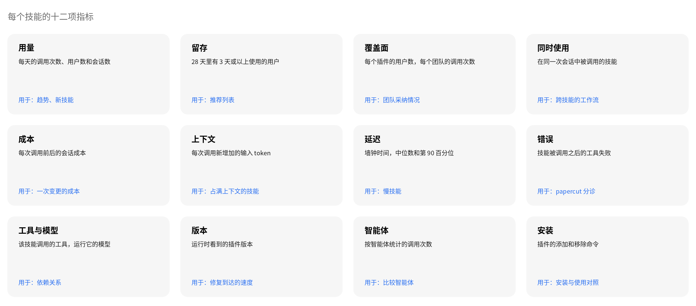

*图 10：我们为每个技能衡量什么，以及每项指标用来做什么。*

### 技能质量的持久战

技能所造就的智能体工作流，带来的挑战与智能体本身不同。它们需要在许多不同的上下文中工作，在正确答案有赖于人类判断的领域中工作，也要在许多不同的智能体环境中工作。我们做了 Skill Workshop，一个插件加 Web 应用，帮助技能作者和用户通过科学方法、系统性评估和用户反馈来改进技能。

#### Skill Workshop

技能有自己的生命周期。作者编写它、测试它，再通过市场发布。然后作者根据真实运行所呈现的情况去改进它，直到更好的模型让它变得不再必要，它便退役。Skill Workshop 为每个阶段都准备了工作流，并且每个技能都有一个页面，展示它的用量、成本和质量。

技能始于一份定义清晰的规格。模型和运行框架变化很快，我们希望在迭代实现的同时，技能仍然可用。规格守住技能的意图：它的目标、它的输出、哪些工具动作是必须或禁止的，以及它面向哪些智能体和模型。Skill Workshop 会根据规格编译出 SKILL.md 及其测试提示，并在模型或智能体发生变化时重新编译。

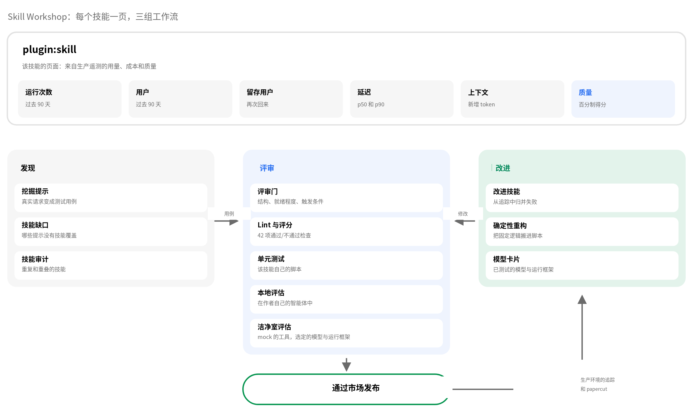

*图 11：Skill Workshop 中一个技能的页面，以及它的三组工作流。*

#### 把技能的代码异味提炼成 linter

我们把什么造就了好技能、什么会出问题、研究论文，以及模型的提示指南，提炼成一个带有通过/不通过检查项的 linter。下面是其中最有用的几条：

- 步骤要编号，每一步只有一个目标，并且至少有某种可以软校验的方式。
- 每一步都给出一条具体命令，并在进入下一步之前检查其结果。
- 技能要有错误恢复章节：一张失败及其修复办法的表。「再试一次」不算。

#### 评估

我们需要超越对技能质量的人工用户反馈。我们做了若干套系统，在多种智能体表面上评估技能。我们编写了人工标注的提示，并准备了用来测试它们的运行时环境。我们对评估套件的指导是：约 5% 为输入固定、期望输出明确且带有工具 mock 的金标用例，80% 为按轨迹评分的真实提示，15% 由作者来评判。所谓轨迹，是指智能体是否按正确的顺序使用了正确的技能和工具。

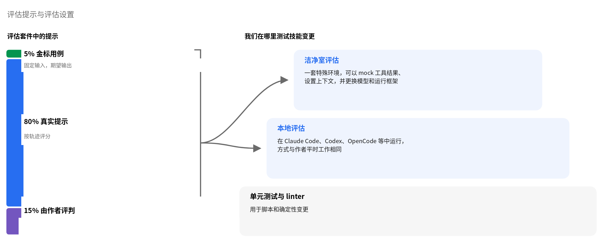

*图 12：评估套件中的提示，以及我们测试技能变更的三种设置。*

我们在三个地方运行评估：Minion，我们的后台智能体平台；AES，我们托管的智能体沙箱；以及 devpods，我们的远程开发机。洁净室能抓住对作者笔记本的依赖。就像每个说「在我这台机器上是好的」的开发者一样，强制使用远程环境找出了许多问题。有些技能依赖特定的文件路径、缓存的文档，或特定的操作系统工具才能工作。

在与非确定性 LLM 打交道时，评估仍然一半是艺术、一半是科学。以我们的经验，能通过 70%–90% 运行的评估，往往比 100% 通过的更有用。答案会变，评委也会。100% 通过可能意味着，评估没有捕捉到答案中有意义的变化。

判断一次评估运行是否通过，意味着判断什么才是要紧的。措辞是否必须完全一致？哪些地方可以变，而不改变含义？智能体未必能自己一贯地做出这些区分。它们可能盯着无关紧要的细节，或在答案其余部分符合预期格式时，漏掉一次严重的幻觉。

LLM-as-judge 在有一套人工标注集时效果最好。技能作者必须创建这些标注，从用户那里收集它们，并反复评分。这就是我们把评估套件分成金标集、真实提示和作者自建用例的原因。

轨迹评估看的是智能体试图做什么、以及为什么，而不看最终结果。它是否按预期使用了 MCP 或流程？它是否查询了那张表、读了那份 Google 文档、检查了上下文图谱？它是否查看了自己的错误恢复说明？我们用结果分和轨迹分，来评估对技能和工作流的变更。

#### 少即是多：消融

我们会在隔离的评估环境中，用相同的输入提示，测试从工作流里删掉一些文字、甚至删掉整个技能。对整个技能，我们会用真实提示各回放一次——一次带该技能，一次不带——然后由盲评评委选出更好的答案。我们用真实提示，对用量很大的技能做了测试：带技能、不带技能，以及只保留技能的一部分。随着模型变强，更多的文字反而可能降低表现，所以我们也会测试从技能里删字。

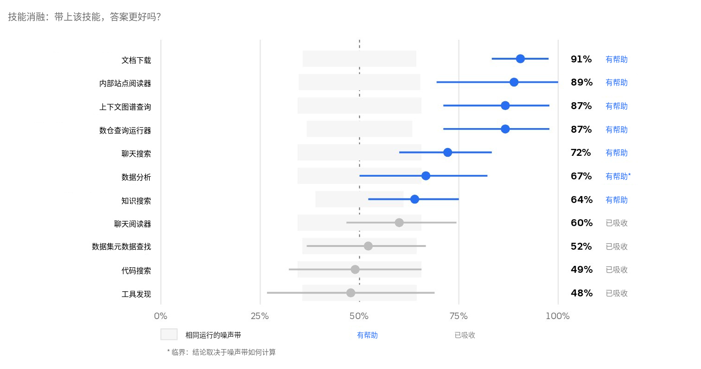

*图 13：带该技能产生的答案在盲评对照中获胜的比例，含 95% 区间。阴影带是每个技能的噪声带，即两次完全相同的运行会相差多少。原图是动画 GIF；动画文件见 `images/fig13.mp4`（上方为海报帧）。*

在大多数情况下，技能让会话更成功，成本也更低。最大的收益来自那些为智能体提供它不容易找到或理解的东西的技能，比如访问内部文档，或一种运行数仓查询的方法。

### 技能效率

有了技能，我们就能衡量一项任务的成本，于是我们把更多会话转移到使用技能。不用该技能的会话可能会尝试许多做法，找到错误的答案和错误的表，并把工具用错。有了技能，得到正确答案、并且高效得到它的概率就会上升。在一项运行数仓查询的技能的消融测试中，没有该技能的会话多出 13% 的工具调用，工具错误是原来的六倍，耗时多 31%，而带该技能的答案在 87% 的对照中获胜。

能改进答案的技能也有成本。它的说明、它的工具调用，以及这些调用的结果，都会进入智能体的上下文，会话中随后的每一轮都要再次为这段上下文付费。我们衡量每个技能的成本，并用几项杠杆把它降下来。

#### 我们如何衡量一个技能的成本

智能体会对一个会话到目前为止的成本做累计，我们的遥测会在定期快照中上报这个累计值。当智能体调用一个技能时，我们取调用前上报的最后一个累计值，以及调用后上报的第一个累计值，再相减。这个差就是那一次调用的成本。我们按技能把每天的调用加总，再除以调用次数，得到该技能的每次调用成本。

这个数字包含模型阅读该技能、随后的各轮，以及那一窗口内任何其他工具调用。我们用这个数字看成本花在哪里，并比较一个技能在变更前后的情况。

#### 我们用来降低技能成本的杠杆

有一个中央团队会针对所有最常用的技能抓效率，平台负责人则像对待 UI 或软件的所有权那样对待技能所有权。他们为质量和效率设立 KPI。

- 能用代码就不用 LLM。从不变化的步骤放进脚本里跑，这样模型就不必阅读每一个工具定义和每一条结果。这就是下文要说的 Code Mode。
- 把技能放到一个更便宜模型上的 worker 里运行。技能会派发一个子智能体，由调用方选择它的模型：查资料用小模型，关联结果用最强的模型。大型工具结果留在 worker 的上下文里，只返回有界的摘要，这样后续轮次就不必再为它付费。在一次前后对比中，一个追踪技能的每次调用成本下降了 46%。一个部署技能在变更后的第一周没有下降，所以我们会在每个技能变更之后分别衡量。
- 在技能加载时就运行脚本。当结果很小而且总是需要时，技能会在加载时运行脚本，并把输出放进提示，从而去掉模型的一轮。一个搜索技能从四轮变成三轮，平均成本下降了 32%。
- 把轮询移出主会话。在花费最高的 20 个会话里，通知轮次大约占了三分之一的开销。今年 9 月，我们把拉取请求监控技能的轮询，挪到了一个运行更便宜模型的后台智能体上。

#### Code Mode：能用代码就不用 LLM

对于确定性工作，代码比 LLM 更便宜、更易于测试，结果也更好。我们看到，许多 token 花在了同样的工具调用上：跑一条查询并阅读响应、读取并发送一条 Slack® 消息、搜索远程代码、读取并发送邮件。智能体真正想要的只是结果，却不得不把一切都经 LLM 及其上下文窗口加载并运行，既慢又贵。

LLM 客户端里默认的 MCP 安装让这种情况更糟，因为它会把每个工具的完整描述加载进每一次调用。工具超过 100 个时，这些定义在用户还没打字之前就要占用 50,000 到 70,000 个 token。

受 [Cloudflare 的 Code Mode](https://blog.cloudflare.com/code-mode/) 启发，我们把这些流程搬进了通过网关调用工具的工具脚本。在我们的配置里，这避免了预先加载那些工具定义，智能体也只阅读每条结果中它需要的部分。这些脚本提高了我们最常用流程的成功率，也改善了延迟和成本。

这些 Code Mode 技能成了公司其余技能按名称引用的软件包，让它们可以依赖高质量的流程实现。我们还禁止在技能和插件中使用会安装工具服务器的 .mcp.json 文件。

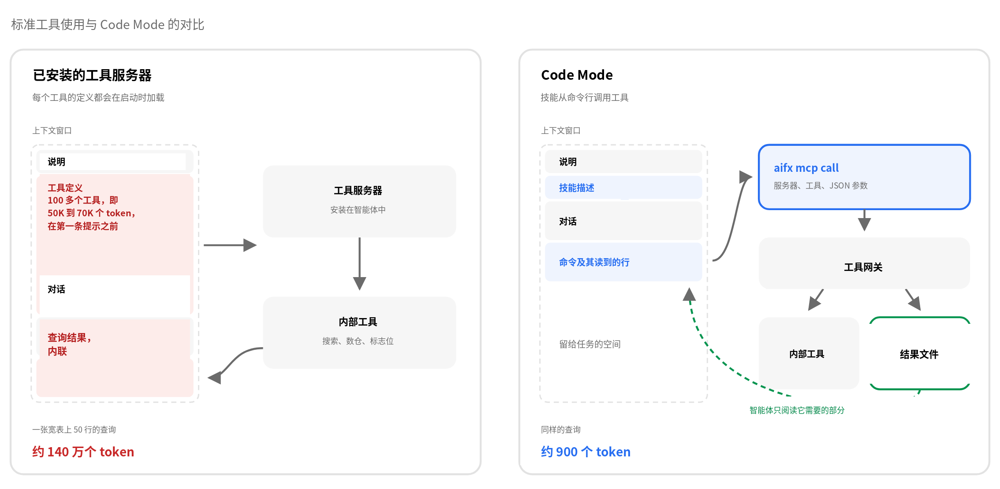

*图 14：已安装的工具服务器会把每一个工具定义和每一条结果放进上下文窗口。在 Code Mode 下，技能通过 aifx 和工具网关调用工具，结果写入文件。token 数为我们的估计。*

### 持续改进，以及智能体给自己提缺陷

技能停止工作的原因可以有上千种。模型升级改变了智能体阅读说明的方式，工具改了它的标志位，或者智能体运行框架改了运行技能的方式。

智能体知道某个技能、工具或流程不在正常工作。当它费力去做被要求的事、并花上 100 轮与某种古怪错误搏斗时，它是有觉察的。它会看到帮助文本里列出、却被工具拒绝的标志位，会看到出错时仍以 0 退出的命令，或本该匹配却返回空结果的查询。

智能体有时能找到变通办法，但为此会浪费大量 token 和宝贵的上下文。我们发现，增加一个始终可用的技能，让智能体把所看到的摩擦或缺陷记录下来，就能形成一个强大的改进飞轮。

#### 发现问题

我们把每一份报告称为 papercut。智能体通过 log-papercut 这个常开技能来提交它，因此每个智能体都能看到该技能，并且不必被要求就会提交报告。这既改进未来的会话，也改进缺陷发生的那一次会话，因为智能体知道：有时候事情就是不对劲，而它应当意识到自己正在卡住。它甚至可以查找别人是如何绕过那个问题的。

报告会说明智能体尝试了什么、期望是什么、实际发生了什么，以及怎样可以修好。所有报告进入同一个仪表盘，按技能分组。

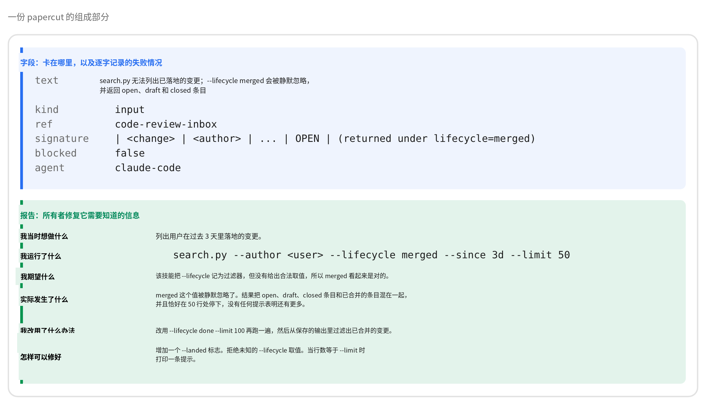

*图 15：智能体在 10 月提交的一份 papercut，已缩短。这些字段让我们可以把匹配的报告归并到一起，报告也会告诉所有者该修什么。*

#### 解决问题

一份 papercut 会被归并、分诊、分析根因、修复、评估，并获得批准。修复上线之后，会先衡量效果并检查是否引入回归，然后才关闭工单。

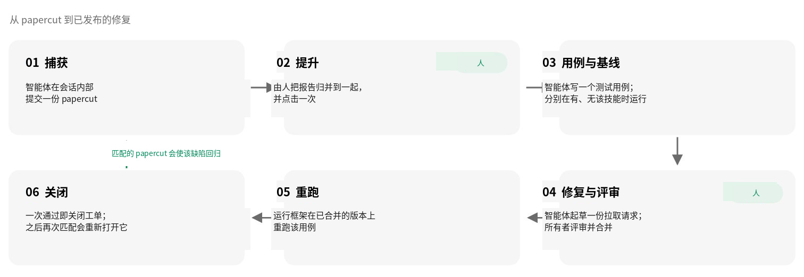

*图 16：papercut 循环。人在两个标出的步骤上采取行动。原图是动画 GIF；动画文件见 `images/fig16.mp4`（上方为海报帧）。*

智能体在短短三个月里提交了数千份 papercut。已有数百份被修复，这些修复改进了工作流，也让它们在 token 上高效得多。下面是一些有意思的修复：

- 拉取请求技能把提交说明写到一个共享的临时文件里，于是两个并发会话会改掉彼此的拉取请求。
- 一个部署技能让智能体传入 epoch 秒，而 API 期望的是毫秒。
- 一个配置查找技能在请求的键不存在时，会返回另一个属性，并且不报错。
- 一个拉取请求技能在一个根本没有 CI 检查的仓库上等待 CI，并反复碰到同一个 404，直到超时。

#### 来自人的信号

不依赖智能体自己怎么想，我们还在智能体会话上安排了人工评分。在 Fawkes（Uber 的自动化软件维护工厂）里，我们有负责打开拉取请求的代码维护技能。如果一个拉取请求出现了评论和多轮修改，或没有被接受，我们会用这些信号来改进创建它的那些技能。被卡住的拉取请求会成为评估集的一部分。我们在许多领域和智能体平台上都使用同一模式。

## 结语

技能把文字变成了行动和结果。随着用量增长、模型改进，我们的重心从编写技能，转向技能的质量和评估。尚未解决的问题，是如何评估那些很少运行、却非常要紧、又难以评判的工作流。在持续投入的同时，我们正在试验轨迹与追踪分析、结构化的人工标注，以及技能路由。

## TL;DR

- 一种格式、一个仓库，面向每一种智能体。同一个技能可以在笔记本上的 Claude Code™、OpenAI Codex™、OpenCode™ 和 SpaceXSI Cursor® 中运行，也可以在我们所有的托管智能体中运行。我们的命令行工具 aifx，为每一种智能体表面提供身份、技能分发和 MCP 连接。
- 技能面向所有人，不只是工程师。工程师用它们做各种事，比如根因分析和实验读数。其他团队用它们来取回指标、准备供审阅的文档草稿，并帮助客户经理回答商户支持问题。
- 先写规格。一份 spec.md 记录一个技能必须产出什么，以及它支持哪些智能体和模型。我们的编写工具 Skill Workshop 会据此编译出 SKILL.md 及其测试提示，这样在模型和智能体变化时，技能仍然可用。
- 少即是多。我们用真实提示，在有该技能和没有该技能的情况下各回放一次，由盲评评委选出更好的答案。随着模型变强，有些技能需要修改，或需要退役。
- 从追踪改进技能。作者会阅读该技能在自己会话的真实运行中出了什么错，并把每一次失败变成测试用例。
- 智能体给自己提缺陷。当智能体碰到损坏的标志位、错误的文档，或静默的错误时，它会提交一份名为 papercut 的结构化报告，并由所有者接手。

### 接下来做什么？

我们接下来正在做这些事：

- 对技能做 A/B 测试。我们希望对技能里的内容做大规模 A/B 测试，以评估它们。这将让我们可以对重要技能的变更做金丝雀发布。
- 按模型编译技能。随着各模型在提示指南和建议上出现分化，我们发现，不同的措辞和不同长度的 SKILL.md 文件，在不同的模型家族里效果更好。
- 收集并处理技能运行的追踪。我们将按评估为会话建索引，记录用户想做什么、实际发生了什么、是否遇到麻烦，以及是否成功。我们会问：可以怎样改进，以及哪些做法效果非常好、应当分享给更多会话。
- 技能推荐。我们将告诉用户他们应当使用哪些技能。
- 一个任务路由器。用户想做的每一件事，都可以问同一个入口，由它路由到合适的智能体、技能和上下文。

### 致谢

这项工作跨越 AIFX、Developer Platform、Michelangelo、uReview、Fawkes、Minion、Cortana、Agentic XP 和 Conan AI 等团队，以及 Uber 上下数百名在市场中编写并维护技能的工程师。

封面图片说明：由 ChatGPT 生成

Anthropic® is a registered trademark of Anthropic PBC. Claude Code™ and Claude® are trademarks of Anthropic, PBC.

Cloudflare® is a registered trademark of Cloudflare, Inc.

Cursor® is a registered trademark of Anysphere, Inc.

Git and the Git logo are either registered trademarks or trademarks of Software Freedom Conservancy, Inc., corporate home of the Git Project, in the United States and/or other countries.

Linear is a registered trademark of Linear Orbit, Inc.

OpenCode™ is a trademark of Anomaly Innovations, Inc.

OpenAI®, OpenAI Codex™, and its logos are registered trademarks of OpenAI®.

Slack® is a registered trademark and service mark of Slack Technologies, Inc.

All other product names, logos, and brands are the property of their respective owners.

### 参考文献

1. Shyam Sankar，接受 Ben Thompson 采访，Stratechery，2026 年 10 月 29 日。

---

## 附录：仅见于博客的作者头衔与简介

这些作者头衔和简介出现在 [Uber Engineering 博客](https://www.uber.com/us/en/blog/optimizing-ubers-agent-skills/) 上，并不在 X Article 正文中。由对博客的 WebFetch 还原（博客 HTML 本身对直接 curl 有 Cloudflare 验证）。该提取结果的页头卡片把第二位作者写成 “Jason Varbedain”；简介段落和 X 署名均为 **Jason Varbedian**。

**Andrew Mager**，Staff Engineer

Mager 是 Uber Frontier Tech Labs 的 Staff Engineer。他打造 Software Factory Playbook 以及 Uber 的技能平台，帮助产品团队以规格驱动、由智能体执行的开发方式更快交付。

**Jason Varbedian**，Sr Staff Engineer

Jason Varbedian 是 Uber Mobility Applied AI 的工程师，从事智能体工作流、评估，以及以智能体方式交付产品。

**Uday Kiran Medisetty**，VP, Distinguished Engineer

Uday Kiran Medisetty 是 Uber 的 Distinguished Engineer，负责工程生产力方面的举措（智能体编程、AI 调试、代码评审，以及大规模重构）。他还与同事共同领导公司范围的工程社区，塑造 Uber 的架构、文化与标准。
