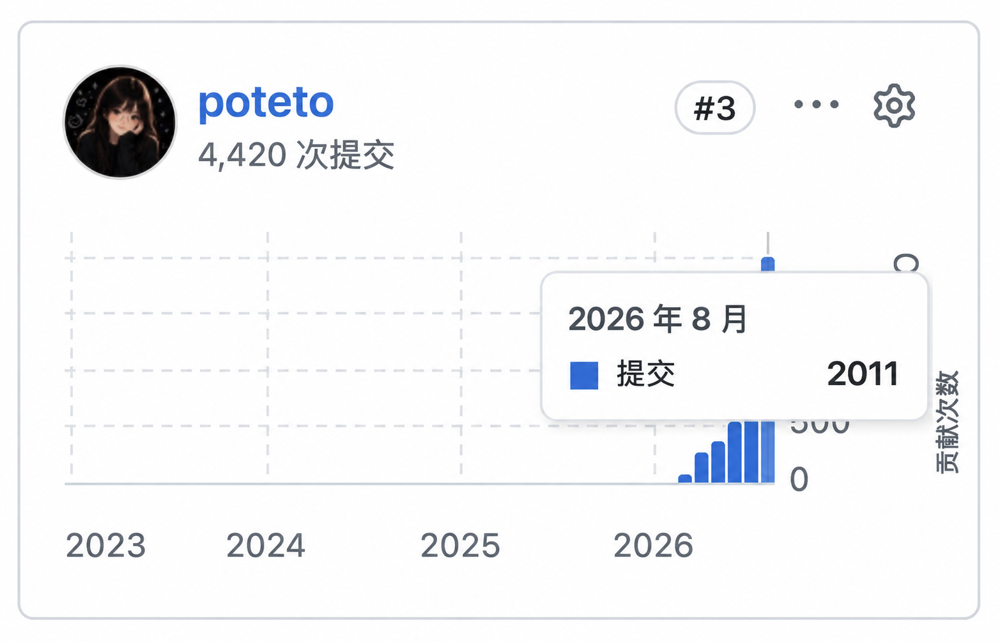
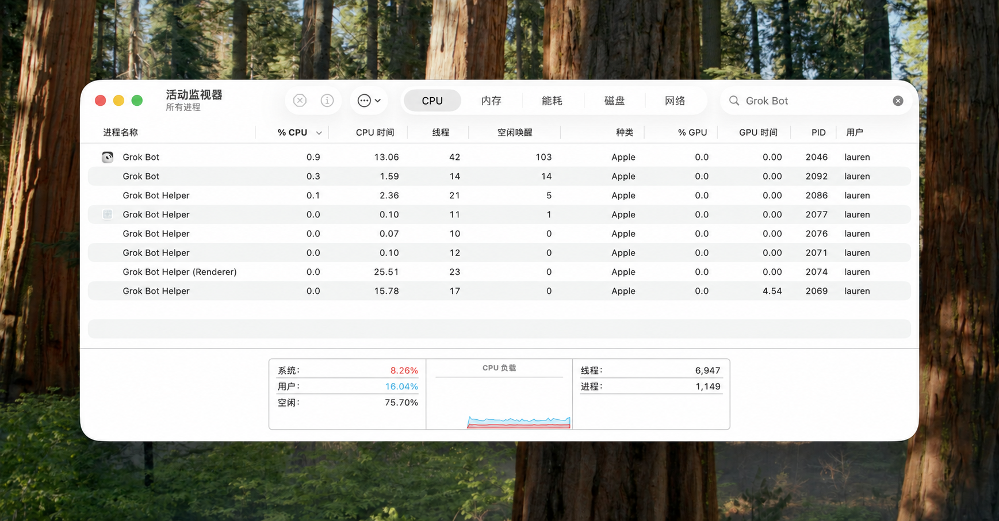
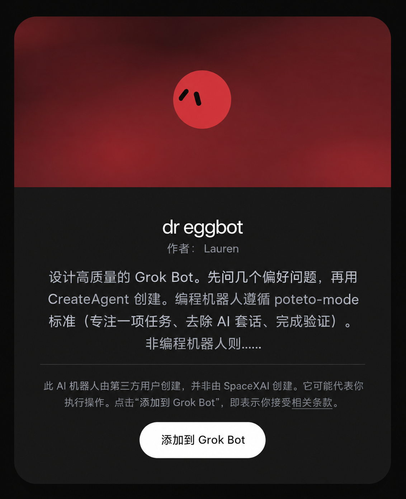
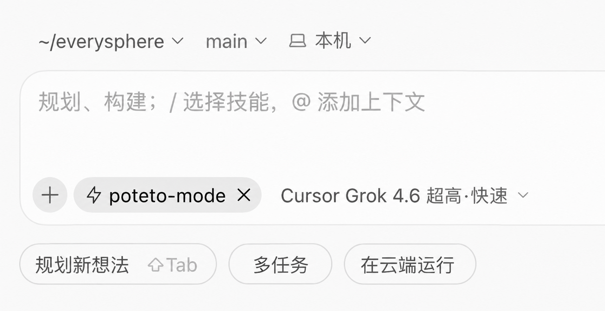

# pstack 完全指南（一）：验证就是一切

> 作者：lauren（[@poteto](https://x.com/poteto)）  
> 原文：[The Complete Guide to pstack Pt. 1](https://x.com/poteto/status/2094457600259842065)  
> 翻译 Url：[https://github.com/samz406/local_wenzhang/blob/main/docs/pstack完全指南/01-验证就是一切.md](https://github.com/samz406/local_wenzhang/blob/main/docs/pstack完全指南/01-验证就是一切.md)


在这个系列里，我会带你看看我是怎么使用 [**pstack**](https://x.ai/bot/plugin/9717366) 的。这是我自己整理的一套技能，用来严谨地做好工程工作。有了它，我每个月能把 2,000 个 PR 上线，而且心里有底。



我以前从不太在意自己写了多少行代码，或是合并了多少个 PR。智能体出现之前，也没人在乎这些，理应如此：单纯的产出数量，并不总能转化成质量，或是用户看得见的成果。这只是个好看的虚荣指标。

但在构建 **pstack** 的过程中，我发现，数量确实有意义，尤其是当你能借助智能体，在维持产品质量、甚至提升质量的同时扩大产出。比如，大约两个月前我开始参与 Grok [@Bot](https://x.com/Bot) 的开发，那时项目还在早期，代码库很新，但已经开始增长。如今团队不断扩大，每天都有几百个 PR 合入 Grok [@Bot](https://x.com/Bot) 的代码库，而 **pstack** 让我依然能够为整个团队守住代码质量：持续审视代码、重构、增加新的 lint 规则和检查，同时继续开发功能。

[文中嵌入的帖子](https://x.com/poteto/status/2090546476464451907)

我之所以能当好 Grok [@Bot](https://x.com/Bot) 的“园丁”和维护者，全靠 **pstack**。原型做出来之后，项目势头很猛，很多人陆续加入团队。那时有一个关键的机会窗口：我可以在代码库持续开发、不断扩展的过程中，不停机地重构整个项目，为它打下坚实的基础。这样，无论有多少工程师——更重要的是，有多少非工程师——参与贡献，这个代码库都能保持高质量，支撑不断扩大的开发规模。为此，我必须一边建设 Grok Bot，一边重构、加固它的底座。只有底座跟得上贡献涌入的速度，这件事才做得到。



*Grok Bot 是目前市面上效率和性能最出色的 AI 桌面应用之一。*

Grok [@Bot](https://x.com/Bot) 本身就是最好的证明。接下来的几周，我会把使用 **pstack** 构建和维护高质量应用所需要知道的东西，都讲给你听。

## 第一篇：验证就是一切

你的工具箱里，最不可或缺的就是一个高质量的验证技能。它的创建和维护重要到什么程度？在我眼里，它更像关键基础设施，远不止“一个技能”而已。好的验证技能能放大整个团队的产出，非工程师也包括在内。做好了，整个团队的产出可以提升 100 到 1,000 倍。

如果你还不熟悉这个说法，*验证*指的是：智能体能够检查自己的工作是否真的做成了。它可以一直干到任务成功，因为现在它能自己闭合反馈回路，不再由你充当瓶颈。如果你想了解我当初是怎么为 Cursor 创建第一个验证技能的，可以读读我之前的文章[《值得信赖的闭环》](https://x.com/poteto/status/2069824386283319343)。

### 一起创建一个验证技能

首先，安装 pstack，然后运行 [/create-verification-skill](https://github.com/cursor/plugins/blob/main/pstack/skills/create-verification-skill/SKILL.md)。我也建议你把 [Dr Eggbot](https://x.ai/bot/93gOz3op1UQdBdbekQFLK) 加入自己的机器人阵容。这是我做的一个机器人，专门帮你创建高质量的机器人。Dr Eggbot 自带 [**pstack**](https://x.ai/bot/plugin/9717366)，既能教编程机器人怎么使用它，也能用同样严谨的标准创建非编程机器人。

你可以让 Dr Eggbot 为你创建一个工程师机器人，再让这个机器人运行 /create-verification-skill，并设置每天运行 /maintain-verification-skill 的例行任务。



*爱了，Dr Eggbot。*

趁它运行，我们来看看这个技能到底做了什么，又是怎样为你创建一个高质量验证技能的。

我把我们开发 Grok [@Bot](https://x.com/Bot) 和 Cursor 时用到的各种验证技能，提炼成了这样一个“元技能”。它会教你的智能体，为你自己的应用创建一个高质量的验证技能。

这时，技术栈的选择就很重要了。比如，你用 Electron 或 Web 技术开发应用，就能利用 JavaScript 生态丰富的调试工具。[Chrome 开发者工具协议（CDP）](https://chromedevtools.github.io/devtools-protocol/) 可以让你使用浏览器开发者工具里的同一套能力。如果开发的是 iOS 应用，则可以利用模拟器。

理想情况下，你需要能与应用交互、调试、采集性能轨迹，以及使用其他你亲手开发应用时通常会用到的调试和开发工具。如果没有足够强大的运行时环境可用，可能就需要让智能体帮你造工具，比如使用 lldb，或写一个在开发环境中以边车方式运行的自定义软件包；也可以先把手头已有的工具用起来。

我个人觉得，让智能体具备验证能力实在太重要了。所以，我是认真的：为了获得压倒性的优势，把软件开发效率推到极致，自己构建一套强大的调试工具，甚至更换技术栈，都值得考虑。前面说过，智能体一旦能验证自己的工作，组织里的每个人就都能参与贡献，并确认自己改的东西确实有效。技术栈越难调试、越难控制，就越难高效地使用智能体。

**让验证可复现**

**pstack** 有一条原则，叫[“造出杠杆”](https://github.com/cursor/plugins/blob/main/pstack/skills/principle-build-the-lever/SKILL.md)。放到技能创建的语境里，就是我们更愿意给智能体工具，而不只是给它 Markdown 文档。对验证技能来说，这意味着创建一个小巧的命令行工具（CLI），把应用交互和调试操作封装成脚本，让智能体方便调用。这样一来，智能体完成任务消耗的 token 更少：执行一条 CLI 命令就行，不必为了点一下某个东西，临时写一段用完就丢的脚本。验证技能也因此更容易复现和测试。

假设你开发的是一个 Electron 应用，智能体做出来的 CLI 可能是这样的：

```shell
# 检查运行状况
node .cursor/skills/verify-atlas/control-atlas.mjs doctor

# 打开一个空白会话，并发送消息
node .cursor/skills/verify-atlas/control-atlas.mjs new-session
node .cursor/skills/verify-atlas/control-atlas.mjs send "列出这个项目中尚未完成的任务"

# 通过键盘快捷键操作
node .cursor/skills/verify-atlas/control-atlas.mjs press "Meta+KeyN"

# 获取当前界面的无障碍快照
node .cursor/skills/verify-atlas/control-atlas.mjs snapshot

# 截图，作为验证证据
node .cursor/skills/verify-atlas/control-atlas.mjs screenshot /tmp/atlas-proof.png

# 等待流式输出或布局稳定
node .cursor/skills/verify-atlas/control-atlas.mjs wait-settle

# 切换当前会话的功能开关
node .cursor/skills/verify-atlas/control-atlas.mjs feature-flag rooms_v2 on
```

现在，所有智能体都能用这个 CLI 快速操作和调试你的应用。你还应该开始考虑应用的开发体验：

- 为开发数据库填充初始数据。
- 如何处理身份认证、测试用户，以及对测试或预发布环境的 API 调用。
- 如何以一致的方式安装并启动开发环境。

这些事，你自己写代码时大概也绕不开。所以，把它当成智能体在你的应用上开展开发工作的主要工具，认真维护，做好测试！

你还可以考虑加入下面这些命令：

```markdown
- **查看信息：** `info`、`snapshot`、`screenshot`、`components`
- **导航：** `home`、`new-session`、`select-project`、`select-runtime`、`scroll`
- **交互：** `send`、`click`、`click-xy`、`aria-click`、`type`、`press`、`eval`、`upload-image`、`add-context`、`feature-flag`
- **性能：** `trace`、`profile`、`record`、`perf-metrics`、`wait-settle`
- **流式信息：** `console`、`network-log`、`network-summary`
- **健康检查与清理：** `doctor`、`cleanup`、`watch --restart`
```

有了这套基础配置，你应该就能明显感觉到智能体变好用了。它们在应用里导航、调试，都会顺手得多。

我建议，先花时间把这个 CLI 做好，消除错误，再去尝试更进阶的东西。你也需要想一想——或者让智能体帮你想——怎样设计一个适合智能体使用的 CLI。网上有不少资料可以交给它参考，我尤其看重这些特征：

- API 易于组合，可以参考 John Ousterhout 的“深模块”理念。
- 任何可能产生破坏性副作用的命令，都应该提供 `--dry-run` 选项。
- 利用子命令逐步展开功能，不要一股脑全部铺出来。
- 错误信息要具体清楚，还要告诉智能体接下来应该怎么做。
- 提供丰富的 `--help` 帮助文本。
- 以机器可读的格式返回结果，比如 JSON。

**用[云端智能体](https://cursor.com/docs/cloud-agent)并行提速，而不是 worktree**

当你用验证技能成功合并了几个 PR，可能就会开始想：能不能把并行程度再拉高一点？既然智能体已经能接过提示，基本上独立推进到可以合并的状态，你不就能腾出手来，同时运行更多智能体了吗？

你的第一反应可能是增加 worktree 支持：让智能体用 Git 创建一份受版本管理的仓库副本，在里面修改代码，与主工作目录隔离。理论上，这样就可以同时运行多个智能体，又不会互相覆盖改动。

我不建议这么做。首先，这会占用你机器上的大量存储和计算资源。视仓库大小和机器性能而定，你也许能靠 worktree 勉强并行运行最多 10 个智能体。但有个好得多的办法！

Cursor 的[云端智能体](https://cursor.com/docs/cloud-agent)运行在 Cursor 的云端基础设施上。它们能使用真正的计算机，也就能安装依赖、运行应用、录视频、截图，像真实用户一样与应用交互。如果你在上一步已经把开发体验打磨好了，配置云端智能体应该不会太费劲。首次配置云端环境时，我们会派一个智能体帮你把环境正确搭起来、跑起来。第一次构建完成后，我们会保存一份[快照](https://cursor.com/docs/cloud-agent/builds)，后续每次启动云端智能体都能很快就绪。

我非常建议你花时间把云端智能体配置好，因为并行能力带来的生产力提升会非常大。后面的文章里，我会展示自己如何在云端同时运行几百个子智能体！不过现在，先把环境搭好，调到一个让你放心把所有智能体都放到云端运行的状态。

**用功能地图，让智能体始终心中有数**

应用越复杂，智能体就越需要指引，才能找到功能并与之交互。为此，我做了一个东西，叫功能地图（Feature Map）。顾名思义，它是一张方便搜索的地图，列出应用里的所有功能、各自的用途，以及用户要怎么找到它们。

我给一个虚构的 Atlas 应用准备了[功能地图示例](https://github.com/poteto/verification-skill-example/blob/main/.cursor/skills/verify-atlas/references/features/README.md)。它其实就是几个 Markdown 文件，由验证技能的 SKILL.md 引用。

这些文件放在哪里都可以。不过，/create-verification-skill 会自动创建 `references/features` 目录，并在其中放置一个 README.md。这个 README 就是地图本身：概览所有主要功能，再链接到各项功能的具体说明。单个功能的描述大概是这样：

````markdown
# 偏好设置

全屏偏好设置浮层及其中的各个标签页。

## 子功能

- settings-overlay：通过齿轮按钮或 Cmd/Ctrl+, 打开的全屏浮层。
- settings-nav：左侧的标签页导航，包括通用（General）、外观（Appearance）、模型（Models）、套餐与用量（Plan & Usage）等。
- settings-search：浮层内的搜索；打开设置后按 Cmd/Ctrl+K 调用。
- theme-picker：外观页面上的快捷主题控件。

## 如何进入（用户视角）

点击账户头像旁的齿轮，或按 Cmd/Ctrl+,。从左侧导航中选择标签页。在偏好设置搜索框中输入内容，可以快速跳转。按 Escape 或点击关闭控件即可关闭。

## 通过 control-atlas 操作

```bash
node .cursor/skills/verify-atlas/control-atlas.mjs press "Meta+Comma"
node .cursor/skills/verify-atlas/control-atlas.mjs snapshot
node .cursor/skills/verify-atlas/control-atlas.mjs press "Escape"
```

- 浮层根节点：在无障碍树中查找名为 Preferences 的对话框或区域。
- 标签页：按界面上显示的名称点击。某些账户状态下可能没有 Plan & Usage。
- 打开设置时，Cmd/Ctrl+K 调用的是偏好设置搜索，而不是全局命令面板，参见 `multi-surface-journeys.md`。

## 注意事项

- 在测试套件执行到一半时关闭设置，可能让焦点落到不合适的位置。使用 `new-session` 或 `home` 恢复。
- 部分标签页受账户权限限制。跳过时，明确说明对应的账户原因。
````

不用担心，这些不需要你自己写！运行 **/create-verification-skill** 时，智能体会自动遍历你的应用，整理全部功能目录，并创建这些参考文件。

功能地图与 CLI 配合使用，是 pstack 验证技能效果出色的主要原因之一。智能体现在有了每项功能的背景信息，也知道怎么找到它们。这既节省了上下文窗口里宝贵的 token，也让它准确知道功能的用途和进入方式。

你可以把功能地图理解成一种“物化的记忆”。如果用智能体有一阵子了，你大概已经熟悉“记忆”这个概念：它们通常以简单的 Markdown 文件保存，比如 Obsidian 知识库；也可能放在更复杂的系统里，比如向量数据库。我个人觉得，代码库才是记忆的终极形态。代码是你和团队历次决策的投影，记录了发生过什么、系统实际上如何运作，是最终的事实依据。功能地图只是把这些内容压得更紧凑，以节省 token。而且，它就是技能里的 Markdown，所有参与代码库贡献的人都能受益于这份共享记忆。

因此，维护验证技能非常重要。我建议每天至少运行一次 **/maintain-verification-skill**，确保智能体始终掌握操控应用的最新细节。随着你越来越多地使用验证技能，也可能会发现，智能体在开发应用时会顺手更新它们。/maintain-verification-skill 会补上那些遗漏的部分。

## 如何使用验证技能

这里有一个为虚构应用创建的[验证技能示例](https://github.com/poteto/verification-skill-example)，可以参考。再提醒一下：运行 **/create-verification-skill** 就能创建一个，里面会包含基础 CLI 和功能地图。

下面是我通常怎样把它和 **pstack** 配合使用。

首先，当然是在提示开头加上 **/poteto-mode**。如果你在 Cursor 里使用 pstack，自动补全 /poteto-mode 时，可以按 Opt + Enter，而不是直接按 Enter。这样就会把技能添加为[自定义模式](https://cursor.com/changelog/08-19-26#custom-modes)，将其固定下来，让智能体每开启一轮新对话，都会收到使用这个技能的提醒。



*输入 /poteto-mode，按 Opt + Enter，将它固定为自定义模式。*

在 Grok [@Bot](https://x.com/Bot) 中，安装[这个插件](https://x.ai/bot/plugin/9717366)，然后输入 /poteto-mode。


*Grok Bot 里也可以用 pstack！*

**示例：开发新功能**

开发新功能时，我通常把验证技能和 /poteto-mode 一起用，让智能体检查自己的工作。比如，我可能会这样写提示：

> /poteto-mode 实现〈功能描述，以及其他有用的背景信息〉。用 /control-app 验证你的改动，给我看视频和截图，作为证明。

这里的 /control-app，就是 /create-verification-skill 创建出来的技能。在 Grok [@Bot](https://x.com/Bot) 中，我会这样写：

> 启动一个云端智能体，让它用 /poteto-mode 实现〈功能描述，以及其他有用的背景信息〉。用 /control-app 验证改动，给我看视频和截图，作为证明。

区别很小：在 Grok [@Bot](https://x.com/Bot) 里，你让机器人启动云端智能体，而不是让它亲自干活。我偏爱这种做法，主要是因为这样可以把机器人解放出来，让它去做别的事，同时保持它的上下文窗口干净。从这个角度看，我更把自己的机器人当成协调者，负责管理和监督云端智能体。云端智能体还让你能充分使用 Cursor 提供的各种模型。它们各有独立的机器，你的机器人所用的计算机也就能腾出来做别的事。

**示例：性能优化**

> 启动一个云端智能体，让它用 /poteto-mode 改善应用的首次加载耗时。先用 /control-app 采集当前状态的性能轨迹，找出优化机会。然后针对问题做修改，再结合 /control-app 和 [/swarm](https://github.com/cursor/plugins/blob/main/pstack/skills/swarm/SKILL.md)，确认性能确实提升了。

[/swarm](https://github.com/cursor/plugins/blob/main/pstack/skills/swarm/SKILL.md) 是最适合与验证技能搭配的技能之一。它可以同时派出任意数量的云端智能体，运行你的验证技能。这样，你就能用足够大的样本量确认性能提升，或是对应用做模糊测试，确保没有破坏功能，也没有引入回归。

**示例：自动复现用户反馈的问题**

当你对验证技能满意之后，可以把它放进 Grok [@Bot](https://x.com/Bot) 的例行任务，或 [Cursor Automations](https://cursor.com/docs/cloud-agent/automations) 中。例行任务和自动化任务可以按计划执行，也可以在某个事件发生时触发。

比如，如果你把用户反馈汇总到 Slack，或者有自己的内部反馈频道，就可以让机器人监听每一条问题报告，自动启动云端智能体尝试复现。如果验证技能和功能地图足够好，你甚至还可以进一步决定让它自动修复问题。

前面说验证是工具箱里最重要的技能之一，是有原因的。它提供了一层基础，让你能在上面构建新的技能和例行任务。最重要的是，整个团队都能受益。

## 持续投入，打磨验证技能

创建验证技能后，要用 /maintain-verification-skill 让它始终保持好用。不断改进 CLI，像投入关键基础设施一样投入这个技能。你甚至可以为它安排值班轮岗：要让整个团队的生产力提升 100 到 1,000 倍，它就是这么重要。

这个技能是我们接下来在 **pstack** 指南中介绍的许多技能的基础，而且能与它们很好地组合使用。

- pstack：[https://x.ai/bot/plugin/9717366](https://x.ai/bot/plugin/9717366)（[GitHub 仓库](https://github.com/cursor/plugins/tree/main/pstack)）
- Dr Eggbot：[https://x.ai/bot/93gOz3op1UQdBdbekQFLK](https://x.ai/bot/93gOz3op1UQdBdbekQFLK)

我建议你把 [Dr Eggbot](https://x.ai/bot/93gOz3op1UQdBdbekQFLK) 加入自己的机器人阵容。这是我做的一个机器人，专门帮你创建高质量的机器人。Dr Eggbot 自带 pstack，既能教编程机器人怎么使用它，也能用同样严谨的标准创建非编程机器人。

你可以让 Dr Eggbot 为你创建一个工程师机器人，再让这个机器人运行 /create-verification-skill，并设置每天运行 /maintain-verification-skill 的例行任务。

感谢阅读，第二篇敬请期待！
