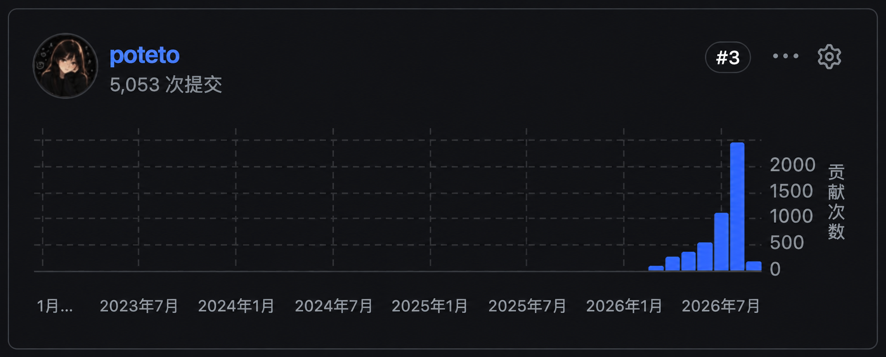
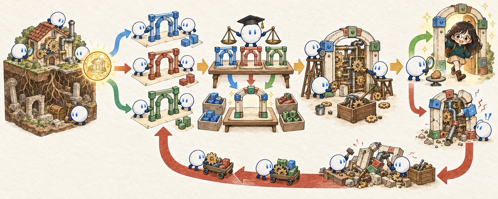

# pstack 完全指南（二）：调研、规划与架构

> 作者：lauren（[@poteto](https://x.com/poteto)）  
> 原文：[The Complete Guide to pstack Pt. 2](https://x.com/poteto/status/2097732320606507506)  
> 翻译 Url：[https://github.com/samz406/local_wenzhang/blob/main/docs/pstack完全指南/02-调研规划与架构.md](https://github.com/samz406/local_wenzhang/blob/main/docs/pstack完全指南/02-调研规划与架构.md)

在[上一篇文章](https://x.com/poteto/status/2094457600259842065)里，我介绍了为什么验证是我使用智能体做任何事的基础，以及如何着手创建自己的验证技能。最重要的一点是：如果智能体无法验证自己的工作，其他一切都无从谈起。你依然是瓶颈，一整天都得守着智能体，像保姆一样照看它们。

[文中嵌入的帖子](https://x.com/poteto/status/2094457600259842065)

不过，一旦验证这件事跑通了，下一个问题就来了：究竟该怎么确定要做什么？

*适用于 Grok Bot 的 pstack · [来自 x.ai](https://x.ai/bot/plugin/9717366)*

这篇文章里，我会带你走一遍自己使用 [**pstack**](https://x.ai/bot/plugin/9717366) 做调研、规划、原型和架构设计的过程。正是这套工作流，让我每个月都能把几千个 PR 上线，同时维持极高的代码质量。

*8 月收官时，已有 2,462 个 PR 上线。*

## 如何监督一个比你更聪明的人

在 2024 年那个“古早年代”，想改动一个系统，你得先读懂足够多的代码，在脑中建立起它如何运作的模型。视代码库的规模和复杂度而定，这可能要花上几小时，也可能是几天，甚至几个月。如果只做小改动，了解某个小子系统的局部情况，也许就够了。但如果要重构核心部分，你大概得先理解整个系统的运行方式，才能把重构做对、做好。

显然，智能体消除了这道门槛。不管你对代码了解多少，只要给智能体一句提示，它就能轻松替你修改系统。不过，要让代码质量和用户体验一直维持在高水平，仍然很难。尤其当你还不是这个领域的专家，不知道该留意什么、该问什么时，就更是如此。

虽然前沿模型已经很强，我依然经常看到两种失败方式：

1. 需求描述不充分或不清楚，导致它们无法完整理解你的意图。
2. 缺少必要的上下文，不知道怎样才能把事情做对。

这两个问题是相互关联的。能不能用好智能体，归根结底取决于你能否用高质量的上下文，为它的上下文窗口做好准备。不这么做，当然也能写出可以运行的代码。但我发现，只要认真把做好工作所需的东西交给智能体，最终的效果和质量就会好得多。

### 用你自己的话说一遍

前沿模型写代码已经很厉害了。用较早的模型时，我可能会把要求讲得非常具体，几乎事事都要插手；而如今，最新的模型写代码已经比你我都好。所以我想把握好一个分寸：既告诉智能体我希望达成什么，又给它自由，让它用我可能根本没想到的办法解决问题。

这就是监督一个比你更聪明的人的艺术：你们面对的代码库并非你亲手写成，而且它已经大到，人类无法再把完整的运行模型装进脑子里。

我喜欢的一种技巧，是间接提示。我不会直接告诉智能体自己究竟想要什么，而是试着让它把答案讲出来——用它自己的话。

比如，Slack 上有人报告问题时，我往往会先让智能体读完讨论串，用自己的话复述问题，再做其他事。

我可能会这样说：

> /poteto-mode 读一下这个 Slack 讨论串。用你自己的话，以通俗易懂的语言，复述你认为真正的问题是什么。

这样能达到三个目的：

第一，迫使智能体把一段嘈杂的对话，压缩成条理清楚的问题描述。第二，让我立刻发现理解偏差。如果它被讨论串里某个无关线索带偏了，我就能在它写任何代码之前，迅速纠正。

第三，我没有抢先抛出自己的假设和猜想，免得把它引向错误的方向。这些假设可能本来就是错的，也可能限制智能体原本能够做到的事。

**建立心智模型**

与一个比你更聪明的人合作时，让对方用你能听懂的方式复述自己的想法，是很重要的一环。这正是 [/teach](https://github.com/cursor/plugins/blob/main/pstack/skills/teach/SKILL.md) 的灵感来源。这个技能会帮助智能体直观地向你解释事情。只要我想确认智能体正在做的事在自己看来也说得通，就会用它。

在底层，/teach 会调用 [/how](https://github.com/cursor/plugins/blob/main/pstack/skills/how/SKILL.md) 和 [/why](https://github.com/cursor/plugins/blob/main/pstack/skills/why/SKILL.md)。

/how 追踪系统在运行时的具体机制。你调用 /how 时，智能体会评估子系统的复杂度。如果它横跨多个目录或服务，就会启动多个探索智能体，使用 Grok 这类快速、高效的模型并行调查。

> /how 虚拟化是怎样实现的？

/why 调查动机与意图。代码能告诉你发生了什么，却很少告诉你，当初为什么这么写。运行 /why 时，pstack 会并行查询多个来源中的历史证据：Git 历史和 PR 审查评论、Linear 工单、Notion 设计文档、Slack 对话、Datadog 监控、Sentry 错误、代码沿革，以及分析数据仓库中的事件。

> /why 我们为什么还停留在旧版 Node.js 上？

当我希望智能体把某件事再讲一遍，让我更理解、更信任它的工作时，就会用 /teach。

> /teach 给我讲讲，你为什么这样实现，而不是采用〈另一种做法〉？你做了哪些取舍，为什么？

实际用下来，我还发现，/teach 技能做的调研不仅对人有用，对智能体自己也有用。即便是最新的前沿模型——当然，这也取决于外层执行框架，也就是 harness 的质量——我仍然经常看到，它们把话说得很笃定，却拿不出数据，也没有真正读过建立系统运行模型所必需的代码。所以，让它教你自己准备怎么做、为什么这么做，最后也帮到了它自己。

**从历史中学习**

我的很多项目会跨越多轮对话。比如，几个月前，我在修复用户反馈的 Cursor 虚拟化缺陷和性能问题。我发现，每开一个新对话，基本上都得重新积累上下文，才能让智能体重新掌握它上次解决类似问题时已有的丰富信息。

后来我意识到，过去的对话记录往往就是一座上下文金矿。pstack 自带 [/recall](https://github.com/cursor/plugins/blob/main/pstack/skills/recall/SKILL.md) 技能，可以从聊天历史中调取近期的上下文。这样，即便是刚启动的智能体，也能拿到所需的信息，重新进入良好的工作状态。

> /recall 调取我昨天处理虚拟化问题的工作记录，然后读一下 Slack 上这份缺陷报告。

我就是靠 /teach、/recall、/how 和 /why，持续更新自己对代码库的心智模型，并把它压缩成容易理解、容易记住的形式。而且，这也帮到了智能体！

### 从结果倒推

理解问题之后，该怎样把解决方案描述清楚？

在我看来，大多数提供计划模式的 harness，都把实现细节规定得太细，其他方面却交代得太少。所以我才会在 pstack 里半开玩笑地说，[“我不相信规划”](https://github.com/cursor/plugins/blob/main/pstack/README.md#why-are-there-no-planning-skills)。其实我当然做规划，只是我通过代码来规划。

对于某些工作，比如创建供别人使用的共享代码或软件包，我非常推崇 README 驱动开发。如果你不熟悉，这是一种以前颇为流行的开发方法：先写 README。它会迫使你站到开发者体验的角度，先向一个假想用户介绍 API，再反过来推导实现方式和架构。

比如，构建我们内部的桌面应用客户端框架 Dune 时，我一开始先写教程，想弄明白用它开发应用会是什么体验。至少，我是想这么做的。可要让智能体写出像样、读得下去的东西，实在太费劲了。所以，我不得不先花点时间磨刀，创建了 [/technical-writing](https://github.com/cursor/plugins/blob/main/pstack/skills/technical-writing/SKILL.md) 技能。

没有 /technical-writing 时，第一版 README 读起来很痛苦，因为它把不同目标混在了一起：既想当教程，又想当操作指南，还想解释架构、充当 API 参考。整篇文章充斥着常见的 AI 套话，以及[刻意雕琢、拿腔拿调的文风](https://platform.claude.com/docs/en/build-with-claude/prompt-engineering/prompting-claude-fable-5-1#writing-density)。

/technical-writing 使用 [Diátaxis 框架](https://diataxis.fr/)，把文档明确分为四种类型：

1. **教程：**边做边学，带着新手一步步做出一个看得见的成果。
2. **操作指南：**面向有经验的用户，给出解决某个具体实际问题的步骤。
3. **参考文档：**平实、完整、权威地描述技术机制、API 和配置选项。
4. **解释文档：**从整体上阐明背景、设计选择和各种取舍。

它还会使用 [/unslop](https://github.com/cursor/plugins/blob/main/pstack/skills/unslop/SKILL.md)，所以写出来的文档读起来很舒服。

用这种方式写计划非常有用，因为它也给了智能体一个具体的目标，让它能够拿自己的工作来对照检查。当然，你也更容易看懂，它究竟要做出什么。

在设计阶段，pstack 的很多技能可以叠加发挥作用。比如：

> （1）/recall 调取过去 7 天里，我修复虚拟化缺陷和性能问题的工作记录。用 /how 和 /why 弄清楚我们当前虚拟化实现的工作方式。
>
> （2）然后用 /poteto-mode planning 和 /technical-writing，设计一个从根本上消除闪烁和抖动的新虚拟化引擎。先写一篇教程，说明我会怎样使用这个新包，为一个 React 应用实现虚拟化。
>
> （3）写完计划之后，用 /teach 给我讲清楚，并向我证明，这种新方法为什么比现有引擎更好。

这个技巧的关键，是引出有价值、足够丰富的上下文，让智能体能像你一样看待整个问题，而不是只看到一小块：

1. 提示的第一部分，调取应用中虚拟化实现相关的过去和当前上下文。
2. 第二部分引导智能体利用这些信息，比如以前修复过的缺陷，设计一套能彻底消除这些问题的新方案。
3. 最后一部分，要求智能体证明这个新包确实更好。这时，[验证技能](https://x.com/poteto/status/2094457600259842065)这样的高质量工具，就显得格外重要了。

### 量上一百遍，再下这一刀

做规划时，我最常看到两种错误：

1. 接受智能体给出的第一个设计。
2. 没有实测证据，却把计划反复推演、越做越过头。

以前由人类写代码时，我们经常围绕设计文档协作。文档会讨论整体架构、考虑过的替代方案、各种取舍，以及需要特别说明的实现细节。在敲定设计之前，来回迭代好几轮，是很常见的事。

有了智能体，可以省掉设计文档的那些流程仪式。但我常看到有人因此犯错：智能体第一次给出什么，就照单全收。使用 pstack，我们反而可以借助并行智能体，把“量两遍，再下刀”的做法推到极致。

具体靠的是[原型开发作业指南](https://github.com/cursor/plugins/blob/main/pstack/skills/poteto-mode/playbooks/prototype.md)。

在 pstack 中，作业指南（playbook）不是技能，而是 /poteto-mode 内部的参考文件。智能体会根据当前任务类型，按需加载，以节省 token。截至 0.15.0 版，一共有 23 份作业指南，每份都包含一套我处理某类任务时使用的工作流。

与技能不同，作业指南会作为 /poteto-mode 的一部分，由智能体自动使用。比如：

> /poteto-mode 为新的下拉菜单做几个原型方案。
>
> /poteto-mode 修复这个缺陷。
>
> /poteto-mode 评测这次技能改动。

原型开发是我最喜欢的 pstack 作业指南之一。它让你可以围绕同一个目标尝试多次，也帮助智能体推敲哪种方案最好。这不只适用于视觉原型，也适用于尝试不同的功能实现、缺陷修复方案等等。

> /poteto-mode 为〈功能需求〉做几个原型方案。用 /control-app* 操作它们，录视频、截图，让我审阅并选择。

*注：/control-app 是我们在[第一篇](https://x.com/poteto/status/2094457600259842065)中创建的验证技能。*

为视觉改动做原型时，智能体会在应用里或临时目录中，搭建用完就丢的草稿。如果测试的是某种界面交互，它会放上两三个变体，再加一个简单的切换器。然后用 /control-app 技能实际操作，给每个变体截图，并测量真实的耗时或布局。

做原型也是规划，只不过用的是代码。它让智能体能够自由探索问题空间，也给它一个机会，拿出你自己根本想不到的东西，给你惊喜。有了原型，智能体可以用实测证据回答自己的疑问，不必等我提供答案。

**为更大的改动设计架构**

作为智能体时代的工程师，更值得我花时间的，是架构、合适的数据结构，以及我构建的各个系统该如何协同运作。实现细节交给智能体补齐。

pstack 自带的另一个实用技能是 [/architect](https://github.com/cursor/plugins/blob/main/pstack/skills/architect/SKILL.md)。它把设计工作划分成几个界限清楚、要求严格的阶段：

1. **摸清问题。**智能体对受影响的系统运行 /how 和 /why，准确理解现有的职责归属与约束。
2. **勾勒设计。**智能体进入一场架构方案竞赛：并行启动彼此独立的候选方案执行者，而且往往会使用不同家族的模型。每个执行者都会收到前期调查简报，并起草一整套设计：调用方的使用草图、核心类型定义、公开函数签名，以及简洁的设计理由。通常，它们会从期望的调用方式出发，先勾勒类型签名。每个执行者都必须评估接口的深度，检查能力较弱的模型使用它时会出现哪些失败情况，并对照我们的设计警示清单筛查问题。
3. **交叉评审与综合。**由一个使用不同于主智能体模型的交叉评审智能体，按照严格的评分标准评估各个候选方案。
4. **按草图实现。**智能体将草图中的占位函数体替换为真实逻辑。如果实现过程中发现，某个函数需要预料之外的参数或额外状态，它会把这种出入明确指出来。
5. **设计错了，就推倒重来。**如果在实现过程中发现草图有问题，智能体就会把它全部丢掉，重新开始。

这样做，是为了给智能体一个自成体系的小闭环：把不同模型家族提出的多个竞争方案，综合成一个最优办法；始终保持严谨，一旦实测证据表明架构设计不对，就敢于推倒重来。如果同一种补丁式绕行办法在互不相关的调用点反复出现，或者类型需要靠 `any`、强制类型转换这类逃生通道才能成立，那就是架构有问题的实证。

> /architect 为这个新的〈功能需求〉设计架构。

这里最重要的经验是：用 /poteto-mode 做原型，再配合 /architect，通过代码来规划，要有效得多。

这也是我从不费心对抽象计划做对抗式审查的原因。智能体会开始臆想理论上的风险，编出复杂的边缘情况，防范那些根本不会发生的问题。计划还停留在抽象层面时，别把它琢磨过头。让智能体自己做原型、自己验证，用这些办法回答尚未解决的问题。

### 好吧，可我就是想要一份计划文档

虽然 pstack 没有单独的规划技能，但它自带一份[多阶段规划作业指南](https://github.com/cursor/plugins/blob/main/pstack/skills/poteto-mode/playbooks/multi-phase-plan.md)。我通常等智能体拿出一个让我满意的设计后，再用它制定具体的执行计划。

> /poteto-mode 把这个设计整理成执行计划。

计划里的每一项任务，都围绕证据和验证来组织。作业指南会告诉智能体：只有测试，还算不上充分验证。只有真正运行代码，确认它能按预期工作，才叫验证通过。

每份计划都会经过自动化脚本检查，校验结构和格式。获批后，计划便逐项执行。每个 PR 都很小、自成一体，也容易审查。

遇到特别大的项目，比如可能要花我整整一周的项目，我有时会把计划临时提交到代码库，让其他智能体知道有哪些工作正在进行。不过，做完之后通常就会删掉，免得留下来把代码库搞得含混不清。我觉得永久保留计划没有什么价值。

## 实际工作流

为了看清这些部分如何配合，我们来看三个具体示例，看看我会怎样用提示触发这些工作流。

### 示例一：调查一个原因不明的缺陷

线上出了问题，但根因还不清楚时：

> /poteto-mode 调查后台工作进程为什么会周期性地报超时错误。分别说明我们已经知道什么、你用了哪些数据，以及你认为最可能的原因。

智能体会并行探索代码、检查指标和历史提交，再根据证据，给出它对问题可能出在哪里的最佳判断。

### 示例二：设计新的服务边界

要引入一个其他模块都将依赖的新子系统时：

> /poteto-mode 我们需要为外部 webhook 增加限流。先用 /architect 做设计，尚未确定的问题用原型来回答。让我审阅后，再继续。

智能体会先摸清现有 webhook 架构，用多个模型并行提出竞争方案，再用可丢弃的原型做基准测试，最终给出一个清晰、经过验证的接口。

### 示例三：执行涉及多个 PR 的迁移

要做横跨大量文件的复杂重构时：

> /poteto-mode 制定一份计划，把我们的整个 UI 库迁移到 StyleX。把迁移拆成小而可验证的 PR。每个 PR 都必须有视觉回归测试和实际运行验证步骤。我要最终结果与原版 100% 一致，连原有缺陷也保留下来。

智能体会把工作拆成独立步骤，写出可核查的清单，把每个工作单元准备妥当，确保它可以安全地构建、验证、合并。

### 示例四：修复大家在 Slack 上报告的问题

如果你在我们的某个问题或反馈频道里见过我，大概也见过这些经典提示：

> *# 讨论串里已经有足够的上下文。*
>
> /poteto-mode 动手吧。
>
> /poteto-mode 用 /control-app 复现这个问题。如果 main 上也能复现，就修掉它，给我看视频作为证明。

这里介绍的很多技能，本来就会由 /poteto-mode 自动调用。所以绝大多数时候，你只管用 /poteto-mode，然后该干吗干吗去！

### 规划的艺术

人们常常使用计划模式，来说服自己：智能体接下来会把事情做对。但现实是，抽象的计划只会给你一种正在取得进展的错觉。一份长篇大论的计划，看起来像是你和智能体都忙出了很多成果，实际可能没多少真东西。

**pstack** 提供了一套工具，把深入调查、实测证据和严格验证结合起来。这样做规划，用智能体开展工程工作就不再像赌博，而会变得可预期、可重复。

*适用于 Grok Bot 的 pstack · [来自 x.ai](https://x.ai/bot/plugin/9717366)*

感谢阅读，第三篇敬请期待！
