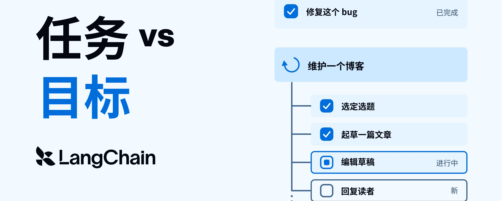
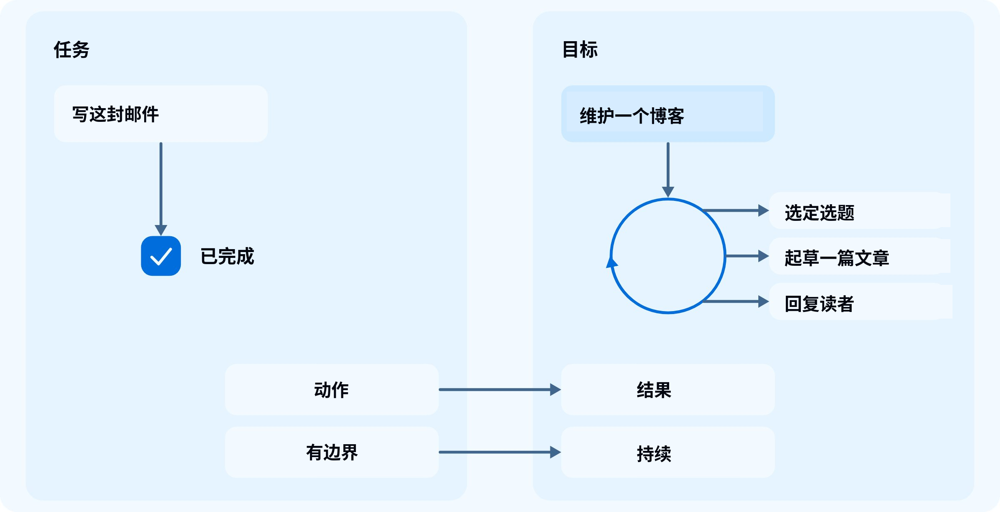
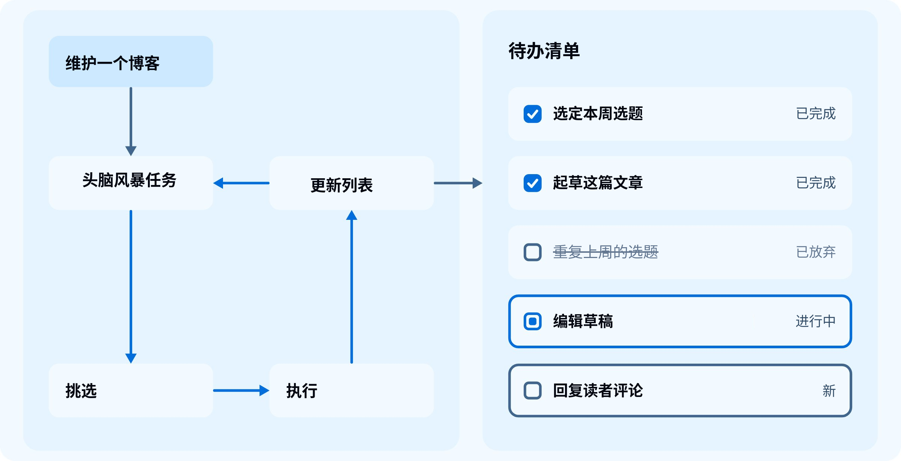
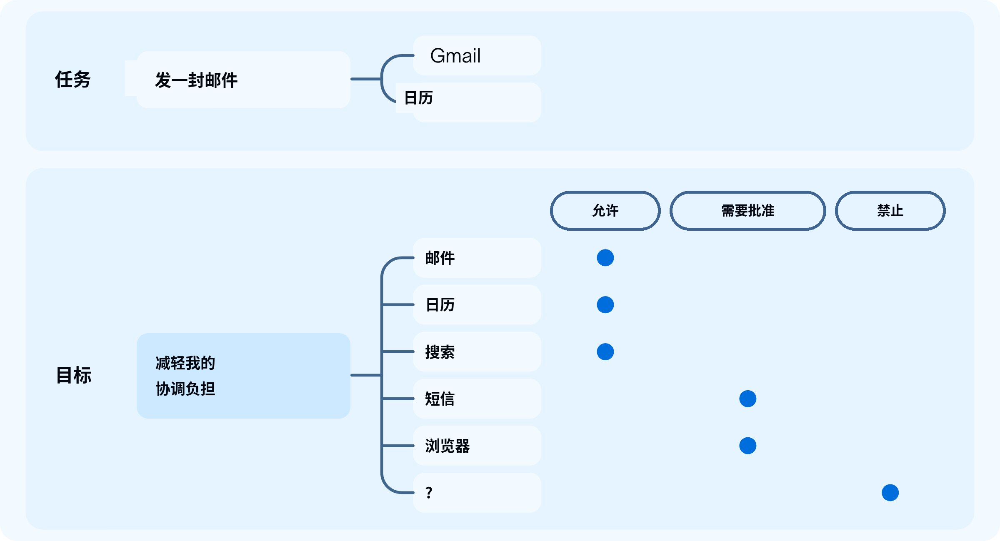
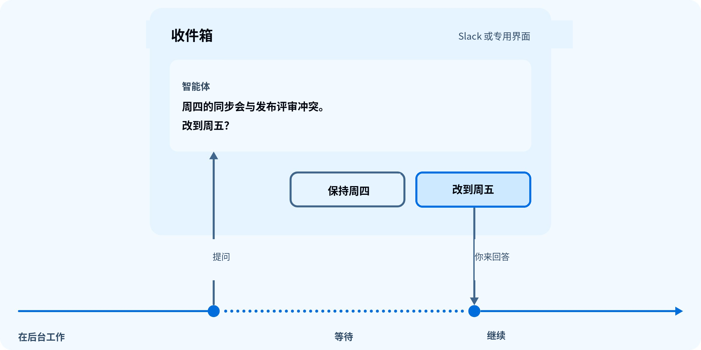
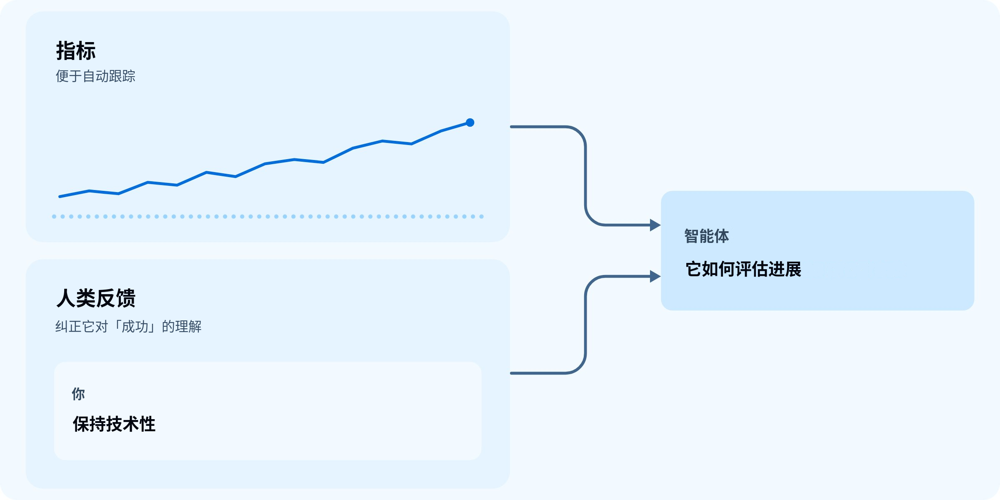
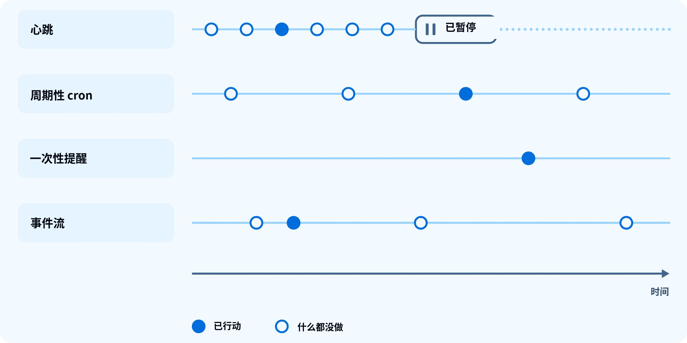
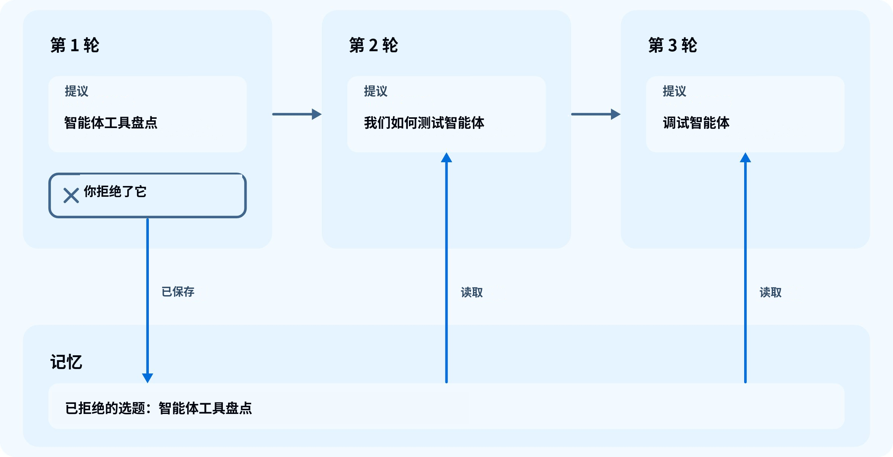

作者：Harrison Chase
原文：[From tasks to goals](https://x.com/hwchase17/status/2122391663889039828)
翻译 Url：https://github.com/samz406/local_wenzhang/blob/main/docs/从任务到目标/从任务到目标.md

# 从任务到目标

随着智能体变得更强大，我们正在从给它们布置任务，转向给它们设定目标。

任务是：

- 写这封邮件
- 起草这篇博客
- 修复这个 bug

目标是：

- **减轻我的协调负担，同时确保重要事项按计划推进**
- 维护一个博客
- 让这款产品获得成功

往底层看，从任务转向目标，其实包含两个更切实的转变：

- 从指定一个动作，变为指定一个结果
- 从一次有边界的指派，变为一项持续的职责

这会改变智能体做什么、它需要什么、如何被构建，以及我们如何与它互动。

## 智能体自己选择任务

以前，用户会指定任务。现在，用户设定一个目标，智能体则通过把目标拆成任务、执行其中一部分、更新任务列表等方式，迭代地朝这个目标推进。

智能体需要擅长头脑风暴，并选出不同的任务，这要求新的上下文工程（context engineering）和提示策略。在构思可能的任务时，它需要有几分创造力——并且要有变化（如果它一遍遍地总是建议同样的任务，那就很不妙）。

***实践要点：你需要某种方式看到智能体正在做哪些任务（例如一份待办清单），同时也要通过提示，让智能体在提出任务时保持创造力***

## 工具调用变得更难预知

当你给智能体一项任务时，你大体知道它会调用哪些工具。当你给它一个目标时——你其实并不知道它会调用哪些工具，甚至可能不知道它需要调用哪些工具。

例如：

- 如果你让智能体发一封邮件（任务），你知道它需要 Gmail 工具，也许还需要日历工具。
- 如果你让智能体去**减轻我的协调负担，同时确保重要事项按计划推进**（目标），你并不知道它何时会需要邮件、短信、搜索工具、浏览器工具，或可能还需要别的工具。

***实践要点：你需要对智能体可以或不可以调用哪些工具，施加更多控制***

## 用来提问的收件箱

当你给智能体一项任务时，你自然就在回路之中。如果你没有一开始就把信息给全，智能体很容易在对话里追问。

当你给智能体一个目标时——它可能在后台运行，并需要在某些点上得到澄清。它需要一种向人类提问的途径——无论是通过 Slack，还是专用界面。

**实践要点：你需要一种机制，让后台运行的智能体可以向你请求澄清**

## 获取反馈的途径

智能体在朝目标推进的过程中，需要知道自己做得怎么样。这既可以是对照一项指标，看它是否在改善；也可以是从人类那里获得关于表现的明确反馈。在某种意义上，越紧扣指标越好（方便它自动跟踪！），但盲目优化一项指标从来都不明智，所以明确的人类反馈也许才是最好的。正因如此，以易于给出反馈的方式来设计目标，就显得很重要。

你可以既为智能体设定它要推进的指标，也提供从用户那里获取反馈的途径。明确智能体将如何评估进展，并给人一种纠正它对「成功」之理解的方式。

**实践要点：你需要以与反馈对齐的方式来设计目标，同时建立一种让智能体能获得反馈的机制**

## 持续性工作需要触发机制（以及停止规则）

当你给智能体的是任务时，它们会一直运行到完成。

当你给它们的是一个目标时，它们需要在后台工作。它们并非一直在运行——而是时不时醒来做一些事。它们如何醒来？

我们见到的一些方法：

- 每隔 X 分钟一次的心跳（heartbeat）
- 周期性的 cron
- 一次性的 cron（提醒）
- 监听事件流

话虽如此，它也需要一种停止、暂停或忽略这些触发的办法。如果它每三十分钟收到一次心跳，却每次都向你重复同一个问题——那会是糟糕透顶的体验。

持续的职责，并不意味着智能体每次都该找点事情做。有时候，什么都不做才是正确的行动。

***实践要点：你需要 cron 和事件触发器来唤醒智能体，也需要通过提示让它决定何时行动。***

## 记忆让反馈产生复利

记忆听起来非常酷，过去几年也俘获了开发者的想象，但在以任务为主的世界里，它其实并没有那么必要（除非你在反复做同一项任务）。

对于单项任务，用户可以每次都提供相关上下文。当你把一项持续的职责委托出去，这部分负担就会更多地落到智能体身上。它需要把决策和反馈延续下去，而不要求你再重复一遍。

例如：拒绝一个博客选题，应当影响以后的选题，而不仅仅是当前这篇草稿。

***实践要点：智能体需要在多次运行之间保留并使用相关的决策与反馈。***

## 结语

给智能体一个目标，并不只是给它一段更长的提示。你是在把「做什么、何时做」的决策委托出去。你的角色，也从指定每一项任务，转向设定方向、划定边界、审阅进展。
