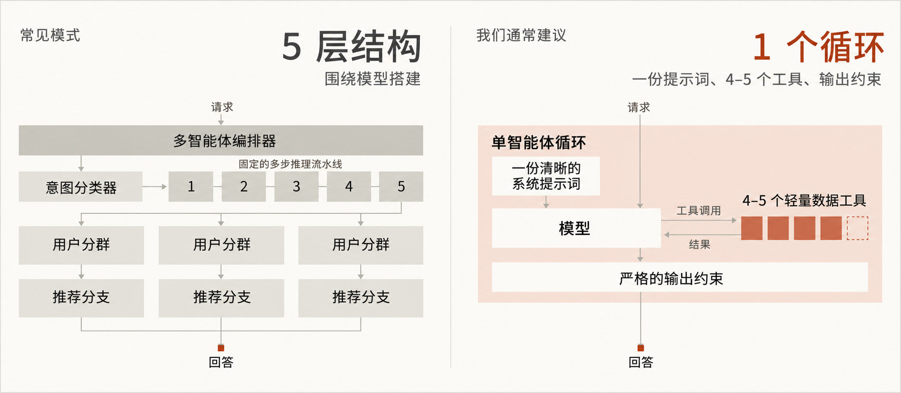
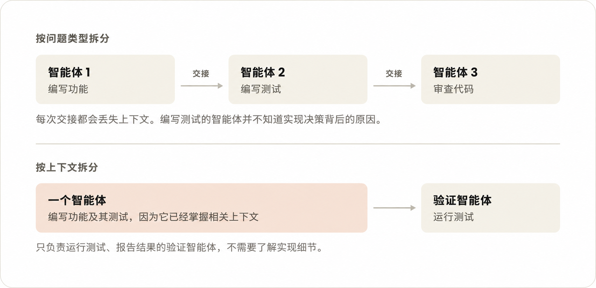
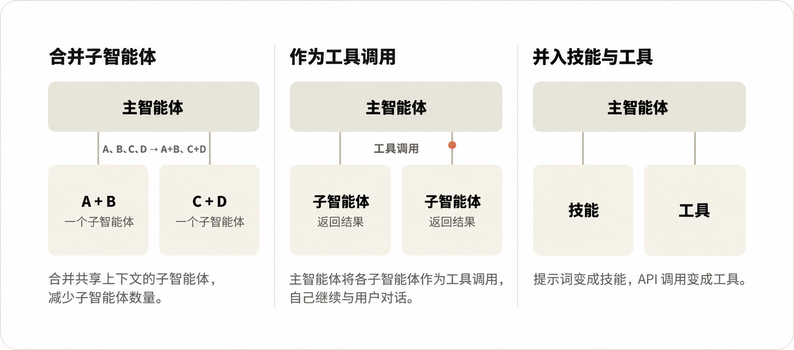

# 构建智能体：何时该把子智能体并入主循环

> 作者：Diane Sarkis（Anthropic）  
> 原文：[Building agents: When to fold subagents into your main agent loop](https://claude.com/resources/articles/building-agents-when-to-fold-subagents-into-your-main-agent-loop)  
> 翻译 Url：[https://github.com/samz406/local_wenzhang/blob/main/docs/何时把子智能体并入主循环/构建智能体-何时该把子智能体并入主循环.md](https://github.com/samz406/local_wenzhang/blob/main/docs/何时把子智能体并入主循环/构建智能体-何时该把子智能体并入主循环.md)  
> 发布日期：2026 年 10 月 22 日  
> 分类：最佳实践、观点｜产品：Claude Platform｜阅读时间：18 分钟

在 Claude Platform 上构建智能体时，减少子智能体，改为按需逐步加载上下文和工具，可能既能提高质量，又能降低成本和延迟。本文介绍何时值得迁移，以及具体怎么做。

*如果你已经在 Claude Platform 上构建了一个包含多个子智能体的系统，可以使用我们的[迁移工具包](https://github.com/anthropics/single-agent-loop-kit)，看看哪些子智能体适合并入主智能体循环。工具包会通过引导式工作流识别你采用的模式、评估替代方案，并验证哪种做法最好。它还附带演示，你可以先在模拟系统上试用，再用于自己的智能体。*

子智能体是智能体设计中的一个核心组成部分：它们各自拥有上下文窗口、工具和指令，[由一个协调者统一编排](https://claude.com/resources/articles/multi-agent-coordination-patterns)。子智能体擅长验证、并行工作，也便于按模块管理权限。我们自己使用 Claude Platform 构建的许多智能体也采用了子智能体，例如[多智能体研究系统](https://www.anthropic.com/engineering/multi-agent-research-system)。

不过，应用 AI 团队最近在企业智能体的实际部署中观察到一类情况：把路由、规划和领域子智能体并入主智能体循环，反而带来了收益。[我们对多个企业部署的比较发现](https://claude.com/resources/articles/the-anatomy-of-effective-commerce-agents#:~:text=In%20our%20comparisons%20across%20several%20enterprise%20deployments,latency%20per%20task)，[配备技能的单智能体](https://claude.com/resources/articles/building-agents-with-skills-equipping-agents-for-specialized-work)在质量上经常同时优于“一份提示词包办一切”的设计和子智能体设计，而且单次任务的成本和延迟往往也更低。

例如，一家公司发现，面向客户的智能体内部有十来个专职子智能体，这让它很难始终提供符合品牌调性的统一体验，还增加了延迟，损害了用户体验。

我们也经常看到一些智能体设计方案，沿着一条熟悉的路线不断堆叠：先加意图分类器，再加固定的多步推理流水线、用户分群、各自独立的推荐分支，最后再在上面放一个多智能体编排器。

这类方案收到的反馈往往是：其中大部分结构，都在替模型做它早已不需要别人代劳的事。一份清晰的系统提示词、4–5 个轻量数据工具，再加上严格的输出约束，就足以覆盖大部分使用场景。

当然，子智能体仍然有用武之地，包括前沿研究。以下情况适合使用子智能体：

- 单智能体循环因上下文膨胀而出现了可以测量的性能下降；或者
- 多项任务需要并行处理，每项任务都需要一个全新的上下文窗口，任务结束后即可丢弃；或者
- 单智能体难以选对工具，或系统提示词中存在相互冲突的指令。

但我们太常看到企业给每个团队、每类问题都配置一个子智能体，最后智能体架构成了组织架构图的翻版——康威定律就这样发挥了作用。

本文会结合我们在大型组织中构建智能体积累的最佳实践，说明何时应该考虑把子智能体并入主智能体循环。

## 大型组织构建智能体时常见的失败模式

企业往往希望构建一个智能体，把多种产品和能力整合到同一个面向客户的界面中。

通常，每种能力都归不同团队负责，于是企业先让各团队分别构建自己的智能体，再由中央平台团队在上面搭建编排器。具体结构可以有多种，例如“编排器—子智能体”，或由一个智能体将其他特定智能体作为 MCP 工具调用。

这看上去是最简单的方案，却会立刻带来几方面的复杂性：

- **上下文管理：** 你需要决定智能体之间交换哪些上下文，而信息在来回传递时经常会丢失细节。
- **子智能体泛滥：** 每个团队都发布自己的子智能体，企业最终可能积累数百个功能重叠的子智能体，既没有强制执行的标准，也没有明确的负责人。
- **东拼西凑的提示词：** 每个团队都往系统提示词里加一句，最后规则相互冲突，表达风格也无法统一。
- **未经审核、过度局部优化的评测：** 每个人都加入自己的评测，只顾把自己的子任务优化到最好。整套评测却无人负责、无人维护，管理层据以决策的，是被稀释、只能反映局部表现的分数。
- **延迟：** 多智能体架构的复杂性会增加延迟。一位客户将自己的多智能体运行框架（Harness）与单智能体循环进行比较，发现后者的运行速度大约快了一倍。

## 在智能体循环中按需逐步加载

前面提到的“编排器—子智能体”设计，是协调不同团队所构建的专职智能体的一种合理方式。不过，往往有更有效的做法：**通过技能按需逐步加载上下文，通过工具搜索按需逐步加载工具**。也就是说，智能体先看到技能和工具的简短描述，只有需要时，才加载完整内容。

这种做法之所以值得考虑，有三个原因：

- **共享上下文能带来更好的回答：** 对于长时间运行的智能体，我们希望不同任务产生的上下文都留在主上下文窗口里。一个看过前面每一步结果的智能体，能够把这些结果联系起来；相比接收各个子智能体返回的一组摘要，它能给出更丰富的输出和更深入的洞察。同时，[上下文窗口更少，交接造成的信息损失也更少](https://claude.com/resources/articles/building-multi-agent-systems-when-and-how-to-use-them)。
- **按需加载可以防止上下文膨胀：** 借助这种方式，团队可以构建能够完成多种任务的单智能体，而不必一开始就把全部上下文塞进一份冗长的系统提示词。这也就消除了团队过去把工作拆给多个子智能体的主要原因。事实上，面向更先进的模型，我们[将 Claude Code 的系统提示词缩短了 80% 以上](https://claude.dev/blog/the-new-rules-of-context-engineering-for-claude-5-generation-models/)，其中一部分精简就来自对技能和工具采用按需加载。
- **模型能力更强了：** 从 Opus 4.5 开始，模型在单个循环中能够处理的事情，就已经远超大多数团队的预期。Opus 5.5 和 Fable 5.1 无法关闭思考，而近期模型越来越多地会在工作过程中说明进展、检查自己的结果，这让运行框架中的某些部分变得多余。每一代新模型，都让你能够把更多决策从运行框架移交给模型本身。更简单的循环也更容易迁移到下一代模型；在我们协助客户完成的迁移中，僵化的多智能体结构，往往恰恰是阻碍新模型承担更多工作的因素。

单智能体循环的设计需要严格管理：系统提示词要精心维护，技能和工具的描述要能在正确的时机触发，上下文窗口、记忆和笔记机制也要有意识地设计。后文会进一步讨论迁移和设计时需要考虑的问题。

应该由一个中央团队负责端到端质量和系统提示词，在每个新工具和新评测上线前进行审核。这个中央团队保持精干，有助于加快迭代，也能降低大型组织内部的协调成本。

如果你选择多智能体路线，就从最简单、可能有效的模式开始，例如“生成器—验证器”“编排器—子智能体”等。合理划定边界的关键，是**按上下文拆分：给每个子智能体一项不太依赖系统其他部分的工作，让它返回精简的结果**。独立的研究方向、接口清晰的独立组件、黑盒验证，都是不错的候选。如果按问题类型拆分智能体，它们就会陷入“传话游戏”：信息来回传递，每交接一次，保真度就下降一点。

## 如何把子智能体并入主智能体循环

许多团队已经在生产环境中运行编排器和一组专职智能体。我们建议逐步演进到下面这样的单循环设计：

- 一个模型、一个上下文窗口，运行一个步骤不预先固定的工具循环；轮数预算、成本预算、写入控制关卡等限制，由运行框架设定。
- 每一轮，模型发出一批工具调用。运行框架并行执行这些调用，把原始结果返回给同一个模型，再由模型决定下一步：继续调用一批工具、向用户提问，或给出回答。
- 模型给出回答，或触及[预算上限](https://platform.claude.com/docs/en/build-with-claude/task-budgets)时，循环停止。回答之后，还可以按需增加目标达成检查，或由验证器进行检查。
- 模型在第一轮把计划写入上下文，并随着结果返回不断修订。这是相较于“编排器加专职智能体”设计的主要变化：制定计划和执行计划的是同一个模型，因此它可以在一轮执行过程中调整计划。
- 上下文仍然会被加载，但由智能体自己管理：
  - 不再需要由代码从一套规则目录中取出规则、据此改写计划，因为每一步都由模型决定。
  - 执行顺序和领域流程放入**技能**。
  - 硬性限制，例如校验、审批关卡，以及对话中途需要处理的其他事项，例如记忆查询，放入**工具**。
  - 对于加载成本低、几乎总会用到的内容，例如实体消歧步骤，仍然可以用代码加载；工具调用中那些机械性的环节，例如构造请求载荷、解析流式数据、在澄清后恢复执行，也可以由工具内部的代码处理。

这种单循环设计，也有助于实现许多团队努力追求的最终目标：让智能体理解用户的高层目标，并代表用户采取行动。因为智能体获得的全部信息，都保存在同一个上下文里。

下面这些建议，说明了团队如何分阶段从多智能体系统迁移到单智能体循环，以及在这个过程中，多个团队如何持续为同一个智能体贡献能力。

### 任务完成评测

第一步是建立一套评测，帮助你判断是否应该把某个子智能体并入主智能体循环。我们见过效果不错的组织方式是：由中央团队维护一套共享的端到端评测，各技能的负责团队再随技能交付规模较小的评测集。起步时，即便只有 10 个精心挑选的标准样例，也已经足够。

依据评分标准评价智能体的最终消息，是跟踪回答质量的一个不错起点。只要还保留编排器，就还应跟踪路由准确率：它是否选对了子智能体？子智能体并入主循环后，则改为检查智能体是否加载了正确的技能、调用了正确的工具。随着系统发展，应逐步建立以任务是否完成为核心的评测，因为比较架构时，这才是最重要的。

如果内部系统难以回放、用户互动难以模拟，这件事就可能很复杂。我们内部用过一种有效的方法：为重要事件记录时间戳，之后回放这些事件，将其用于有针对性的评测。

### 逐步减少子智能体

向单智能体循环演进，需要把子智能体的能力并入工具和技能。可以合并领域子智能体，可以把它们当作工具调用，也可以用技能和工具取代它们。

### 合并领域智能体

第一次合并之前，先构建一套小型端到端评测。然后**从使用最频繁的子智能体开始，依据共享上下文来合并**。

如果几个专职智能体会接续处理彼此的输出、访问相同的数据，或经常一起被调用，就考虑[合并它们](https://claude.com/resources/articles/building-multi-agent-systems-when-and-how-to-use-them)。例如，如果相当一部分生产流量都是先调用某个专职智能体，紧接着再调用另一个，这一对就属于紧密耦合，适合考虑合并成一个领域智能体。

### 把子智能体当作工具调用

如果符合前面提到的三个条件之一，你决定保留某个子智能体，那么可以让主智能体像调用工具一样调用它，自己继续维持与用户的对话。这往往是一种有效的安排。

只有当子智能体需要直接与用户交流时，我们才建议进行完整交接，让它接管对话。除此之外，都可以放到主循环中，以技能加工具的形式实现。

这样，你可以为子智能体定义统一的响应结构，由主智能体依据真实数据核验结论，并精简最终汇总步骤需要接收的输入。这是不错的第一步，因为你不需要**重写**子智能体。同时，你也能在决定是否进一步把子智能体并入主智能体之前，建立任务完成评测的**基线**。

不过，一些失败模式仍然存在：

- 每个专职智能体仍有自己的提示词、上下文、负责团队和评测。
- 每次调用返回的仍然是一份有信息损失的摘要。
- 每次调用仍然会嵌套一层模型循环，增加延迟。

### 通过技能和工具，把子智能体并入主智能体

一次并入一个子智能体：把它的提示词转为技能，把 API 调用转为 MCP 工具。比较保留和移除这个子智能体时的评测表现，再决定该保留哪种设计。

比较时，不要只看最终分数，还要查看哪些任务的成败发生了变化。我们曾在一个客服智能体样例上做过测试：把一个子智能体并入另一个之后，延迟降低了，但一个原本能够通过的流程却出了问题。主智能体拿着订单查询工具就自行作答，没有向配送专职智能体询问送达日期。

每次修改之前，都要确保评测覆盖生产环境中所有会共同运行的智能体调用链，以及智能体绝不能违反的每一条规则。每个任务还要多跑几次，因为上面这种故障，在两次运行中只出现了一次。

## 多个团队如何共同建设一个智能体

领域推理所需的内容，可以从知识库、技能和 MCP 工具中获取。各团队可以把职责从维护智能体转向维护技能和工具，由一个精干的中央团队继续负责系统提示词和端到端质量。这也意味着，新技能、新工具和新评测都要经过审核才能上线。

### MCP 工具

当智能体需要执行操作、从系统读取实时数据，或以固定结构返回结果时，适合使用工具。在迁移期间，也可以通过工具继续调用子智能体。我们建议按用户意图组织工具，而不是每个 API 都对应一个工具，因为一旦系统提示词中的工具定义超过 30–50 个，工具选择的表现往往就会下降。

使用支持延迟加载的[工具搜索](https://platform.claude.com/docs/en/agents-and-tools/tool-use/tool-search-tool)，减少硬性前置条件；确实需要的前置条件，则放进工具内部。例如，Y 需要 X 的输出，就让 Y 的工具检查该输出是否存在，并返回模型能够据此行动的指令。按用户设置的权限也一样：每个工具自行检查调用者可以查看什么、执行什么；不允许时，就返回模型能读懂的明确拒绝信息。这样，同一个循环就能服务权限不同的用户，不必为每个权限级别单独建一个智能体。

### 技能

当智能体需要了解一个团队如何开展工作时，适合使用技能，例如原先放在专职子智能体提示词中的操作步骤、规则，以及需要作出的判断。

扩展技能库时，我们的做法是把维护工作交还给技能的编写者。Claude 可以承担其中繁重的工作：使用能够创建、测试和精简其他技能的技能。

为了避免技能泛滥，可以让各团队的直接负责人（DRI）对本团队的技能负责，确保每项技能都经过精心编写、职责清晰且不与其他技能重复，并附带合适的评测。

- **`/skill-creator`** 可以帮助你创建结构规范的新技能，也可以审核现有技能，对其进行精简、去重和重组。
- **`/skill-doctor`** 可以让你了解技能库中每项技能的成本、实际使用频率，并删除那些徒增负担的内容。

### 知识库

对于智能体只是偶尔才需要的参考材料，适合使用知识库。事实和参考资料，例如政策、指标定义、产品规格，可以放在模型能够调用的搜索或查询工具背后，也可以作为参考文件随技能一起交付。避免[由代码检索这些上下文，再将其直接粘贴进提示词](https://claude.com/resources/articles/seeing-like-an-agent)。

## 帮你加快这项工作的工具

我们最近[发布](https://code.claude.com/docs/en/commands)了一组 Claude API 技能，可以协助完成前文提到的大部分工作。[迁移工具包](https://github.com/anthropics/single-agent-loop-kit)把这些技能串成一套引导式工作流，用于评估多智能体系统，并将其迁移到单智能体循环。工具包还附带演示，你可以先试用，再用于真实系统：

- **`/claude-api build-eval`：** 可以帮助中央团队建立第一套端到端评测，也可以帮助各团队构建随技能一起交付的小型评测。
- **`/claude-api prompt-audit`：** 可以找出提示词、技能和工具描述中为旧模型编写的指令，并以差异对比的形式提出修改建议。你可以用它审查系统提示词，找出哪些规则是为早期模型添加的，如今却拖慢了智能体，或让它变得僵化。各团队的直接负责人也可以用它检查自己的技能和工具描述。
- **`/claude-api hillclimb`：** 可以依据现有评测，迭代改进应用。它既可用于优化系统提示词，也可用于比较“并入主循环”和“保留子智能体”两种方案：把一个子智能体转为技能加工具后，让它迭代改进技能和工具描述，看看并入后的版本能否达到甚至超过原子智能体的表现。
- **`/claude-api cost-optimize`：** 分析调用的开销分布，并从提示词缓存、删减不必要的输入输出 token、调整推理投入程度、选择模型等选项中，一次提出一项节省成本的改动。这有助于在既定设计下进一步降低成本和延迟。

模型在演进，我们对如何最好地使用模型的认识，以及相应的最佳实践建议，也会随之改变。因此，任何一种具体架构，都不如背后的原则重要：衡量效果，一次只改一件事，留下经得起检验的做法。

这里讨论的就是这样一种情况。随着模型能力增强、智能体运行时间变长，你的更多子智能体都可以转为技能和工具。不过，你不必一步到位。先构建一套小型端到端评测，再并入一个子智能体；只有并入后的版本得分更低时，才继续保留它作为子智能体。然后重复这个过程。
