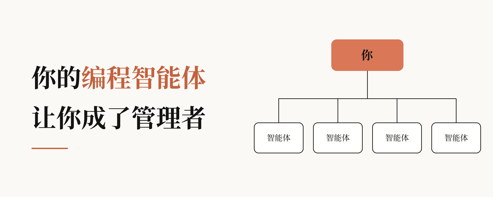
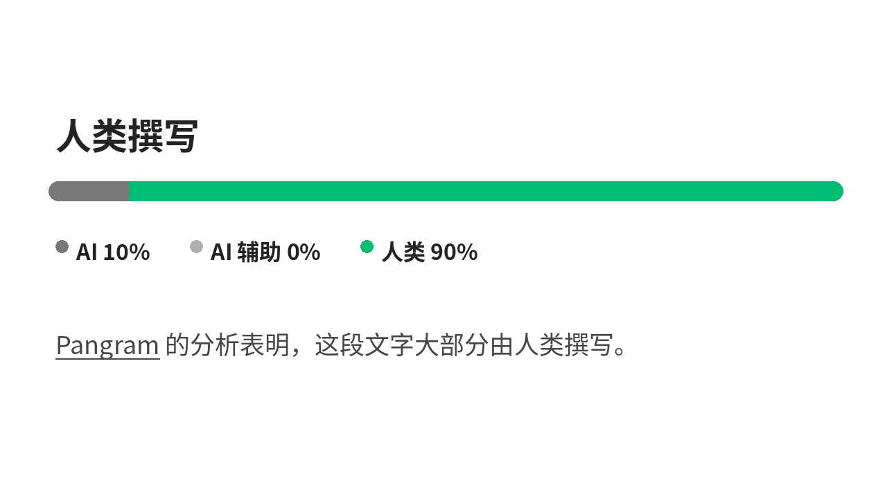

# 你的编程智能体让你成了管理者

> 作者：Addy Osmani（[@addyosmani](https://x.com/addyosmani)）  
> 原文：[Your coding agents made you a manager](https://x.com/addyosmani/status/2119332146485891501)  
> 翻译 Url：[https://github.com/samz406/local_wenzhang/blob/main/docs/你的编程智能体让你成了管理者/你的编程智能体让你成了管理者.md](https://github.com/samz406/local_wenzhang/blob/main/docs/你的编程智能体让你成了管理者/你的编程智能体让你成了管理者.md)



*管理智能体的技能，基本上就是带团队的技能——你不必先当上管理者，也能学会它们。*

如果你整天都在跟编程智能体打交道，那你就是在做管理。你一遍遍地选任务、写指令、委派、跟进、评估结果，再决定什么可以上线。把智能体用得最充分的工程师，不一定是最会写提示词的那些人。他们是学会了如何管理的人——有意也好，无意也罢。

这个说法可能不太受欢迎。我欣赏的许多工程师选择了个人贡献者（IC）这条路，就是为了贴近具体工作。他们看着朋友当上管理者之后，整个人淹没在日历里。但我不是在劝你变成那种管理者。我这里说的「管理」，含义很具体：通过让别人把活干好，来产出好结果。我也绝不是说，智能体可以替代管理者或同事。

你对糟糕管理者的每一条抱怨，都是一份关于「如何与智能体协作」的缺陷报告。想想交接。如果你经历过糟糕的交接，收到的可能是含糊的需求、缺失的上下文，或是不断改口的期望。对 IC 来说，好消息是：你这些年一直站在交接的接收端，大概知道一次好的交接长什么样。

我以前写过，[你的编程智能体也需要一位管理者](https://addyosmani.com/blog/coding-agents-manager/)。我也写过委托背后那些不声不响的风险——[认知投降](https://addyosmani.com/blog/cognitive-surrender/)。这篇文章把优秀工程管理者的做法，和我们在使用、打造 Claude Code 的过程中学到的东西对照起来。各节大致按影响力排序，所以杠杆最高的习惯放在最前面。

## 给它一条验证自己工作的路径

**最佳实践：** 给智能体一种验证自身工作的机制——测试套件、构建，或截图——并让它把结果当作证据给你看。

**反模式：** 把「看起来做完了」当成确认。这会迫使你承担全部验证，自己变成智能体的测试套件。

问问有经验的管理者：不把所有东西都读一遍，怎么能确信团队产出了好东西？他们会谈护栏。CI、代码评审、仪表盘、on-call，诸如此类。不建护栏的新手管理者，最后只能自己验证一切，不出一个季度就会成为瓶颈。智能体也是一样。正如 [Claude Code 最佳实践指南](https://code.claude.com/docs/en/best-practices) 所说，智能体在工作「看起来做完了」时就会停下来。如果没有验证，「看起来做完了」就是它仅有的验证。提供验证机制，智能体就能自己干活、跑验证器、看到失败、再自行修正。如果是 UI 改动，这可能意味着真正在浏览器里打开页面，迭代到能用、也好看为止。

验证机制几乎可以是任何东西，只要它能给出明确的通过/失败结果。比如测试、构建退出码、linter、diff 脚本，以及截图。指南指出：运行这些验证的那条命令，是你能写进 CLAUDE.md（智能体每次会话开始时读取的指令文件）里最有用的一行。有了验证机制之后，可以用这些方式把它带进工作流：

- **开口要求。** 「做完后跑 auth 测试，一直跑到通过为止。」
- **设定目标。** 用 /goal，会由另一个模型在每一轮之后做条件检查，最适合长时间的后台工作。
- **强制执行。** Stop hook 可以拦住这一轮，直到 typecheck 通过才让它结束。
- **发起评审。** /code-review 会把 diff 发给一个没看过你们对话的新子智能体去评审——就像作者不会批准自己的 PR。

你甚至可以控制评审的范围。如果你让它找问题，它总会找出点什么。但如果你让它找正确性问题、忽略风格，它就会照做。优秀的管理者学着征求反馈时，也是这个路数。Claude Code 工具箱里的大部分功能，都是为了把这个回路收得更紧。Skills、hooks、子智能体和 MCP，都是为了弥合「把活干完」和「验证活干得对不对」之间的空隙，好让你只把注意力放在智能体无法自行验证的事情上。有经验的工程管理者，做的也是这件事。

## 把上下文讲清楚

**最佳实践：** 把智能体单靠查看仓库无法知道的内容，清清楚楚地写出来，包括：任务目标及为何重要、约束、范围外事项，以及成功标准。

**反模式：** 只丢过去一行任务，真正的期望全在你脑子里；或者把智能体读代码就能发现的东西，也一股脑塞进简报。

有效的管理者会把期望的结果、约束和目标讲清楚。他们说清这项工作要达成什么，但把「怎么做」的自由度留给做事的人。在军队里，这叫指挥官意图（commander's intent）。在 Netflix，这叫「情境，而非控制」（context, not control）。

跟智能体协作的难点在于：你很难知道它缺了哪些上下文。编程智能体接到任务后，第一件事就是读你的代码。当下的模型非常擅长抓住你的目录结构、约定和测试配置，而且比你口述快得多。

落笔之前，先想想智能体自己能搞清楚什么。如果它能在代码里读到，而且它确实会去读，你就不必再说。把字数花在仓库里没有的东西上——比如一次会议的决定、某个人内部的部署流程、为什么这项任务重要，以及这一次怎样才算做完。

我们拿一个含糊的任务「把仪表盘做得更快」为例，把它写成一条提示。这里的数字只是举例。

```bash
将拥有 10k+ 成员的组织的 /team 仪表盘 p95 加载时间降到 2 秒以内。

原因：企业管理员每天都会打开它，加载慢是他们反馈最多的支持工单。

约束：不改 schema；保持 API 响应结构不变。

范围外：UI 改动；整页缓存。
验收：运行 scripts/perf/team.sh，并给出优化前后的数字。
```

不是每个任务都得这么做。如果是在做探索性工作，写一条笼统的提示完全没问题。你会边做边再打磨一点。如果你还写不出提示，就让智能体采访你，直到它能写出规格说明，把规格存成文件，然后开一个新会话，让智能体按这份规格去实现。之后你还可以拿这份规格来对照评审。

你可能还需要给智能体开通其他工具的权限，比如 issue 跟踪器、错误仪表盘，或团队聊天。对待智能体，就像对待团队里的一名新同事。如果是它已经认识的 CLI 工具，比如 gh，你往往什么都不用交代。

## 让每一次纠正都产生复利

**最佳实践：** 同一件事纠正超过一次，就写进团队的 [CLAUDE.md](http://claude.md/)，或做成共享 skill。随着时间推移，检查更新的模型是否降低了这些纠正的必要性。

**反模式：** 每个会话都手动纠正同一件事，或依赖只存在于你自己机器上的隐性知识。

把 CLAUDE.md 用到极致的团队，会隔三差五更新它，并把那些值得防范的教训写下来。有些团队甚至在代码评审里 @claude，把反馈变成一条长期政策。CLAUDE.md 要保持简洁。下面这些内容适合写进去：

- 如何验证某件事（给出确切命令）
- 代码里容易误导人的地方
- 仓库里找不到的决策
- 你纠正过两次的任何事情

这些都体现了书面信息的复利：人会换团队，模型会被替换，写下来的东西却能留下来。

## 让它自己做决定，只强制那些不能通融的事

**最佳实践：** 默认让智能体自己做决定，只对少数必须永远发生或永远不能发生的事使用硬性强制（例如 hooks、deny 规则）。

**反模式：** 用全大写写规则，给可有可无的偏好也定义 hooks，或在新模型早已超越旧习惯之后，还抱着旧模型时代的做法不放。

安迪·格鲁夫（Andy Grove）在《高产出管理》（*High Output Management*）里把这称作任务相关成熟度（task-relevant maturity）：监督的力度，应当取决于一个人在那项具体任务上的既往表现，而不是他的整体能力。

给新管理者的一条老建议说的是同一件事：给人的自由度，要比你觉得舒服的范围再大一点，同时为他们撑腰，也要他们负责。

Claude Code 把这一点说得很明白：提示、CLAUDE.md 和 skills 是请求——模型可以考虑，并选择是否照做；hooks、deny 规则和托管设置则是要求——始终会被强制执行。大多数情况下，你希望由智能体来拍板。很多时候，模型看着真实代码，比你事先定下的规则更适合判断某条指南是否适用。用强制手段去设硬性要求，比如「永远不要改生成出来的 client」或「始终运行 license-header 脚本」。特别是，新的终端和 VS Code 会话会以自动模式启动，并带有一个分类器，会过滤掉不安全的行为，比如部署到生产环境，或 force push 覆盖别人的工作。

指南的建议有两面。如果你已经在 CLAUDE.md 的某一行上加重语气，智能体却还是没领会，那就应该做成 hook。如果一个 hook 表达的是偏好而不是要求，就该删掉它，让智能体自己拿主意。这就像团队决定废止一个不再有用的流程。这也意味着换了新模型时要做调整。指南列了一份可以停掉的习惯：全大写指令、「think harder」（现在努力程度是一项设置了），以及「don't be lazy」。对当下的模型来说，这些往往会导致规则过严、工作过度。跟智能体协作时，流程过多就是新的微观管理。

## 先规划，再构建

**最佳实践：** 在智能体开始写代码之前，先敲定一份双方认可的计划，审读其中隐含的假设，并把任务拆成互不重叠的并行工作。

**反模式：** 让多个智能体同时处理互相重叠的任务，然后把下午耗在解决合并冲突和重复决策上。

这里有一套不错的工作流：先进入 plan mode，把计划迭代到正确为止，再把编码委派出去。计划够好的话，模型常常能一遍就全部实现。对于更大的任务，另开一个会话，像 staff 工程师那样审一遍计划；这就是设计评审，也是抓住走偏成本最低的地方。审计划时，要盯隐含的假设（放在 1:1 里，这就相当于问：「你有哪些拿不准的地方？」）。

拆解工作，越来越多地被委派给智能体。Claude Code 的 /batch 会把一次大型机械式改动拆成 5 到 30 个任务，展示计划，在各自的 worktree（仓库的独立检出）里执行，并为每一个创建 PR。你不再需要亲自划分工作，只需检查各切片有没有重叠，并确保共享接口先落地。没有这一步，你得到的可能是虚假的并行。五个智能体接手互相重叠的任务，不会带来五倍产出，只会带来一场有五个作者的合并冲突。

## 及早纠偏，尽快重置

**最佳实践：** 盯住第一分钟，给智能体掌舵。一旦发现它走偏，立刻纠正。如果你已经两次纠正失败，就开一个新会话、用更好的提示重新开始。

**反模式：** 第三次、第四次去纠正智能体，而不是去改请求本身。

有经验的管理者知道：如果一个能干的人连续失手，问题可能出在上游——指令、上下文或范围。智能体这边的版本很明确：它一走偏，就按 Esc。如果你已经两次纠正失败，就清空会话，写一条更好的提示，把你学到的教训写进去。第三次纠正，多半只是给模型添了更多必须反复重读、再处理的信息（包括那些失败的尝试）。

低成本回滚也在改变游戏规则。/rewind 可以把代码和对话滚回到更早的时间点，让你先试一条更大胆的路，而不必承担太大风险。好的管理者对员工也是这样做的：如果撤销一个错误很便宜，就让他们去试更大胆的方案。然后做一次复盘，如果适用，就把修复抽象进 CLAUDE.md。

## 委派任务，但绝不委派判断

**最佳实践：** 智能体干活，重要的事你来拍板：产品决策、安全边界、什么可以上线。把每一份 diff 都当成你会因此被叫起来处理故障那样来对待。

**反模式：** 因为测试是绿的、名字看起来也合理，就批准大份 diff。这不是代码评审，这是代码盖章。

没有哪个管理者能说「那是我下属发的，不是我」。你跑的每一个智能体也是如此。我自己也掉进过这个坑。我让一个智能体去研究与竞品的差距，并写本地 PR 来补上这些差距。我读了研究报告，略读了代码，差点就把那些给用户增加了复杂度、收益却很小的改动推上去。我把活委派出去了，也差点把决定一并委派出去。这是个很容易掉进去的坑：一份 600 行的 diff，名字看起来合理，测试是绿的，批准。

这样拆分任务是合理的：让智能体去做风格、lint、评审后续、常见 bug 和单元测试，但安全边界、合规和产品决策交给人来处理。

协调也是同一道理。智能体可以跟踪交接，但在互相竞争的请求之间做取舍、让人们真正承诺下来，仍然是人的工作。

你不必处在每一次改动的内循环里。你真正需要盯住的是外循环：约束是什么、输出你实际读了多少、你保留哪些证据、哪些必须由人签字放行。另外，改动要保持小——因为评审的单位，就是理解的单位。

## 设计一次不需要你在场的运行

**最佳实践：** 在部署一项自主任务之前，先定义「做完」长什么样、自我验证、边界、护栏，以及需要人批准的环节。

**反模式：** 睡前启动一个长时间运行的进程，既没有「做完」的定义，也没有停止点，第二天早上醒来才发现，模型整晚都在一个错误的前提上埋头苦干。

隔级管理者不直接管理单个工程师的具体工作；他们管理的是目标、护栏、检查点和负责人。AI 智能体正沿着类似的轨迹前进。它们已经在把任务的一部分委派给子智能体，也能按计划、在 CI 失败后或新的 pull request 打开后自主运行。前沿是能够自主启动、自我验证、只在需要做决策时才呼叫人类介入的自治系统。

角色从「控制这一次会话」转向「设计你的回路」。设计一次无人值守的运行时，问自己的五个问题，和一个好管理者在把项目交给资深工程师、自己去休假之前会问的，是同一批：

- **它知不知道「做完」长什么样？**（目标条件、规格文件，或一个必须变绿的失败测试。）
- **它有没有自我验证机制？**（测试套件、Stop hook，或评审步骤。）
- **它的边界是什么？**（权限控制、sandbox、worktree，或它被允许 push 的那一个分支。）
- **它的护栏是什么？**（轮次上限或花费上限。）
- **输出产生在哪里，谁来批准？**（一份 PR 或摘要，以及对任何不可逆操作的人工批准。）

指南里还有两个管理者会觉得眼熟的好习惯：先试点，也就是让一个批量任务先在三个文件上跑，迭代提示，再跑剩下的；以及任何新东西，先看着跑前几次，再放心让它无人值守。把它想成试用期。

## 扩展验证，而不是注意力

**最佳实践：** 扩大智能体的使用规模，只能和检查、目标、以及带着全新上下文的评审者接管盯梢的速度一样快；除了吞吐量，还要衡量质量。

**反模式：** 打开的会话比你能认真评审的还多，并用 AI 写了多少代码来衡量成败。

管理者很快就会摸清自己的管理幅度。超过一定数量的直接下属，每个人分到的管理者就变少，质量就会下降。智能体也是如此。我称之为编排税（orchestration tax）：过了最初的几个智能体，每再多一个，需要你投入的注意力都比上一个更多。大多数日子里，我会跑四五个后台智能体，外加几个本地会话，有些日子这就已经太多了。

管理大量会话，靠的不是超级专注，而是把大部分盯梢委派给自我评估、目标和带着新上下文的评审者，把注意力留给决策。用通知代替轮询，再加一个后台任务的集中视图，也会有帮助。你没法靠「盯得更多」来扩展智能体的数量，只能靠「需要盯得更少」。然后衡量的是系统，而不是活动。有用的指标包括：PR 的周期时间、新员工的上手时间，以及回滚或返工的频率。把 AI 编写代码的百分比当成目标没什么用，因为你真正要的是质量和可靠性。格鲁夫「带着制衡指标一起衡量」的法则在这里适用：如果你衡量合并了多少 PR，那就同时衡量回滚和返工。

## 决定什么不去构建

**最佳实践：** 问清楚谁需要它、你怎么知道它奏效了、什么情况下该停手，并限制 WIP。

**反模式：** 每个说得通的想法都丢进一份 PR——反正构建很便宜。你现在多了一个杂物抽屉，团队还得去评审、加固和维护。

管理者常说的最重要的一个词，往往是「不」。有了智能体，说「不」变得更难。开工几乎零成本，任何一个说得通的想法，午饭前都能丢进一份 PR。可这样一来，团队就多了一堆需要评审、加固、支持和维护的 PR。现在稀缺的资源是评审和验证。

事实上，那些老派的管理问题，现在比以往更重要。谁提出来的？我们怎么衡量成功？我们怎么知道该停手了？如果构建很便宜，难的就不是「我们能不能做？」，而是「我们该不该做？」

## 类比在哪里失效

**最佳实践：** 遵循管理上的最佳实践，但要考虑到智能体模型的不同之处：返工几乎免费、它们有多快就会同意你，以及每发布一个新模型就会变化的能力强弱。

**反模式：** 以为智能体就跟初级开发者一样，或以为你能跑五个智能体，就准备好管理五个人了。

这个类比有用，但并不完美。这件事做得最好的人，清楚它在哪些地方不成立：

- **管理人更难，这些技能也无法反向迁移。** 你能跑五个智能体，并不等于你准备好管理五个人了。激励、冲突、职业发展，或长达数月的信任建立，在智能体这边没有对应物。
- **返工几乎免费。** 你可以问智能体一些你绝不会拿去问一个人的事情。如果白板前发生了一场技术争论，智能体可以做出两三种方案，你再来比较。
- **智能体没有经验，只有一本笔记本。** 自动记忆只在一台机器上记笔记。它们不会迁移到同事的会话里。这不是你在职业生涯中积累起来的经验和判断力，你需要把这些教训写下来，留给整个团队。
- **智能体既殷勤又自信。** 如果你让一个优秀的工程师去做一件错事，他们会反驳。智能体更可能照你说的去做，而你也更容易过度信任它们。在沃顿关于认知投降的研究中，参与者大多数时候接受了有缺陷的 AI 答案，而且变得更加自信。你可以让智能体反驳自己的答案，来对冲这种过度自信。
- **你只有一种智能体原型，而且每隔几个月就会变。** 人类团队有多样化的技能和优势。你所有的智能体都有相同的长处和短处，并且会随着每次模型发布而变化。
- **你仍然得培养初级开发者。** 当智能体接管了初级开发者用来掌握这门手艺基本功的入门工作，你就必须有意识地为他们创造这些练习——作为管理者。
- **人类团队依然重要。** 有时候你会花一整天管理智能体，却没意识到自己挤掉了打造一个有凝聚力的团队所需的时间。别这样。

## 你不需要那个头衔

**最佳实践：** 把精力放在让好软件真正发生上：设定上下文、定义「做完」，以及做好评审。

**反模式：** 一边跑着交代不清、无人检查的智能体，一边用代码行数来评价自己。

优秀的 staff 工程师一直都是这样。他们写设计文档。他们设定上下文。他们做彻底的评审。他们让周围的人变得更好。智能体让所有工程师从第一天起就能这样做。它们给你上了一堂管理速成课。反馈以分钟计，而不是以季度计。你还可以撤销自己的错误。这份工作正变得不再那么关乎亲自写代码，而更多地关乎成为好代码得以写成的原因。

没有人生来就是伟大的管理者（或伟大的工程师）。你积累技能的方式和以往一样：靠练习。只不过有了智能体，练习很便宜。

不妨试试这些做法：

- 每个任务都需要一项它能自己跑的检查。把证据要过来。
- 告诉智能体它看不见的东西，它能看见的就别说了。
- 写代码之前，先把计划过一遍。
- 同一件事纠正过两次？记进 CLAUDE.md。反复出现的工作流？做成 skills。
- 两次纠正都失败了？重启，并改写提示。
- 评审 diff 时，就像你会因此被叫起来处理故障一样。

你不必渴望成为一名管理者。但那些把智能体用得好的工程师，都会在这个过程中学会管理。


