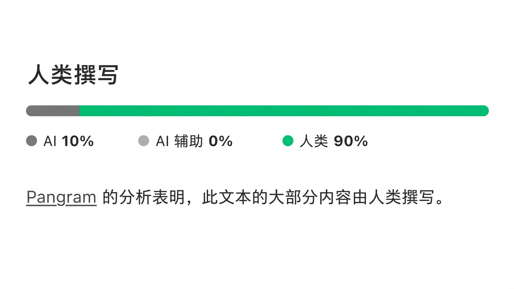

# 当智能体代劳时，如何保持批判性思维

> 作者：Addy Osmani（[@addyosmani](https://x.com/addyosmani)）  
> 原文：[Critical thinking when agents do the work](https://x.com/addyosmani/status/2117512471930167377)  
> 翻译 Url：[https://github.com/samz406/local_wenzhang/blob/main/docs/当智能体代劳时-如何保持批判性思维/当智能体代劳时-如何保持批判性思维.md](https://github.com/samz406/local_wenzhang/blob/main/docs/当智能体代劳时-如何保持批判性思维/当智能体代劳时-如何保持批判性思维.md)

早些年，批判性思维被教成这样：带着谦逊的好奇和适量怀疑去面对新信息——吸收不同观点，再形成自己的判断。这一点至今没变。

可越来越明显的是：眼下我日常工作里，几乎没什么会逼着我再去批判性思考——因为大量工作已经交由智能体（agents）跑起来了。

写给那些已经彻底拥抱智能体工作流的工程师和产品人（并行开多个会话、指望模型继续变强）：我本人是这类工具的铁粉。写这篇文章，不是为了劝大家少用智能体。

我的目标是：在「随便什么都能甩给智能体」变得太容易的世界里，帮你把批判性思维守住。

过去，我们大部分认知与审美加工，发生在「提问」和「得到答案」之间的那段空隙里。现在这段空隙以秒计。你越依赖智能体工作流，这件事就越难——但难的方式，未必是很多人预想的那种：模型越强，一眼就能看出的错误越少。许多（或许是大多数）输出会写得很像样、大体正确，却不再会逼你多看一眼。

哪怕你同时开着许多智能体，盯着输出的眼睛，终归只有一双。

你必须把批判性思维嵌进日常，因为默认情况下，不会有任何东西替你这么做。

这件事之所以难自我校正，部分原因是：智能体工作流太舒服了。在忙碌的一天里，快速、顺眼、常常还挺正确的答案很解渴——也正因为此，警觉才更容易松懈。

## 认知卸载、认知移交与认知投降

跟人聊这件事时，我习惯把它说成一条光谱：

最上端：认知卸载（cognitive offloading）——把任务委托给 AI，但结果的所有权仍在你手里。我整天都在这么干，你也应该这么干。中间：认知移交（deferral）——工具的输出变成了你的新输入；结果不再是「待检验的假说」。最下端：认知投降（cognitive surrender）——AI 的输出悄然变成了「你的」输出，你觉得没必要再核对。

「认知投降」这个词，由沃顿的 Steven Shaw 与 Gideon Nave 提出。它精准对上了我一路看到的现象：信任（或懒惰）上升时，人们会沿着光谱往下滑。这个过渡很少被察觉，因为每一步都渐进，而且看起来都挺合理。上一份答案你认真读过了，下一份就略读；再下一份，你只扫一眼骨架。然后有人问起某一行，你解释不出来——即便有智能体帮忙也不行。

这就是认知投降。认知债（cognitive debt）就是这样堆积起来的。通常要等你试图套用对系统的心智模型、却发现模型根本不存在时，才会被发现。Margaret-Anne Storey 写过，这在团队里会表现为对「共享系统理论」理解的侵蚀。我写过代码侧的对应物：理解债（comprehension debt，由 Jeremy Twei 提出的说法）。当下它完全隐形：代码库看起来干干净净，测试也全绿。直到你要对系统动手改动，才发现已经没人真正懂它了。策略文档或规格说明书只扫过目录就签字，也会落到同样的境地。

先说清楚：我不是在鼓吹做不到的事。在大型现代代码库里，维持完整心智模型本来就不可能。Claude Code 团队公开说过，他们是按需重建理解的：需要弄懂某一块时，就让 Claude 解释那一片，而不是把整套模型常驻在脑子里。我以前也写过，这类债的可恢复程度，往往高于多数工程师的预期。你不必维持完整模型，只要能在需要时局部重建就行——你只需要知道，自己手里缺什么。

利害低的时候，尽可整段委托出去。可一旦某个答案你解释不清——即便有智能体帮忙也不行——你就已经让出了所有权。这也不总是问题。就在不久前，我录一门课，要从三家评分差不多的酒店里选一个当录制地点。我没时间逐条翻评论，就把决定交给了 AI。效果不错，下次我还会这么干。但我不会这么做：决定怎么投资我们的钱、怎么给孩子做职业建议，或在工作里——该做什么、改动会影响哪些用户、能不能安全上线。错误代价低的地方，把接力棒交出去；后果要由别人承担的地方，把推理权留在自己手里。

## 我问自己的那些问题

以前拿不准自己怎么想时，我常会回到这样一张基础问题清单：我怎么知道自己在解正确的问题？我怎么知道解法对路？有没有证据支撑我的结论？我怎么知道自己做完了？多数时候，无非就是谁、什么、哪里、为什么、何时、怎么做。写出来显得幼稚得离谱，但它会逼你按那些本来容易忽略的类别去想。如今太容易跳过这一切，直接问智能体「你觉得我该怎么办」。下面是我现在问自己的「新版」问题。

**发问之前，我有没有先形成假说？** 在非琐碎任务上跑智能体之前，我会先写下——哪怕只在脑子里——我认为答案大概会是什么。猜得很烂也没关系。有了新信息，随时可以改主意。可一旦你读过一份写得很漂亮的回答，就很难再想象别的可能性。若你完全没有方向，可以按 Thariq Shihipar 所说，做一次盲区扫描（blind spot pass）：把你已知的交给模型，让它找出你的未知的未知。

**我是在请它帮我思考，还是把思考从我身上卸掉？** 两者都可以，只要你清楚自己在做哪一种。

**要怎样才会是错的？** 然后去核实。模型对自身置信度的自评，远不如你能实际执行的一次检验有价值——那就给它一次检验。

**我有没有从另一个角度听过反方论证？** 当我对某个偏开放的议题立场很硬时，会请不止一个模型去辩护对立面，再审读输出、形成自己的判断。这更费时，但最后我对主题的了解会深得多。

**我会不会在必须维护它的那个人面前，为这个结果下注？** 这适用于代码，也适用于你交付的任何东西。我认为，这就是可问责性的门槛。

**我不再练习的是什么？** 或许是一些例行调试。其中一部分我可以放下，但我想让这种放下是有意为之的。

## 把验证当成习惯

我最近写了很多关于验证的内容，因为我认为瓶颈已经从「写代码」转向「确认自己是对的」。当你给智能体提供验证手段——无论是端到端测试、属性测试，还是真实的应用交互——它可以改一处、跑验证、读输出、再试一次，而这一切都发生在你看任何东西之前。这就是 Boris Cherny 所说的「给 Claude 一条验证自己工作的路径」，我认为这是做出好结果最关键的要素之一。与其逐行阅读，不如去搭建这些回路，并审阅证据。

你也可以在验证上投降。「有没有证据支撑我的结论？」会变成「检查是不是变绿了？」智能体让写测试变得极便宜，你会看到大量绿灯——而一个能通过的测试，完全可能抓不住已坏掉的功能。测试若与功能犯了同一个错误，它就会通过。而且一盏绿灯只传达一个属性。太容易想象它已经覆盖了一切。

每看到一盏绿灯，就写明：它检查了哪个属性。然后再写明：它没检查哪个属性。

事先定义「什么叫已验证」，因为事后你会为任何结果找合理化借口。智能体工作的终点线，应当是可触摸的东西：测试通过、一张截图、一段日志或追踪。这样，「做完」的标准钉在事实上，而不是事后拿「看起来像做完了」之类的说法自我开脱、然后就此放手。收到智能体的完成通知时，先别看摘要，先看它执行的命令片段以及输出。

Claude Code 也能（通过全新上下文里的子智能体）对自己的工作做一轮自检；值得把这一步烤进回路，让它每次都跑，而不是只在你想起来时才跑。我仍然会在最后问一句：「我有没有漏掉什么？」听起来挺傻，但很多次，我用前沿模型做完复杂功能、看过、审过，再问「我有没有漏掉什么？」它就会再带回两三件事。所以我总是要问。

当然，这些不必成为常态；知道何时深挖，本身就是一种技能。我最喜欢的一条经验法则，来自我们关于 Claude Code 团队如何做代码评审的那篇整理：「如果你说不出这些检查会漏掉什么，就该要一次真正的评审，而不是快速批准。」

这也适用于代码之外。若智能体替你综合了五十次客户访谈，或一份竞品分析，抽查几份源文档，确认摘要准确。核对你的建议所依赖的那个数字，确认计算无误。

智能体让「搭起验证」变得便宜。对你来说难的，是知道什么样的验证才算好。

## 真正盯住生成出来的东西

假设智能体给了你一份 600 行的 PR。你大致看了结构，没有逐行读。变量名看起来合理，测试也过了，于是你批准。可中间某处，事务边界里有一次微妙的顺序调整，或某个你从没想过的边界情况下默认值被翻转了。你算是审过了——但只审了你本来就知道会去找的那些东西。

写代码和审代码是不同的技能；到了某个临界点，评审就会变成橡皮图章。所以，把 diff 当成「不是 AI 写的」来读，然后再越过 diff，去看智能体替你做了哪些决定。在一次很长的会话里，它会替你做大量细小决定：默认值、什么算超出范围、两条需求冲突时它重新解释了哪一条。

这些你不会在「一切顺利」的摘要里看到，所以请它列出自己做过的决定与假设。然后考考自己。随机抽几行，问：这行为什么这样？那行呢？若是文档，合上它，试着凭记忆写出主论证。有人在长会话里有个我很喜欢的习惯：让 Claude 写一份变更报告，并在文末给你一份测验——规则是「测验满分，我才合并」。

把你要交付的东西理解到足以为之辩护。因为迟早会有人来问。

智能体也可以替你护住注意力。比如，我有一个开源项目，收到大量 PR。我会用智能体帮忙判断：进来的是什么、哪些违背我们的指南、我的注意力大概该落在哪里。我很少让智能体自行定夺，但它们可以把范围缩到我该聚焦的地方，然后我再真正去想：这些改动是不是在用正确的方式解正确的问题。

然后还有体量——你必须对自己诚实。我称之为编排税（orchestration tax）：智能体生成的东西，与你愿意署上自己名字的东西之间的那道缺口。若「已完成」的工作堆得比你消化得还快，再开一个会话也救不了你，除非你先修好这件事：把检查收紧，让更少内容需要你亲自过目；或者，减速。

当你产出的量超过你能站台的量，你就不再是在评审。你是在碰运气。

## 输入质量决定输出质量

人还在，只是不再卡在中间，而是挪到任务开头和结果验收两端。你把精力花在写清任务与上下文，以及审阅输出。正因为此，好的输入对输出质量至关重要；我也把写好提示，看成一种批判性思维技能。

过去，你若提出含糊请求，会有人挑战你，你或许会意识到：「等等，我其实还没想清楚。」智能体往往不会在那里拦住你。它会补上你省略的部分，交回一份看起来像做完了的东西——尽管背后的想法仍然模糊。我把这写成意图债（intent debt）：可能存在于你并未亲手写下的产物里的隐含目标、约束与理据。和其他债不同，这一笔没人能替你还。意图必须来自你。

你的提示，映照的是你对问题的理解；若你表达不清楚，它在你自己脑子里也可能并不清楚。

在开口求助之前，先用自己的话写一份请求简报。写明受众、超出范围的事项，以及「完成」的定义。若第二轮修正仍到不了位，别再微调——重写你的提示。

你也可以让智能体帮忙做这件事。我喜欢 Andy Clark 对「委托给 AI 系统」与「与之协作」的区分。后者是一种相互放大的良性循环：你的提示磨利输出，磨利下一轮提示，也磨利你对问题的心智模型。若不清晰，就请智能体就它不懂的地方采访你。若会话结束时，你自己的心智模型更清晰了，那就是成功的信号。

也要当心输入本身。很容易出现：每个智能体只把上一个智能体的摘要塞进自己的上下文；没过多久，第三个智能体已经没读过原始文档。

你还需要自己的输出标准。我在各种创作媒介里玩过 AI，大部分从未拿出来示人，因为达不到我的标准。东西全都排版精美、语气笃定，所以「光鲜」已不再是有用的信号。

AI 或许让生产更快了，但若我不愿意把这份输出归到自己名下，我就不会把它发出去。

当某样东西不达标时，把原因记进共享配置、钩子或测试，免得重蹈覆辙。品味就是这样复利增长的；记下「为什么没过线」，本身就是好习惯。

## 「可模型会比我更擅长啊」

若你像我身边许多人一样，对这块领域的未来同样乐观，读到这里大概已经冒出过这个念头：再过一两年，模型能发现的，就是我能发现的那些——那我为什么还要守住这项技能？

在大量检测层面，你或许是对的；我自己也一直主张，把越来越多的检测推给智能体。但我认为它仍然重要的理由是：最终，总得有人为上线的东西负责。无论 AI 帮了多少，必须由人来承担责任。

对任意给定任务，该信任智能体到什么程度，本身就是一种判断。保持校准的一部分，就是去审阅工作——因为模型会错在哪里，一直在变。Anthropic 针对自家工程师与研究员的研究，把这个陷阱称为监督悖论（paradox of supervision）：「监督 Claude，需要的恰恰是那些可能因过度使用 AI 而萎缩的编程技能。」

下面这些，对我最要紧，也是更好的模型解决不了的：你在构建什么、为什么值得做、影响谁、你愿意牺牲什么？这些都是你必须回答的问题。智能体可以在推演过程中帮上忙，我也希望它帮忙——但最终，它们仍是你的问题。

你可以卸下工作，也可以卸下大部分审计，但不能卸下问责。

## 日常可用的做法

你不必把这一切做得很严苛。把适合自己工作流的部分接进去就好。

每周一次，不靠智能体写一点代码，或亲手做一件「若忘了怎么做会很难受」的实事。（我管这叫校准练习，但不是道德练习。）每月一次，写下你已经停做的事，并决定其中哪些你真的可以不做。我旧博文里的一个问题，至今依旧成立：如果 AI 不存在了，你会有多慌？

若有什么超出你的理解范围，就去学。写东西时若碰上没见过的说法，我本可以搜一行解释然后塞进去。我更愿意稍作研究，真正弄懂它，好知道它该落在哪里。

认真检查机器，是真正的工作；假装它不是，团队最后就不会去做。它并不免费，所以把它当成日程上的正式一项，你才会真的做完。

你停止练习的技能会溜走，而且大概比你猜的更快。那些你不愿放手的，就继续做。

*Pangram 对本文英文原稿的检测：多数内容由人类撰写。*

## 带走这些

要有意为之。智能体可以测验你、采访你、出示证据，但前提是你把这些设好。所以，设好它们。

诚实面对自己在光谱上的位置。若某个答案你解释不清——即便有智能体帮忙也不行——你就已经投降了。

要有假说。发问前先形成一个，哪怕很烂。

绿灯只代表一件事。它检查了什么？没检查什么？

去找证据。在读摘要之前，先读它跑了什么、返回了什么。

读懂它替你做了哪些决定。它替你决定了什么？

打磨你的提示。你怎么写提示，就暴露了你对问题理解了多少。

立下一道门槛，并守住它。若你不愿意署上自己的名字，它就不该发出去。

用你在意的那些技能亲手练手，好让自己仍留在局里。你可以试一件事：开口之前，写下你认为会发生什么；智能体做完之后，写下它没检查的一件事。看看这会不会改变你读输出的方式。独立思考。问更好的问题。为结果承担责任。
