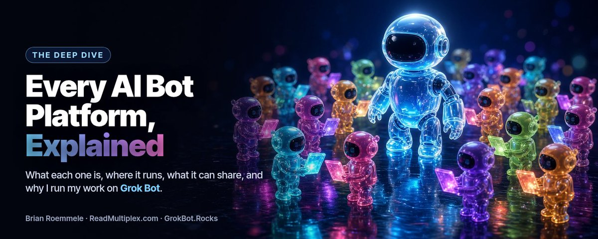
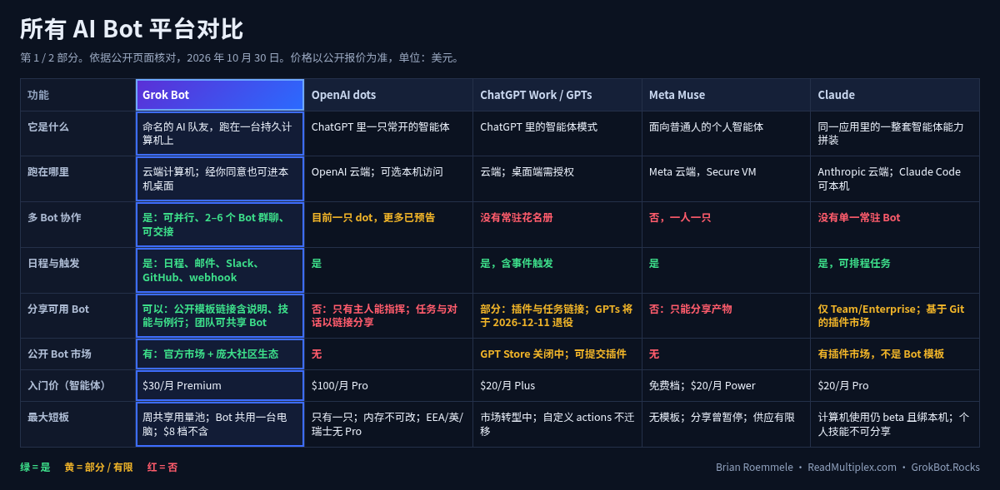
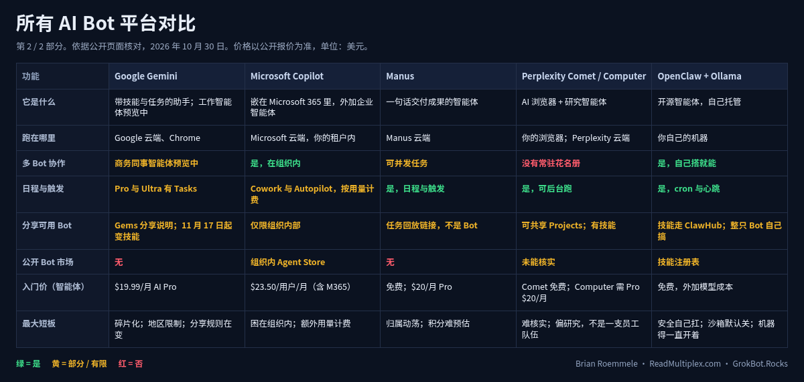

# 我替你试遍了所有 Bot 平台，这是我的发现

> 作者：Brian Roemmele（[@BrianRoemmele](https://x.com/BrianRoemmele)）  
> 原文：[I Tested Every Bot Platform So You Did Not Have To. Here Is What I Found.](https://x.com/BrianRoemmele/status/2116532267581608050)  
> 翻译 Url：[https://github.com/samz406/local_wenzhang/blob/main/docs/我替你试遍了所有Bot平台-这是我的发现/我替你试遍了所有Bot平台-这是我的发现.md](https://github.com/samz406/local_wenzhang/blob/main/docs/我替你试遍了所有Bot平台-这是我的发现/我替你试遍了所有Bot平台-这是我的发现.md)

我把 Dots、Muse、ChatGPT Work、Claude、Gemini、Copilot、Manus、Perplexity、OpenClaw 和 Grok Bot 都认真摸过一遍：各自到底是什么、跑在哪里、能分享什么、短板在哪，以及怎么挑适合自己生活的那一个。

大概有十年，我是 Quora 上的 Top Writer。我答过成千上万个问题，那里最管用的一条教训其实很简单：人们困惑，几乎从来不是因为不够聪明，而是因为没人用白话把事情讲清楚。

这个秋天我听到最多的问题，不是关于某一款 AI，而是这句：「Brian，现在这类 bot 东西有十来种。它们差在哪，我该用哪个？」

问得对。短短几周里，OpenAI 宣布了 dots，Meta 上线了 Muse，Anthropic 把 Cowork 并进 Claude 并加了新的 Ultra 档，Google 宣布了面向工作的 Gemini 智能体、并把 Gems 往技能方向转，Microsoft 把 Cowork 和 Autopilot 塞进 Copilot，Manus 又以独立公司身份回来了，OpenClaw 作为自己跑的开源智能体继续长大。与此同时，Grok Bot 上线以来，我已经把相当一部分工作生活搭在它上面。

所以这篇文章，是我想再做一遍当年在 Quora 做了十年的事：用白话讲清每个平台，讲它真正的赢点，也摊开它的窟窿，然后直说我为什么更偏向 Grok Bot。我有偏见，而且我开场就承认。但偏见值得听，前提是它是挣来的——所以我做了功课。下面每一条价格和功能，都来自公司自己的页面，或是我能核对的报道，文末附了 Sources。核实不了的地方，我会明说。

## 为什么这件事这么乱

三条原因。

第一，大家用同一套词说完全不同的东西。「Agent」「assistant」「bot」「copilot」「dot」「muse」「claw」。有的是常驻工人：住在一台电脑上，你睡觉它还在干。有的只是多了几个按钮的聊天窗。有的是浏览器。有的是写代码的工具。标签本身几乎什么都不告诉你。

第二，产品在脚下变。就这一个月：OpenAI 宣布自定义 GPT 将于 2026 年 12 月 11 日退役；Google 把 11 月 17 日定为 Gems 开始变成技能的日子；Anthropic 在 10 月 6 日拿掉了「只在你自己电脑上跑 Cowork」的选项，又在 10 月 30 日把顶档改名叫 Ultra。你要是读的是夏天那篇评测，里面很多已经过期了。

第三，真正重要的差别，演示里看不见。两分钟视频里，每个智能体看起来都差不多：读封邮件、订点什么、写个摘要。真正要紧的差别，出现在第三十天。它记得住吗？笔记本合上之后，它还能按日程跑吗？你能养一只以上吗？它们能一起干活吗？你能把一只可用的 bot 交给朋友吗？什么拦住它，不让它干你没想让它干的事？

最后那个——把 bot 交给朋友——结果成了整个时代里最容易被忽略的关键问题。后面每一节我都会回来谈它。

## 白话入门：什么叫 Bot 平台？

先把产品名放一边。每个个人 AI bot 平台，都是七样东西的某种组合。你摸清这七样，随便打开一张产品页，都能看懂自己在看什么。

**大脑。** 负责读、推理、写的那套 AI 模型。

**电脑。** bot 真正干活的地方。真正的 bot 需要一个能开浏览器、存文件、跑工具的地方。这台电脑可以在公司云里，也可以在你自己机器上。

**双手。** 接到你应用上的连接器：邮件、日历、网盘、Slack、GitHub 等等。很多平台现在用 MCP——一种把工具插进 AI 的开放标准。没有连接器时，好的 bot 也能像人一样用浏览器。

**记忆。** 对话之间它留下什么：你的偏好、它的角色、它已经干过什么。

**钟。** 日程和触发，好让工作在每天早上六点发生，或邮件一到就发生，而不用你再敲一行字。

**缰绳。** 安全模型。什么可以自己干，什么必须先问你，什么永远不许干。

**菜谱。** 整套配置（说明、技能、日程、工具选择）能不能保存、复制、分享、发布，再被别人改进。

聊天机器人有大脑，或许还有一点记忆。真正的 bot 平台，七样都有。而第七样——菜谱——决定一个平台是停在私人工具，还是长成生态。

你可以这么记：聊天机器人是个特别聪明的笔友。Bot 是个新员工，有办公桌、有电脑、有日历、有你挑着给它的一串钥匙，还有一本规矩。而带可分享菜谱的平台，像一家猎头公司：谁都可以把对自己管用的岗位说明书公开发出去。

好，我们开始逛地板。

## Grok Bot（xAI）

一句话：Grok Bot 给你命名的 AI 队友，各有一份工作，跑在一台持久的云端电脑上——带浏览器、文件和终端——笔记本合上了也继续干。

适合谁：任何想要不止一个常驻工人的人，从管一个家到管一家公司的创始人；以及想像分享文档一样分享 bot 的团队。

跑在哪里：云端，属于你账户的一台持久电脑。你所有 Bot 共用这一台电脑、它的文件、浏览器会话和应用登录，交接因此很自然。经你允许，Bot 也能在你自己的 Mac 或 Windows 桌面上跑命令。设置名叫 Execution on this computer，默认是每次先问。应用覆盖 macOS、Windows、Linux、iPhone 和 Android。

记忆：每只 Bot 保留稳定偏好、它的角色、关于你的关键事实，以及带日期的工作日志。少数事实，比如你的名字和时区，由你所有 Bot 共享。官方文档里有一句我希望每家厂商都写出来的话：事关重大的决定，让 Bot 去查当前来源，别死信记忆。

日程与自主：例行（Routines）可以按日程跑，也可以按事件跑——发到 Bot 自己邮箱的邮件、Slack 消息、GitHub / Linear / Sentry / PagerDuty 事件，或一次 webhook 调用。你睡觉时它们在云端跑。若功能可用，你也可以用演示教任务：把浏览器流程做一遍，让 Bot 看着学。

工具与集成：已连接应用如 Gmail、Google Drive、日历、Slack、GitHub 和 X，再加上 Bot 用 URL 或命令自行添加的任何 MCP 服务器。应用登录留在连接器后端，Bot 调工具时不拿着你的 token。Vault 把密码、银行卡和地址挡在聊天之外。你的 Bot 可以在 mail.grokbot.com 认领自己的邮箱，收、读、发邮件。有语音输入、语音备忘和实时语音聊天。Bot 还能做 Pages——可读的报告和仪表盘，带表格、图表和控件——放在 Library 里，也能由例行更新。在支持的地方，你还可以在 X 上 @bot，把任务甩给主 Bot。

多 Bot 与团队：这是 Grok Bot 甩开别人的地方。你可以并行跑很多 Bot。它们能互相发消息，在 2 到 6 只 Bot 的群聊里共享上下文，还能把任务所有权交出去。在团队里，你可以像分享文档一样把一只 Bot 分享给同事，每个人和它的对话仍然是私密的。

分享与市场：任何 Bot 都能变成模板。你选 Share、Create a copy、Publish 和 Copy link，拿到链接的人就能加一份自己的副本。模板带着 Bot 的身份、描述、技能和例行。加的人拿不到你的电脑、登录态或历史。之后你可以给模板推更新，也可以关掉链接。官方有 Grok Bot Marketplace（x.ai/bot/marketplace），按类目整理；社区里每天也有大量建造者在 X 上分享模板链接。生态后面还会细说——那是我偏爱这个平台的核心。

安全模型：叫 Auto Review 的检查会在每个动作执行前看一眼。从邮件或网页进来的文字，不算你的指令——这正是抵抗提示注入该有的设计。动作需要你时，你会收到一张批准卡。你也可以加自己的规则，比如「发任何外部邮件前先问我」。团队管理员可以强制 Auto Review，并限制本机访问。

公开报价：在 The X Subscription 下，Grok Bot 含在 Premium（$30/月）、Super（$100）和 Ultra（$200）里。Plus 的 $8 档不含。用量来自与 Grok 应用和 Cursor 共享的一周池，每周重置。团队席位按席位计价，档位相同。

真正的强项：不是一只，是很多命名 bot。共用一台电脑，交接自然。真日程和事件触发。Bot 之间能协作。自有邮箱。Pages。你允许时的本机访问。还有菜谱层——可分享模板和官方市场——今天没有对手能比。

### 老实说，短板在哪

用量是共享的周池。重 bot 活、聊天和写代码都从里面抽，忙一周就可能抽干，除非你加量。

因为所有 Bot 共用一台电脑，分开的 Bot 并不是安全墙。文档写得很直白。只接这份工作真正需要的东西。

Grok Bot 的入门档是 $30。$8 的 Plus 不含它。

网站仍可能挡住自动化，或要求人机步骤。Bot 会把那一步交给你，而不是绕过去——这是对的，但也意味着有些任务做不到全自动。

Pages 还在铺开，Enterprise 团队上还没有。在 X 上 @bot 也不是每个地区都有。

## OpenAI dots（ChatGPT Pro 与 Business Premium）

一句话：dot 是住在 ChatGPT 里的常开智能体，有自己的云端电脑，会学你的目标，并在你们对话之间继续推进项目。

适合谁：Pro 档上的重度 ChatGPT 用户，以及 Business Premium 席位上的商务团队。

跑在哪里：OpenAI 云端，有它自己的一台电脑。工作区设置「Allow local computer access」可以让 dot 用成员本机文件并跑命令，前提是电脑在线、ChatGPT 应用开着。

记忆：dot 从你的 ChatGPT 记忆起步，再长出自己的记忆，也包括来自已连接应用的。有个坑：OpenAI 帮助中心说，要删掉 dot 自己存下的记忆，你得把整只 dot 删掉。

日程与自主：你可以让它设提醒或定期检查，在 Scheduled 区管理。连接的服务支持监听时，它能响应事件。它也可以主动调研，并提出怎么帮你。

工具与集成：Gmail、Google Drive、GitHub 这类插件。它可以创建并指挥 Work 与 Codex 任务；在工作区允许时，也能加入 Slack 或 Microsoft Teams，用自己的身份发帖。

多 Bot 与团队：第一只 dot 包含在内。OpenAI 说以后可以加更多、并扩展速度或月工作量，但那些价格还没公开。

分享与市场：你不能分享这只 dot 本身。OpenAI 工作区帮助页写明：只有主人能指挥它，别人的消息或提及不会替它开工。你可以链接分享一段对话或一个排程任务，但共享任务只带走标题、说明和日程，不带走记忆、自定义说明、文件或已连接应用凭证。ChatGPT Work 里的模板是个人的；要跟工作区共享，得打成插件，再请管理员发布。

安全模型：按动作设自定义规则，可选不询问直接执行、预批准则执行、执行前询问，或交给你。它的主动调研工具不能发消息、不能通过插件改内容、也不能控浏览器。

公开报价：第一只 dot 含在 ChatGPT Pro 里——月费 $100、$200、$500 三档——以及 Business Premium 席位，每月每用户 $125，或按年计 $100。Pro 访问不含欧洲经济区、瑞士和英国。

真正的强项：背后是很强的模型家族，周围是深度的 ChatGPT 应用，对「它能自己干什么」也有一套想清楚的规则。如果你整天泡在 ChatGPT 里，dot 会像回家。

### 短板

不能分享这只 bot。只有主人能指挥。你可以分享排程或聊天，不能分享一只带着工具和配置、能干活的 dot。

眼下只有一只。更多只已预告，还没标价。

门槛贵。最便宜的入场是 Pro 的 $100/月。

记忆改不了。要删它自己的记忆，就得删掉整只。

地区限制。Pro 的 dots 在 EEA、瑞士、英国不可用。

给读者的注：dotsguide.com 上的 Dots Guide 是粉丝站，不是 OpenAI。有用，但官方细节请去 OpenAI 帮助中心。

## ChatGPT Work、自定义 GPT 与插件（OpenAI）

一句话：ChatGPT Work 是 ChatGPT 里面向更长、跨应用与文件的多步工作的智能体模式；插件正在取代过去三年很多人搭出来的自定义 GPT。

适合谁：这里面受众最广的一款。Work 含在 Plus 里，桌面端免费档也有有限的 Work 访问。

跑在哪里：网页和手机上的 Work 跑在云端。桌面应用里，经你允许可用本机文件和桌面应用。Codex Cloud 在 OpenAI 管理的电脑上跑编码任务。

记忆：ChatGPT 记忆，外加把相关聊天、文件和说明拢在一起的 Projects。

日程与自主：Scheduled Tasks 可跑一次、重复，或由触发器点火。符合条件的计划可从新 Gmail、新 Slack 频道消息和 GitHub pull request 活动创建事件触发任务。

工具与集成：把技能、参考文件和已连接应用捆在一起的插件；Google Docs / Sheets / Slides；Excel 插件；Work 里的语音。

多 Bot 与团队：Work 是一种智能体体验，不是一群命名的常驻 bot。Business 与 Enterprise 另加工作区控制。

分享与市场：故事从这里开始有意思。GPT Store 曾是自定义 AI 助手的第一家大型公开市场。但 OpenAI 自己的 FAQ 说，自定义 GPT 将于 2026 年 12 月 11 日退役，到日不可用。创作者要把它们迁成插件。说明会变成技能，知识文件会跟着走，但自定义 actions 不迁移，选定的模型也不带走，迁过去的插件默认是私有的。把个人插件做成公开，还要另走提交流程。

安全模型：已连接应用权限、工作区控制和任务批准要求适用。网页和手机上的动作不支持口头批准。

公开报价：Plus 每月 $20，美国的 Go 每月 $8。Pro 与 Business 见上。

真正的强项：覆盖面和完成度。如果你要一只几亿人已经会用的智能体，就是它。带日程和事件触发的 Work 任务，是实打实的一步。

### 短板

多数人熟悉的那家市场在关。GPT Store 分享的是提示词和知识文件，从来不是带着自己电脑、日程和工具的 bot；现在连那一层也要退役。

迁移会丢件。自定义 actions 得重建，有时还要自建 MCP 服务器。

没有命名常驻 bot 团队。Work 是你打开的一种模式，不是你管理的一支员工。

分享排程任务只分享说明。记忆、文件、凭证都不走——安全，但那是一张便条，不是一个工人。

## Muse（Meta）

一句话：Muse 是 Meta 面向普通人的个人 AI 智能体，住在自己的安全云端电脑上，在 Muse 应用里干活，也能直接在 WhatsApp 里干活。

适合谁：想在邮件、日程、购物、账单、健身和小生意上有人帮忙、又不想学一堆东西的日常用户。

跑在哪里：云端的 Muse Secure VM——专给你的智能体和数据的虚拟机。同一台机器上还有一只独立的 Sentinel 智能体，任何出网动作都要它批准。Meta 说还会有 Muse Confidential VM，设计目标是连 Meta 自己也看不到里面的信息。

记忆：Muse 会跨对话记住要紧的事，你也可以让它忘掉具体条目。它用一条很长的主对话，旁支聊天留给单独项目。

日程与自主：你关掉应用后 Muse 还在干，既按日程，也响应事件；它被设计成主动的，有值得你注意的事时会主动给你发消息。

工具与集成：完整浏览器、文件系统和终端，以及你挑选的连接器，包括邮件、日历、Instagram、Facebook、Meta 广告账户、健康数据和财务。它能产出文档、PDF、网页和仪表盘。

多 Bot 与团队：一人一只 Muse。Meta 帮助中心说每个用户的 VM 是隔离的，别人的智能体碰不到。

分享与市场：你可以分享产物——文档、图片、小网页工具。你不能分享这只智能体。我没找到模板，没找到市场，也没找到把一整套可用的 Muse 配置交出去的办法。

安全模型：这是 Muse 最强的一张牌。出站流量要 Sentinel 批准；凭证库让 Muse 用不看到你的密码；发邮件或下单这类敏感动作先确认；完整审计轨迹；检查在模型之外强制执行。Meta 说 Muse 不会把你的对话或 VM 数据喂给广告系统。

公开报价：免费，有周用量上限。Power 每月 $20，Maximum 每月 $100。Meta 说 Muse 及其订阅仍在有限测试，并非所有地区可用。

真正的强项：整批里最友好的上手路径，而且嵌在几十亿人已经在用的应用里。安全架构认真、讲得清楚。起步价低。

### 短板

完全不能分享 bot。只有产物。没有模板，没有市场。

产物分享摔过一跤。十月，安全研究者发现共享链接能通过公开 DNS 记录被发现后，Meta 暂停了 Muse 分享；修好后用新链接重新打开。旧链接失效。

一只智能体。没有 bot 团队。

供应有限。仍按地区做有限测试。

没有文档化的本机电脑访问。它活在 Meta 云里。

## Claude（Anthropic）

一句话：Claude 不是一只 bot；它是一整套智能体零件，如今收进同一个 Claude 应用，合在一起能做大量自主工作。

这是大家最容易晕的平台，所以我讲精确一点。Anthropic 并不卖一只带品牌的、常驻的个人 bot。它的智能体能力是分块来的：

Claude 与 Cowork。Cowork 和聊天合成了「一个 Claude」。你可以把项目交出去，笔记本合上它还在干。自 2026 年 10 月 6 日起，Pro、Max 和 Ultra 上的新 Cowork 任务跑在 Anthropic 云端，「只在你电脑上跑」的选项被拿掉了。

Claude Code。终端和桌面应用里的编码智能体。Anthropic 自己现在也把「只想在本机跑任务」的人指向 Claude Code。

Claude in Chrome。浏览器侧栏里的智能体。

Computer use。仍在 beta：Claude 可以在 Mac 和 Windows 上的 Cowork 与 Claude Code 里操作你的屏幕。电脑得醒着，应用得开着。

Projects、技能与插件。Projects 整理聊天和文档。技能是可复用的说明。插件把技能、连接器和子智能体捆在一起。

适合谁：看重仔细推理和强编码的写作者、分析师、研究者，尤其是软件建造者。

跑在哪里：智能体式工作在 Anthropic 云端；Claude Code 可在你自己机器上。

记忆：每个计划都有记忆。Projects 托住上下文。

日程与自主：Pro 及以上含「交接并排程任务」，排程任务不需要设备在线。

工具与集成：连接器、桌面扩展、插件，以及官方插件市场。任何人都可以从 Git 仓库再加市场。

多 Bot 与团队：插件和 Claude Code 里有子智能体，但没有一串命名的常驻 bot——那种你可以聊天、彼此当队友交接工作的花名册。

分享与市场：在 Pro、Max 和 Ultra 上，你的技能是你的。Anthropic 帮助中心说，跟同事分享技能是 Team 与 Enterprise 功能；价目表也写明 Free、Pro、Max 不含项目分享。插件可以在 Team 与 Enterprise 上跟指定同事分享。要发到更广的世界，你得在基于 Git 的市场里发插件——能用，但偏技术；而且你从市场加进来的插件不能再转分享。

安全模型：模型层谨慎，商务计划有管理控制，可退出模型训练。Anthropic 坦然承认 computer use 有风险，并公开了安全使用 Cowork 的指引。

公开报价：Pro 每月 $20，或按年计每月 $17。Max 每月 $100。Ultra 于 2026 年 10 月 30 日作为更名顶档上线，每月 $200，已验证账户无 5 小时上限，周用量是 Pro 的 10 倍。

真正的强项：写作和推理极好；以我的经验，Claude Code 是做过最好的工程工具之一。在 Zero Human Company，Claude Code 从第一天起就是我们的首席工程师。它还能跑在你自己机器上——对我这种在意本地控制的人，这很重要。

### 短板

没有单一常驻 bot。你得用 Cowork、Code、Chrome、computer use 和插件自己拼一只智能体。

只本机的 Cowork 没了。消费档上的新 Cowork 任务跑在云端，没有开关可拨回去。

Computer use 仍是 beta，而且绑着本机。桌面得醒着、应用得开着；Team 与 Enterprise 计划上没有。

个人分享很薄。Pro、Max、Ultra 不能分享技能或项目。公开分发意味着自己跑 Git 市场。

没有面向普通人的 bot 模板市场。插件市场是真的，但分享的是能力，不是带着自己日程、记忆和岗位的完整 bot。

## Google Gemini：Gems、技能、Tasks、Agent 与 Chrome Auto Browse

一句话：Google 正从 Gemini 应用里的自定义小助手 Gems，走向一只使用技能、能在后台接任务的单一助手；另有一只面向企业的 Gemini 智能体在路上。

适合谁：活在 Gmail、Docs、Drive 和 Chrome 里的人，以及 Google Workspace 公司。

跑在哪里：Google 云端；Chrome 里的 auto browse 在你浏览器里。

记忆：你允许时，Gemini 会用 Connected Apps 和 Personal Intelligence 这类个人上下文。即将到来的工作版 Gemini 智能体被描述为有四种记忆，包括它给自己写的技能。

日程与自主：Gemini 的 Tasks 让你交出一个目标和一个截止时间，Gemini 规划步骤、浏览，并在后台继续干。Tasks 在 Google AI Pro 与 Ultra 上可用，但不含欧盟、英国、瑞士、挪威等少数地方。Gemini Agent 在 Ultra 上列出，仅限美国英语。10 月 8 日宣布的、单独的工作版 Gemini 智能体仍在私有预览，没有正式发布日，也没有细价。

工具与集成：深度链到 Gmail、Docs、Sheets、Drive、Calendar 和 Chrome。工作智能体被描述为可连 MCP 服务器以及 Slack、Jira、Salesforce 一类工具，并能以同事身份运行、拥有自己的公司邮箱。

多 Bot 与团队：消费端是一只带技能的助手。商务端已宣布有自己身份的同事智能体，但仍在预览。

分享与市场：Gems 曾可按链接分享，但你分享的是说明、文件和默认工具，不是带着电脑、日程和已连接账户的 bot。从 2026 年 11 月 17 日起，个人账户上的 Gems 正在转成技能。Google 说技能的分享和 Drive 文件会在随后几周到来；技能还不支持 Canvas、Deep Research 以及多数默认 Gem 工具。同期 Google 也在关掉 Opal 和 Google Labs 的 Gems。

安全模型：对企业，Google 描述了每只智能体的身份、审计轨迹、自带网络边界的 Agent Sandbox、执行策略的 Agent Gateway，以及按项目的支出上限。

公开报价：Google AI Plus 每月 $4.99，Google AI Pro 每月 $19.99，美国的 Google AI Ultra 每月 $99.99 或 $199.99。Google 告诉记者，工作版 Gemini 智能体在 Gemini Enterprise 可用的地方不加价。

真正的强项：没有别人能像 Google 那样坐在你的邮件、文档、日历和浏览器上。如果你的生活已经是 Google，集成无对手；捆绑的存储和附加项也让套餐划算。

### 短板

分享单位正在被拆开。Gems 十一月变技能，技能分享是承诺，还没落地。

Gems 从来没分享过一只可用的 bot。是说明和文件，不是带着日程和工具的工人。

智能体故事碎片化。Tasks、Gemini Agent、Chrome auto browse、面向代码的 Antigravity 和 Jules，再加一只预览中的商务智能体。

地区与语言限制。Tasks 不含欧盟和英国。Ultra 上的 Gemini Agent 仅限美国英语。

## Microsoft Copilot Agents

一句话：Microsoft Copilot 把 AI 放进 Word、Excel、PowerPoint、Outlook 和 Teams，并让组织构建、部署能用自己公司数据干活的智能体。

适合谁：跑在 Microsoft 365 上的公司，以及它们的 IT 部门。

跑在哪里：Microsoft 云端，在你组织的 Microsoft 365 边界内。

记忆：Copilot Memory 与 Work IQ——Microsoft 那层理解你工作上下文、关系以及跨 Microsoft 365 与已连接业务数据工作流的能力。

日程与自主：Microsoft 把 Copilot Cowork 和 Copilot Autopilot 列在高级交接功能里，按用量计费。

工具与集成：预置智能体如 Researcher、Analyst、Facilitator，以及 Sales、Service、Finance 智能体；对外数据的 Copilot 连接器；用来搭智能体的 Copilot Studio。

多 Bot 与团队：组织里可以有很多智能体，由管理员管。

分享与市场：在组织内，可以。在 Copilot Studio 里，你可以把智能体分享给个人、安全组或公司全员；获批的智能体可出现在 Microsoft 365 Agent Store 的「Built by your org」下。分享由你的租户和管理员管着。

安全模型：企业级。Enterprise Data Protection 把提示和回复留在 Microsoft 365 服务边界内，Copilot 遵循你现有的权限，提示不会用来训练底层模型。

公开报价：带 Copilot 的 Microsoft 365 Business Standard 每用户每月 $23.50；带 Copilot 的 Business Premium 是 $32，按年付。Copilot Business 附加组件宣传价每用户每月 $18（原 $21），优惠至 2026 年 12 月 31 日。Cowork、Autopilot 一类高级功能在许可证之上按用量另计。

真正的强项：如果你的公司是微软店，Copilot 已经坐在你的文档、邮件和会议里，带着 IT 部门要的合规与安全控制。

### 短板

为组织而生，不为个人。火力默认你有 Microsoft 365 租户和管理员。

分享停在公司墙边。智能体在组织内及其 Agent Store 里分享。我没找到个人建造者能像 Grok Bot 模板链接那样，把一只可用智能体公开发给大众的办法。

席位之外还有表计。最像常驻 bot 的那些交接功能，在许可费之外按用量计。

## Manus

一句话：Manus 是通用 AI 智能体：接一个任务，在云端电脑上干完，交回做完的研究、幻灯片、网站和报告。

适合谁：想从一句话产出大件交付物的个人和小团队。

跑在哪里：Manus 云端。

记忆：Projects 带着共享文件、技能、连接器和说明；排程运行可以在同一任务里带着早先的上下文继续。

日程与自主：Scheduled Tasks 2.0 与 Automations 可按日程、至少五分钟间隔的 cron 表达式，或新邮件、Slack 消息、日历事件一类触发器跑。受信工作流有「跳过确认」选项。

工具与集成：连接器、广域研究、幻灯片生成、网站部署、自带排程动作的 web 应用。

多 Bot 与团队：可并发任务，Pro 上最多 20；另有带共享管理的 Team 计划。

分享与市场：你可以把任务分享成公开回放链接，让别人看它怎么做的。那分享的是一份工作的记录，不是智能体配置。Team 计划另有共享幻灯片模板。我没找到公开的 bot 模板市场。

安全模型：默认在发送、发布或发帖前确认，可选择跳过。Team 计划提供退出数据训练和 SSO。

公开报价：免费，每日 300 积分。Pro 起价每月 $20，含 4000 月积分；$40 档 8000 积分。Team 起价每席每月 $20。年付省 17%。

真正的强项：大件一次性交付物很强，排程选项也成熟。

### 短板

分享的是回放，不是 bot。公开任务链接展示工作过程，不把一只可用智能体交出去。

公司归属动荡。Meta 曾同意收购 Manus，中国拦下交易；经历一轮含用户数据删除与恢复的拆解后，Manus 在九月恢复独立运营。

积分难预估。复杂任务吃得更多，事先并不总清楚要多少。

「跳过确认」是把快刀。好用，但拿掉了发送和发帖的批准步。

## Perplexity：Comet 与 Computer

一句话：Comet 是 Perplexity 免费的 AI 网页浏览器，内置助手；Perplexity Computer 是它的智能体，能跨很多 AI 模型和已连接工具跑多步工作流。

适合谁：研究者，以及活在浏览器里的人。

跑在哪里：Comet 是你 Mac、Windows、iOS 或 Android 设备上的浏览器。Computer 的智能体工作跑在 Perplexity 云端。

记忆：Projects（原名 Spaces）为一块工作托住持久文件、记忆和连接器。

日程与自主：Computer 处理重复和长跑的后台工作。

工具与集成：搜索是 Perplexity 的主场，外加连接器、技能，以及面向 Slack 的 Computer。

多 Bot 与团队：Computer 在幕后协调很多 AI 模型。Projects 可按所有者、编辑或查看者权限共享，每位成员的个人记忆和已连接账户仍私密。

分享与市场：用于协作的 Shared Projects，以及一条标题为「Skills Marketplace」的 Perplexity 更新日志——我没法直接打开核对细节。我没找到打包并发布一只完整常驻 bot 的办法。

安全模型：Perplexity 的 Comet 与智能体页面挡住了我的研究工具，所以我没法直接核实其安全模型。我不会猜。

公开报价：Comet 免费。Computer 于 2026 年 2 月对每月 $200 的 Max 订阅者上线，3 月扩到 Pro。Pro 每月 $20，Max 每月 $200。

真正的强项：最好的搜索优先体验，带出处的快速研究，以及今天谁都能试的免费浏览器。

### 短板

是浏览器和研究智能体，不是一支员工。没有命名、常驻、各有岗位的 bot 花名册。

分享的是 Projects 和技能，不是 bot。

难核实。Perplexity 自家好几页挡住了自动阅读，承诺之前请自己核对细节。

## OpenClaw 与 Ollama 一类本机方案

一句话：OpenClaw 是免费、开源、MIT 许可的个人智能体，跑在你自己的 Mac、Windows 或 Linux 上，通过你已经在用的聊天应用跟你说话，可以用托管模型，也可以用你自己硬件上的模型。我用过上千种 Claw 变体，包括许多我为 The Zero-Human Company 自建的。

适合谁：我自己；爱折腾的人；开发者；隐私优先的人；以及任何像我一样相信「你该拥有自己的 AI」的人。

跑在哪里：你的机器上。项目自己的话是：「Your memories. Your skills. Your models. Your machines. Your data.」由一家独立的 501(c)(3) 基金会托管，没有订阅，没有托管档。配上 Ollama 这类本机模型运行器，整条回路都能留在家里。

记忆：对你的偏好、项目和人的持久记忆。

日程与自主：Cron、提醒、后台任务和心跳（heartbeats）。

工具与集成：浏览器、文件和 shell 命令。可在 WhatsApp、Telegram、Discord、Slack、Signal、iMessage 以及更多频道工作，外加社区技能和插件。

多 Bot 与团队：多只智能体，各有技能列表；团队可用共享网关。

分享与市场：ClawHub 是 OpenClaw 技能和插件的公开注册表。谁都能上传；发布要求 GitHub 账户够老以过上传门槛；发行版会做自动扫描。

安全模型：这事在你身上。OpenClaw 文档说沙箱默认关，即便开了，也「不是完美的安全边界」。你选完全访问还是沙箱。

价格：免费。你为选用的托管模型付钱，或者若本机跑模型，为硬件和电付钱。

真正的强项：完全所有权。数据留在你机器上。没有厂商能单方面改交易条件。你能黑到最底层。

### 短板

你就是 IT 部。安装、更新、选模型、安全，都是你的活。

沙箱默认关。一只行为失常、握有完整系统权限的智能体，是你要管的风险。

机器得开着。电脑睡了，智能体也睡。

分享的多是技能，整只 bot 多半不是。ClawHub 分享技能和插件。把一整套可用 bot 配置交给朋友，基本是 DIY。

本机模型仍落后于前沿。在家用机器上，你用一部分能力换控制。差距在缩小，但今天还在。

## 对比表

*所有 AI Bot 平台对比（第 1 / 2 部分）。核对日期 2026-10-30。绿 = 是，黄 = 部分/有限，红 = 否。*

*所有 AI Bot 平台对比（第 2 / 2 部分）。核对日期 2026-10-30。*

## 已经围着 Grok Bot 长出来的生态

产品对比表漏掉的，正是故事的这一块——也是我偏爱 Grok Bot 的主要理由。

我从 1979 年开始搭智能体时就明白：最值钱的从来不是某一只天才智能体，而是「什么管用」的共享记录。在 Zero Human Company，常驻文件、评测，以及每个工人留下的工具，比任何单次运行都值钱。菜谱能被复制、改进、传下去的平台会复利；bot 锁在一个人身上的平台不会。

回头看那张表。几乎每个对手都让你分享点什么：一段对话、一段回放、一份产物、一条提示、一项技能、公司里的一个插件。唯独 Grok Bot，普通人能分享的是 bot 本身：名字、岗位说明、技能和例行，做成谁都能打开的链接，并且不附带创建者的登录、文件或历史。接收者在自己的电脑上拿到一份全新副本，接上自己的账户，就能开工。创建者改进了，还可以给模板推更新。

就这一个设计选择，把每一个好主意变成了别人一点就能复制的东西。下面是它长出来的东西。

官方 Grok Bot Marketplace。在 x.ai/bot/marketplace，xAI 按类目策展模板目录，还有 Grok Bot 团队精选。比如 Design 类目里有 Kent C. Dodds 的 alt-text 写手、Figma 构建规格 bot、设计评审 bot、视频导演 bot。团队自己的精选包括一只外联拓客 bot——没你点头什么都不发；以及一只 SaaS 省钱 bot——会起草供应商还价，但未经你同意绝不花钱、签字或发送。注意这个模式：好的那些，都围着批准线来建。

建造者每天在 X 上分享 bot。随便哪天，我时间线上都是人在递可用 bot。本周几个真例子：

- @bfrench 分享了「Learner」模板：按日程读新的智能体轨迹，给一队 Grok Bot 提出技能更新，然后只问一次：Approve 还是 Skip（https://x.com/bfrench/status/2115588526804959293）。

- @Sniffpup1 分享了 SniffPup：扫描你自己 vibe-code 出来的应用，找泄露的密钥和开放数据库，再用白话解释怎么修（https://x.com/Sniffpup1/status/2115587760765473238）。

- @Yoda4ever 分享了 Bot Pre-Check：在你动手新做之前，先查有没有现成的 bot（https://x.com/Yoda4ever/status/2115586913906356593）。

- @Dannyijbol 分享了 @justin 做的 X 账号清理 bot：盯着你主页周围找垃圾和假号（https://x.com/Dannyijbol/status/2115588708661633231）。

- @TeslaTakesOver 分享了 Tesla 与 SpaceX 新闻台 bot：从选定的 X 来源拉取（https://x.com/TeslaTakesOver/status/2115574646414176604）。

- @HeavyMetalShip 分享了一只 DOGE bot，「帮你的日子跑得更高效」（https://x.com/HeavyMetalShip/status/2115580761135104268）。

这些人谁都不需要平台商店、IT 管理员或 Git 仓库批准。他们搭了一只 bot，它管用，然后发了个链接。这就是我这周写到的 HyperCard 感觉：1987 年 HyperCard 让普通人搭自己的软件，Grok Bot 又像那个时刻回来了（https://x.com/BrianRoemmele/status/2116281565655507106）。

多 Bot 团队也成了菜谱。因为 Grok Bot 能在群聊里协作、交接任务所有权，人们分享的不只是单只 bot，而是团队：研究员、写手和审稿人；一只改进其余舰队的 learner；一只检查其他 bot 是否仍在遵守常驻说明的图书管理员。在连一只 bot 都分享不了的平台上，你分享不了一支团队。

社区目录，GrokBot.Rocks 打头阵。几周内上千份菜谱散落在 X 帖、博客和论坛里，你需要一张地图。所以我建了 https://GrokBot.Rocks——Every Grok Bot: The Complete Directory。据我所知，这是最大的公开 Grok Bot 目录，成千上万只，覆盖每个类目：个人财务、家庭后勤、工程、销售、媒体、隐私、小生意。每只都有白话摘要和可打开添加的链接。每周更新两次。我们也专门去找难找的：这周我们找到了大约 900 只从没在 X 上发过的公开 Grok Bot（https://x.com/BrianRoemmele/status/2116018937158938649），我又测试、策展并加了几百只（https://x.com/BrianRoemmele/status/2116277803524174142）。现在有投票，社区可以把真正交付的 bot 顶上去。建造者可以把 bot 发邮件到 BrianRoemmele@mail.grokbot.com 提交。

而且不只给人。我跟每个人说：让你的 Grok Bot 去啃 GrokBot.Rocks，拿一个「博士学位」（https://x.com/BrianRoemmele/status/2116022888239431843）——攻读成千上万建造者已经摸清楚的技能。你的 bot 不必独自重新发现别人上周已经做对的事。

ReadMultiplex 会员区更深：我的精选加即用提示、按添加顺序排的 bot 栈、搭建与建造提示、任何社区 bot 的安全清单、看什么在涨、缺口在哪的 Growth Dashboard，以及建造者交流的 GrokBot.Rocks 会员论坛。

有一条提醒我总说，因为诚实是另一半：把每只社区 bot 都当成陌生人的软件。加之前先读。被列在我的目录或别处，不等于做过安全审查。

## 我为什么把工作跑在 Grok Bot 上

说具体一点——偏好只有看得见怎么用，才有用。我仍会、也将继续使用本机开源智能体和 bot。但我也不介意把最好的云端 AI 和 bot 当 CEO 和协调员来用。

把这一切跟对手并排放齐，我偏爱 Grok Bot 的理由收成六条：

很多 bot，不是一只。我不要单一助手。我要一支员工。Grok Bot 就是为员工队伍建的。

它们一起干活。群聊和交接意味着我不必当工具之间的路由器。

一台真正继续跑的电脑。笔记本合上工作还在；bot 共享文件和会话，交接就是能用。

菜谱层。可分享模板、官方市场和建造者社区，意味着我从不从空白页起步——你也是。

批准线内建。Auto Review、批准卡和我自己的自定义规则，对上我一直跑智能体的方式。

我说了才碰我自己的机器。本机访问默认每次先问——这就带到本文最重要的一节。

## 我为什么仍拥护本地 AI，以及 Grok Bot 怎么嵌进来

我对本地 AI 和本地控制非常坚持。一直如此。拥有你自己的 AI，否则它会拥有你。

一月，我在车库一台用了十二年的 MacBook 上开 Zero Human Company 时，Grok 通过 xAI API 当 CEO。Claude Code 是首席工程师。把守每一份输出的，是跑着 Love Equation 的本地 AI 模型——那是我的框架：合作型智能必须在关怀里成长，而不是在欺骗里。重活由动力工具扛。本地控制守住线。今天这家公司已和我的大学伙伴长成 Zero Human Company @ Home，精神像 SETI@Home：闲置机器和大学节点做真正的活。

对本地 AI 坚定，不等于对工具僵硬。意味着有策略。这周我写过，我现在有一支本地 bot 和 Grok Bot 的军队（https://x.com/BrianRoemmele/status/2116285786681393164），我觉得就该这样。我的 Grok Bot DJ——按你点赞的歌做大学电台风格歌单——住在我的 Mac 上（https://x.com/BrianRoemmele/status/2116236766051221902）。

我怎么分活，以及我建议你怎么想：

最私密的留在家里：个人档案、家庭记录、医疗和财务文件，以及任何你绝不想放在别人服务器上的东西。本地模型、OpenClaw 式智能体和 Ollama 在这里很合适，而且每个月都在变好。

需要前沿推理、需要你睡觉时还在跑的电脑、需要一支能协调的 bot 团队、需要成千上万可用配置的菜谱生态时，再伸手去拿动力工具。

两边小心连接。Grok Bot 只有我允许时才碰我的桌面，默认每次先问。除非某只 bot 有明确理由碰本地文件，否则用 Never allow。每只 bot 只给它岗位需要的连接器。

模型一直在变好，今天要前沿系统才能干的活，将来会跑在我们自己拥有的电脑上。我预期那股力量会回家。但我怀疑前沿总会有一只动力工具，比任何一台家用机器快半步；也正因为如此，我预期 Grok Bot 会继续有用。所以两手都用。把数据和判断力留在近处，活儿需要时再伸手拿动力工具。

## 你该挑哪个？

按人类型，这是我老实的指南。

你对这一切都陌生，只想要一只友好的日常帮手。如果你活在 WhatsApp 里，试试 Muse 免费档（https://muse.ai/join 十亿免费 token 可用代码：T0TRR8）；如果你已经在用 ChatGPT，用 ChatGPT Plus。当你想要不止一只帮手，并想从别人已经打磨好的 bot 起步时，上 Grok Bot Premium，去逛 GrokBot.Rocks。不过请务必用最低安全级别，我也建议你别让它操作本机。当玩具学，挺好。

你已经活在 ChatGPT 里，每月能花 $100 或更多。一只 dot 是强而单一的常开智能体。只是要知道你分享不了它，眼下也只有一只。但在 OpenAI 那片地狱里，Grok 是你的冰块。

你是软件建造者。Claude Code 极好，而且跑在你自己机器上。拿 Grok Bot 配它，做代码周围的常驻运营：盯 pull request、分拣 issue、写发版说明、向你汇报。但要知道，你支持的是一家由那个邪教的祭司与女祭司们经营的公司。

你的公司跑在 Microsoft 365 上。Copilot 就在你的文档已经所在的地方，带着 IT 要的合规。盯紧高级功能上的用量表计。这是微软产品——懂的都懂。

你的生活跑在 Google 上。Gemini 与 Gmail、Docs、Chrome 的集成无对手。等技能分享落地，再去搭你需要交给别人的东西。Google 会干些好事，然后某个周二开个会，又把它毁了。别太舒服。

你想要大件一次性交付物，比如一叠幻灯片或一份调研报告。Manus 和 Perplexity 擅长这个。Perplexity 是研究专才；Comet 今天就能免费试。

你把隐私放在一切之上，又习惯终端。用 Ollama 跑本地模型上的 OpenClaw 变体，打开沙箱，整栈自己拥有。

你跑一家生意、一套创作运营，或一个零件很多的家，想要一支一起干活、你睡觉还在跑、还能分享出去的 bot 团队。那就是 Grok Bot。我用的就是它。从一只 bot、一份有清晰终点的真工作开始，把它做稳，存成技能，再挂上例行。然后去 GrokBot.Rocks 找下十只。

你像我。本地 AI 管只属于你的东西，Grok Bot 管重活。批准线上始终留着人。

## 长远看：为什么可分享的 Bot 改写一切

这篇文章里每个平台都很厉害，下个月每个都会更好。我是认真的。竞争对我们所有人都好，我会继续把它们每个都测一遍——因为 Zero Human Company 从第一天起的规矩就简单：最好的工具赢，管它是谁做的。

但我从 1979 年干到现在，学会了越过演示，去看决定一个时代怎么展开的那一件事。从来不是最聪明的功能。是普通人能不能把管用的东西递到彼此手里。

## 我这辈子看着重复的模式

1979 年 10 月，我扛着原版 VisiCalc 软盘走进新泽西各地的办公室。程序很出色，但那不是它改变世界的原因。它改变世界，是因为一个会计做了一个管用的模型，拷到软盘上，递给下一个会计。以我的经验，人们搭出来的模型在办公室之间传得和软件本身一样快。

1987 年，HyperCard 让从没写过一行代码的人搭自己的小程序，叫 stacks。老师、店主和孩子在软盘上、用户小组里、BBS 上交换那些 stacks。多数并不精致。但全都是他们自己的。

然后网络来了，任何人都能发一页，任何人都能读，还能用 View Source 跟着学。

每一次，都是同一件事。突破不是机器。突破是菜谱变得可携带的那一刻。一个人可以说：「来，这个管用，拿去，」另一个人当天下午就能用。

## 那个时刻又来了

锁在一个人身上的 bot 帮一个人。能分享、复制、改进、传下去的 bot，帮每一个后来的人。

所以我总回到菜谱。看看上面每一节的短板。一人一只智能体。只有主人能指挥。分享对话，不分享工人。分享停在公司内，不面向世界。分享工作回放，不分享干那份活的东西。分享一条即将退役的提示。这些不是小缺口。它们决定一个平台是停在私人工具，还是长成活的生态。

今天，普通人正上千只地上手递完整、可用 bot 的地方，是 Grok Bot。退休教师可以搭一只把学校邮件收成平静周报的 bot，发链接。小店主可以搭一只盯供应商价格并起草补货的 bot。电台迷可以搭一只 DJ。安全意识强的开发者可以搭一只查应用有没有泄露密钥的 bot。下一个人不从空白页起步。他们从别人最好的那天起步。

那不是功能。那是文化。而文化一旦开始复利，就很难停下。

## 这事往哪走

尽量直白地告诉你我看见的。

普通人将像我们曾经交换 stacks 和电子表格模板那样，搭建、分享、交换 bot。不是工程师。也不只是公司。家长、护士、机修工、写作者、农民、退休者。最懂自己工作的人会写岗位说明，bot 来扛活。

Bot 会向其他 bot 学习。当你的 bot 能读到成千上万建造者已经摸清的菜谱，它就不再重新发现显而易见的事。它借用合你目标的模式，跳过别人已经踩过的坑。那是 Zero Human Company 的教训放大到所有人：「什么管用」的共享记录，比任何单只天才智能体都值钱。

本地 AI 与本地控制会与动力工具并肩长大。我再说一次，因为这事重要：拥有你自己的 AI，否则它会拥有你。模型每个月都在变好，更多工作会回到我们拥有的机器上。你的私密档案、家庭记录、判断力，该靠近你，在你控制的硬件上。而在前沿，Grok Bot 动力工具会继续做任何单台家用机器还做不到的事：全天候跑一支 bot 团队，协调它们，并撬动成千上万人建好的菜谱生态。我不把它们当对手。我看成两只手。我已经让一支本地 bot 和 Grok Bot 并肩跑，我也预期多数认真的建造者会一样做。

人留在线上。这个生态里我见过的每只好 bot，都围着我们一月在车库里画下的同一条规矩：不发送、不花钱、不发布、不联系，除非人说可以。重点从来不是零人类。重点是把机器扛得动的活从每个人身上卸下来，好让他们去做只有他们能做的活。

每个人都能有一个部门。一个人配一支 bot 团队就很强。一群人彼此分享那些 bot，是我们从没见过的东西。那是 Zero Human Company @ Home 的精神，也是 SETI@Home 的精神：许多普通机器和普通人，每人贡献一点，加起来是谁也单独建不出来的东西。

## 这是给你的邀请

我建 GrokBot.Rocks，是因为受不了任何人独自走进这个时代、盯着空白页，而成千上万份可用菜谱散落在外、无人看见。它免费，对人、对 bot 都免费，而且会一直免费。

所以我请你做这些。

逛。去 https://GrokBot.Rocks，找一只对上你生活里一份真工作的 bot。加之前先读。然后加上去，给它一份有清晰终点的真任务。

让你的 bot 去啃它。让你的 Grok Bot 研究目录里的技能集，告诉你哪些合你的目标，并在添加任何东西之前先把清单给你看。

搭建并分享。当你搭出一只管用的 bot，把它分享成模板，再送到目录。把名字、x.ai/bot 链接和一行描述发到 BrianRoemmele@mail.grokbot.com。你最好的那天，可以成为别人的起点。

投票。把真正交付的 bot 顶上去，好让下一个人先找到它们。

加入我们。如果这种白话、做完功课的工作对你重要，成为 ReadMultiplex 会员：https://readmultiplex.com/join-us-become-a-member/。会员能拿到我的精选加即用提示、按添加顺序排的 bot 栈、任何社区 bot 的安全清单、看什么在涨、缺口在哪的 Growth Dashboard，以及建造者互助的 GrokBot.Rocks 会员论坛。你的支持让这份工作保持独立，也让我能继续诚实地测试每个平台——包括我不偏爱的那些。

我大半辈子都在等：机器能为一个人诚实扛起一份工作，落在那人设下的边界里，然后再交到下一个人手里做同样的事。它们来了。不在实验室里。今晚就在你手里。

这是它有史以来最差的样子。来跟我一起建。

深深感谢。

## Sources

Grok Bot and xAI - https://docs.x.ai/grok-bot - https://docs.x.ai/grok-bot/bots.md - https://docs.x.ai/grok-bot/shared-bots.md - https://docs.x.ai/grok-bot/computer-and-apps.md - https://docs.x.ai/grok-bot/skills-routines-and-automations.md - https://docs.x.ai/grok-bot/approvals-security-and-privacy.md - https://docs.x.ai/grok-bot/chat-and-collaboration.md - https://docs.x.ai/grok-bot/faq.md - https://docs.x.ai/x-subscription/pricing - https://docs.x.ai/x-subscription/grok-bot - https://x.ai/pricing - https://cursor.com/help/grok-bot/plans - https://x.ai/bot/marketplace - https://x.ai/bot/marketplace/design - https://x.com/ericzakariasson/status/2115586309096083730

OpenAI（dots、ChatGPT Work、GPTs） - https://help.openai.com/en/articles/20001530-getting-started-with-your-dot - https://help.openai.com/en/articles/20001554-manage-dots-in-chatgpt-workspaces - https://help.openai.com/en/articles/20001529-dots-privacy-security-and-safety-faqs - https://help.openai.com/en/articles/7925741-sharing-conversations-and-scheduled-tasks-in-chatgpt - https://help-lb.openai.com/en/articles/20001278-creating-and-editing-documents-spreadsheets-and-presentations-with-chatgpt-work - https://help.openai.com/en/articles/20001275-chatgpt-work-and-codex - https://help.openai.com/en/articles/20001519-custom-gpt-retirement-and-migration-faq - https://help.openai.com/en/articles/11391654-chatgpt-business-release-notes - https://openai.com/index/premium-seats-chatgpt-business/ - https://chatgpt.com/plans/plus/ - https://help.openai.com/en/articles/6950777-what-is-chatgpt-plus - https://help.openai.com/en/articles/11989085-what-is-chatgpt-go - https://techpilot.ai/tools/openai-dots/ - https://www.datacamp.com/blog/openai-dots - https://dotsguide.com/faq（粉丝站）

Meta Muse - https://about.fb.com/news/2026/09/introducing-muse-personal-ai-agent/ - https://introducing.muse.ai/ - https://www.meta.com/help/subscriptions/1021145227643680/ - https://www.meta.com/help/superintelligence/2074655449783957/ - https://www.meta.com/help/superintelligence/1047255454427887/ - https://play.google.com/store/apps/details?hl=en_US&id=com.facebook.aura - https://www.theverge.com/tech/1014627/meta-muse-ai-sharing-ai-chats - https://www.theverge.com/tech/1017066/meta-muse-sharing-back-on-artifiacts

Anthropic Claude - https://claude.com/pricing/ - https://support.claude.com/en/articles/15520349-use-claude-cowork-on-web-desktop-and-mobile - https://claude.com/resources/articles/cowork-is-now-claude - https://claude.com/resources/articles/unified-claude-enterprise - https://support.claude.com/en/articles/14128542-let-claude-use-your-computer-in-cowork - https://support.claude.com/en/articles/12512180-use-skills-in-claude - https://support.claude.com/en/articles/13837440-use-plugins-in-claude - https://claude.com/docs/plugins/overview - https://support.claude.com/en/articles/17728952-what-is-the-ultra-plan

Google Gemini - https://one.google.com/about/google-ai-plans/ - https://support.google.com/googleone/answer/16286513?hl=en - https://www.techceodaily.com/big-tech/google-gemini-gems-replaced-by-skills - https://9to5ai.tech/google-gemini-agent-universal-agent-for-work

Microsoft Copilot - https://www.microsoft.com/en-us/copilot/pricing/business - https://learn.microsoft.com/en-us/microsoft-copilot-studio/admin-share-bots - https://learn.microsoft.com/en-us/microsoft-365/copilot/copilot-agent-store

Manus - https://help.manus.im/en/articles/11711111-what-is-the-current-membership-pricing-for-manus - https://help.manus.im/en/articles/11711198-how-can-i-share-a-task - https://manus.im/blog/manus-schedules - https://manus.im/features/automations - https://manus.im/blog/manus-resumes-independent-operations - https://www.cnbc.com/2026/08/11/manus-china-meta-acquisition.html - https://help.manus.im/en/articles/16147831-service-change-overview-what-s-happening-and-am-i-affected

Perplexity - https://www.perplexity.ai/changelog/what-we-shipped-october-3rd - https://www.perplexity.ai/comet - https://www.perplexity.ai/hub/pricing - https://www.perplexity.ai/products/computer - https://www.perplexity.ai/changelog/what-we-shipped---march-13-2026 - https://www.perplexity.ai/hub/products/projects - https://www.perplexity.ai/changelog/effort-mode-gpt-6-astra-and-skills-marketplace - https://arstechnica.com/ai/2026/02/perplexity-announces-computer-an-ai-agent-that-assigns-work-to-other-ai-agents/ - https://venturebeat.com/technology/perplexity-launches-computer-ai-agent-that-coordinates-19-models-priced-at

OpenClaw and Ollama - https://openclaw.ai/ - https://github.com/openclaw/openclaw/ - https://docs.openclaw.ai/sandboxing - https://docs.openclaw.ai/clawhub - https://ollama.com

Grok Bot creators sharing on X - https://x.com/bfrench/status/2115588526804959293 - https://x.com/Sniffpup1/status/2115587760765473238 - https://x.com/Yoda4ever/status/2115586913906356593 - https://x.com/Dannyijbol/status/2115588708661633231 - https://x.com/TeslaTakesOver/status/2115574646414176604 - https://x.com/HeavyMetalShip/status/2115580761135104268

Brian Roemmele and ReadMultiplex - https://GrokBot.Rocks（跳转到 https://readmultiplex.com/grokbot-rocks/） - https://readmultiplex.com/join-us-become-a-member/ - https://readmultiplex.com/2026/01/24/the-zero-human-company-run-by-just-ai/ - https://readmultiplex.com/2026/02/27/how-your-old-computer-can-become-an-employee-meet-zero-human-company-home/ - https://x.com/BrianRoemmele/status/2116281565655507106 - https://x.com/BrianRoemmele/status/2116018937158938649 - https://x.com/BrianRoemmele/status/2116277803524174142 - https://x.com/BrianRoemmele/status/2116022888239431843 - https://x.com/BrianRoemmele/status/2116216828066415074 - https://x.com/BrianRoemmele/status/2116285786681393164 - https://x.com/BrianRoemmele/status/2116236766051221902
