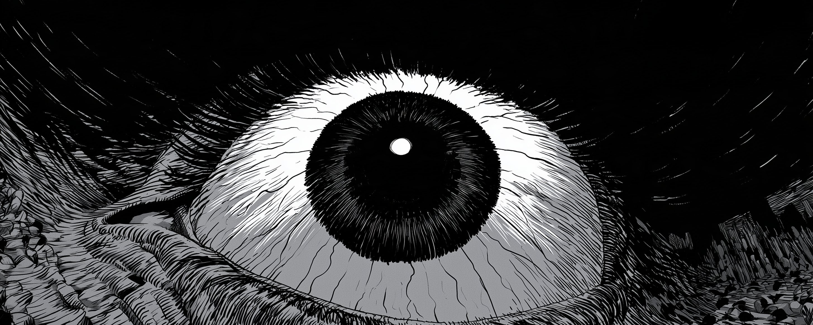

作者：Dan Koe
原文：[The deep work routine that changed my life (1 hour every morning)](https://x.com/thedankoe/status/2125643815122002300)
翻译 Url：[https://github.com/samz406/local_wenzhang/blob/main/docs/改变我人生的深度工作习惯/改变我人生的深度工作习惯.md](https://github.com/samz406/local_wenzhang/blob/main/docs/改变我人生的深度工作习惯/改变我人生的深度工作习惯.md)

# 改变我人生的深度工作习惯（每天早上 1 小时）

如果你能花 8 小时去打造别人的梦想，你也能花 1 小时来打造自己的。

但这 1 小时你怎么用，决定了一切。

如果你把注意力集中在那一件最能把你推向理想生活的事上，每天 1 小时，趁早上头脑最清、干扰最少的时候做，坚持 6-12 个月，那就等于朝你想要的生活投入了 365 个潜在小时。在这么长的时间里，你能做成的事，远比你以为的多。

我人生的大部分时间里，每天只工作 2-4 小时。

我知道，网红动不动炫耀自己的百万身家，很容易让人反感，但为了把结果说清楚，我还是稍微炫耀一下。那每天 2-4 小时，正是我把全平台粉丝做到快 500 万的方法；光是个人品牌，我就赚了将近 1000 万美元，还不包括我其他的公司。那些时间，我拿来发帖、写文章、写 newsletter、做 YouTube 视频和播客。2 本书也是这么写出来的，还有 2 本正在写 - 全程没有用 AI 代笔。

当年我还有一份朝九晚五的工作，根本没有每天 12 小时来把副业做起来。我只有 1-2 小时，周末再多挤出一点。

如果你只想要那套简单到离谱的深度工作习惯，可以直接跳到这封信的最后一节。

但如果你的注意力比金鱼强一点，也明白自己那么渴求的 “可执行建议” 离开了上下文就毫无意义，我还是建议你把每一节都读完。时间不够的话，先把这篇文章收藏起来，设个提醒，回头再来看。

后面的章节你当然可以跳着读，但如果你的注意力比金鱼强一点，我还是建议你把每一节都读完。时间不够的话，先把这篇文章收藏起来，设个提醒，回头再来看。

我们来聊聊：为什么忙忙碌碌的人最后往往落在底层；为什么除了毕生事业以外的追求都是在浪费时间 - 尤其是当工作正在先缓慢、再突然地消失；以及最后，如何安排一天，不只是为了最高效率，更是为了最大杠杆。

祝读得愉快。

## I – 在人类历史的大部分时间里，最忙的人地位最低。

Aristotle 说，我们工作，是为了能有闲暇；没有闲暇，谁也成不了智者。

Seneca 说，最忙的人往往成就最少，因为他们把日子花在了一切事情上，唯独没有花在自己的人生上。

闲暇曾经是地位的标志，忙碌则是义务的标志。忙碌属于奴隶、农奴和劳工，他们从日出忙到日落。

上个世纪的某个时候，这件事翻了过来。

“我好忙” 成了一枚荣誉勋章，哪怕大多数人心里清楚，自己做的事毫无意义，最后拿得出手的，不过是把时间投进了别人的愿景里。

我相信，这样的翻转还会再来一次。

很快，整天盯着电脑、跟 Claude 来回发消息，会被看成（比现在更明显地看成）一件很没地位的事。我们都有远大的梦想和志向，但若不想把每天 12 小时的 “苦干” 当作主要策略，就得有相当程度的创造力，才能把那些梦想做成。

用来思考、谋划和创造的时间，会成为高地位的标志。在很多情况下，它会变成有钱人的专属。

刚才我说自己每天只工作 2-4 小时，其实有点撒谎。

作为写作者，如果把我走路、阅读、学习、思考、甚至睡觉的时间都算上……我一天 “工作” 24 小时。因为所有这些活动，都在为写作的质量供能；而一天只写一小时，却能触达数百万人，只要其中一小部分人向我或我的生意付费，我就能赚到数百万美元。有些人想不通这一点，因为他们的收入是跟花在劳动上的时间绑在一起的。他们不是靠头脑的创造能力赚钱，而在未来，这种能力只会变得越来越不可或缺。

这很大程度上也是我们在做 [Eden](https://eden.so/) 的原因。它是你增长受众、打造数字生意的地方。你在这里销售产品，保存所有想法和收藏，再把那些独特的想法变成内容。内容有了传播，你再推广自己的作品，并从中获得报酬。有一个 [30 天冲刺](https://eden.so/sprint) 会带你把这一切走完。只要区区 5 美元。

## II - 历史上的常态是自我雇佣，上班只是一段暂时的故障。

> 专业化其实只是一种包装精美的奴役：靠让 ‘专家’ 感觉自己作为回报得到了一个在社会与文化上更受推崇、因而高度稳固的终身位置，从而骗他接受这份奴役。
>
> – Buckminster Fuller

工业化时期，一切都变成了工厂。

学校也不例外。

学校体系的唯一目的，是让孩子为那个时代的工作做好准备，而当时的工作就是工厂岗位 - 我不由得想，当我们这个时代的工作发生剧变、甚至变得毫无意义时，教育会变成什么样子。我相信我们正在走向第二次文艺复兴，不过这个话题以后再讲。

铃声标记一天的开始和结束。孩子按年龄分组，像一批批货。科目被拆开，像流水线。分数和考试是质检。学生因为按别人的时间表、朝别人的目标、做别人吩咐的事而受到奖励。

读到这里的人，大概都经历过这套体系。

而心智是被条件化塑造的，身份又会依附于那些给我们安全感和舒适的东西，所以我们或多或少都在无意识中，被绑在一种其实只是一场实验的工作方式上。

现代 “job” 这个概念只有 100-200 年的历史。Homo sapiens 已经存在了 30 万年。朝九晚五地上班、领一份工资、把自身价值跟头衔绑在一起，这并不正常，也绝对不适合我们大脑的构造。生活很快就会变得机械。

工作曾经意味着 *拥有* 自己的活。

1800 年，大多数美国人是农民、农场工人，或经营着一份家族生意。这个词 “job” 直到 18 世纪末都是指 *一件活*。它并不意味着你人生中的 40 多年。

文艺复兴的理想是样样出色的 “全能人”。工匠在行会里干活，从学徒做到帮工，再成为师傅。“Masterpiece”（杰作）最初的意思，是你为了证明自己已是师傅而做出的那件作品。

我相信历史正在重演，它向来如此，而我们正在进入工匠的时代。工匠的价值，取决于他们<em>如何 </em>使用自己的工具。今天，一台笔记本电脑、互联网和 AI，都是人人买得起的便宜工具。他们追求的手艺、对作品的愿景，以及对细节的执着，才是真正拉开差距的东西。谁都能做出任何东西，但注意力是有限的，所以只有那些把自己的工作当作毕生事业、把心血倾注进去的人，才会脱颖而出。

在 *第三次浪潮，* 中，Alvin Toffler 也有类似的理论。

他称之为电子农舍（Electronic Cottage），在他看来，这是工作的第三波。

第一波是农耕，人们大体上自给自足。第二波是工厂，把人拆成生产者和消费者。第三波是信息与计算机，工作重新回到家里。我们再次成为 *创造者。*

他的论点是：过去很多工作本就是 “家庭手工业”，一家人在家里纺线、织布、做东西。工厂把工作从家里抽走，集中到一座大房子里。他预言，计算机会把这个过程反过来，再把工作带回家里（顺便说一句，我现在正坐在自己的办公室里，穿着内裤，上午 10:09，写着这篇文章）。

> 在第一波期间，大多数人消费的就是自己生产的东西。他们既不是通常意义上的生产者，也不是通常意义上的消费者。他们是或许可以称为产消者（prosumers）的人。

我相信，这就是创造者的含义。不一定特指内容创作者，不过在今天这个世界，创造者要找到自己的受众，靠的还是社交媒体，直到社交媒体被另一种媒介取代。

我有一个网友，因为反对聚酯纤维服装而卖棉质服饰。我可以从他那里买衣服。另一个网友教哲学，我可以从他那里受教育。还有人卖软件。还有人制作并寄送烘焙食品。诸如此类。我可以追求自己的兴趣，在一个数字部落里找到自己最能贡献的切入点 - 我们把这叫作 “niche”。创作者经济起起落落，但说到底，我把它看成一个数字社会：我们可以在其中学习、赚钱、创造，并贡献于彼此的生活。这就是现代的文艺复兴式生活。

Marshal McLuhan 把这称为 *地球村*：我们这个专门化、碎片化的文明，开始重新部落化。

如果你有任何愿望，想去追求自己的兴趣，按 *你* 自己的意愿过一生，并变得足够适应变化，而不必担心丢掉工作：

## III – 我求你，全力投入自己的毕生事业

> 这个星球上差不多有 70 亿人。我希望有一天，也会有差不多 70 亿家公司。
>
> – Naval Ravikant

如果你跟得上科技和 AI 的动态，大概听过类似的话：

软件死了。信息死了。公司死了。一切都死了。以后人人都会用 AI 给自己做软件、取自己需要的信息。

那当起步都显得毫无意义的时候，你该怎么办？

第一，并非一切都死了。社交媒体很擅长让你安于现状。

居然连 Jake Paul 都转去做信息产品这个领域了 - 看看他的商业 YouTube 频道就知道，因为坦白讲，它们至今仍是[创作者变现的最佳途径](https://eden.so/features/store)，哪怕 AI 已经掌握了所有信息（提示：如果一个人不知道该问 AI 什么，也不知道好的建议长什么样，他就得不到自己需要的信息 - 对那些认同某个人观点的人来说，人类仍会充当教育和信息的代理。）

第二，想想看，人们连自己的饭都不做，还肯为 Uber Eats 付高得离谱的钱，我很难相信他们会去给自己做软件。放着每小时能赚 1000 美元、真正能撬动杠杆的那一件事不做，反而去做一个工具来替代 10-20 美元的订阅，这很愚蠢。

而且，我宁愿付钱给一个把打造最好的、比如说内容排期应用当作毕生事业的人，也不愿自己去做（尽管那正是[我做出来的东西](https://eden.so/features/scheduling/)），未来也不会出现 1000 个内容排期工具。我宁愿付钱给那个会执着于细节的 *工匠*，因为如果那些细节让我自己去执着，只会让我从推进自己的优先事项上分心。

“谁都能做出任何东西” 是我们这个时代最大的干扰，因为我们都再清楚不过：对 *一件* 有高潜在回报的有意义目标保持长期专注，才能带来最大的成果和最深的满足。未来不是人人什么都做，而是人人做好 *自己的那一件事*，再彼此交换。一个地球村。

这样的话，最好的行动路线就是：弄清自己的毕生事业是什么，再用手头的工具把它做出来，传播给一群认同你使命的人。

> 你的 “毕生事业”，是那种能让你、特指你，把头脑中全部的创造能力释放出来的工作，好让你的潜力有一个容器，并以你所能达到的最充分状态贡献给人类。

要把自己的毕生事业精确贴上一个标签，很难。你也不需要给它起个名字。人们会卡在必须确切知道自己的毕生事业是什么上面。这不是一份工作。不是一串固定的任务。它是一条通往未知的路。它是一种生活方式：你的学习、思考和行动彼此和谐，你以一种只有你能做到的方式，贡献给自己和这个世界。

这意味着，你选择的工作必须是你有深切兴趣的事，并且允许近乎无限的向上空间。

换句话说，你大概得成为某种形式的创业者。

因为以我们今天定义的 “工作” 来说，技能天花板往往很低。你会到达一个已经学得够多、可以划水的节点，工作变得重复而乏味，你感到无聊，却没有自由长到下一层壳里去；直到那层壳也变得太窄，于是你便在各种让自己退化的活动里过度放纵。

那么问题就是：

你要如何找到那件特属于你、你生来就该做的事？

你又要如何把它变成自己的工作，好让你能体面地生存，并收获因影响他人而来的意义？

## IV – 每天一小时。一个有意义的项目。一个对未来的愿景。

> 代码和媒体是无需许可的杠杆。它们是新富阶层背后的那股杠杆。你可以做出软件和媒体，在你睡觉时继续为你工作。
>
> – Naval Ravikant (again)

把这一切连起来：

- 不忙碌是新的地位标志，也是真正创造性思考所必需的
- 钟摆正在摆回自我雇佣和创业成为常态的那一侧，趁早抓住机会
- 若要竞争，你必须追求自己的毕生事业 - 必须把自己献给一件事，避开干扰，不要试图什么都做，专注于质量和手艺 - 否则你就会被归进那些生产粗制滥造内容的人堆里

所有这些都在论证同一件事的重要性 - *杠杆*。

> 杠杆，就是每一小时的努力能换来更多结果，因为在你停下之后，仍有时间以外的东西在继续替你干活。

创造性思考、创业（工作上的自由）和经验，是杠杆的必要前提。在一个 ‘人人什么都能做’ 的世界里，这是唯一的竞争方式。除了自己的毕生事业，把承诺交给任何别的东西，都是死刑判决。

在一份工作里，你养成的雇员心态，会把你的头脑训练得反杠杆。而大多数人这种思维方式已经根深蒂固。

**大多数人需要被吩咐该做什么。** 他们很难接受，任何事情都可以通过试错搞明白 - 我们所知的这个世界，正是这样来的；而且在还没有操作手册的年代，人们确实做成过了不起的事。

**大多数人无法把时间和金钱拆开来看。** 他们觉得一项任务的价值是扁平的，因为只要每周到岗 40 小时，就能拿到工资。他们无法想象，只要把注意力只放在杠杆最高的任务上，就有办法在一小时内赚到相当于自己整整一个月的收入。

举个例子，我可以发布一篇 X 文章，这篇文章不知怎的就能获得离谱的 2.6 亿次浏览，其中 1% 的人访问产品页面，再有 1% 的人花 150 美元购买那个产品，那就是 390 万美元。

不过那都是疯狂的数字。

可如果你持续发帖，做到每月积累几十万次展示（这并不难，只要你学习、真正去试、并且不要两周就放弃 - 要把一件不起眼的事情做好，本来就得超过两周），并且明白你可以通过调整帖子、落地页和产品方案，把转化率提升到一个 “还行” 的 2.5%，那这笔钱会多到你都不知道该怎么花。

这就是杠杆。

你有能带来流量的帖子，也有能在你睡觉时销售的产品。两者都与你的毕生事业一致。

这跟约会一样。如果你（产品）本身有价值，却不把自己展现在男人/女人（流量）面前，那就约不上会。这很明显。如果你（产品）没有价值，却把自己展现在大量男人/女人（流量）面前，那你大概也约不上会，至少约不上你想要的那种。

除了找到自己的毕生事业，毫不夸张地说，只有这两件事要紧。改进你提供的东西 - 一个产品或一项服务 - 以及迭代你用来获取流量的帖子、广告、赞助或任何其他方式。对于没有资本可投、也还没有经过验证的产品方案的人来说，最好的选择是在社交媒体上发自然流内容。

我做了这个 [Life’s Work Finder AI](https://app.eden.so/ai/13e35ea2-85fa-4db2-85b6-1d23c7eb2857?via=eden-f136db14df6d)，它会通过访谈帮你找到自己的毕生事业，然后告诉你内容主题可以是什么、可以卖的第一个产品是什么，再帮你在 Eden 里把这一切搭建好，开始发帖和销售。

换成实际行动 - 你到底该做什么？

> 每天留出 1 小时。
>
> 做一个有意义的项目。
>
> 瞄准一个对未来的愿景。
>
> 一天一天来，坚持 1 年。
>
> 1 小时的深度工作胜过 0 小时，而 365 小时足以彻底改变你的生活。

然后，增加到 2 小时，或许甚至 3 小时。你当然还有别的工作要做，但我更关心的是：把优先级最高、杠杆最大的那件事放在早上第一件事来执行，确保它一定能完成。

因为，你上一次在动手之前问自己：如果今天只做一件事，哪一件能让我朝目标走得最远，是什么时候？

大概从来没有。

那么，那一个小时里你做什么？

如果你还没有产品，就在那一小时里做一个。

有了产品之后，开始写内容。

现在的生意，就是这么做起来的。

看看 Jordan Peterson、Andrew Huberman，还有其他那些人。他们大概不会把自己看成 “内容创作者” 或 “个人品牌”。他们对自身的兴趣有一种深切的执着，把所学和自己的世界观分享给世界，希望能帮到别人。

他们用内容来抓住注意力，因为现在注意力就在那里。你不喜欢社交媒体也没关系 - 那就祝你用报纸或广播当渠道，把一门生意做起来吧。

关于这个，我以后还会再写。

眼下，你可以在[这里读到更多我写的东西](https://letters.thedankoe.com/)，在[这里](https://eden.so/)用 Eden 增长受众并开始做线上生意，再在[这里](https://app.eden.so/ai/13e35ea2-85fa-4db2-85b6-1d23c7eb2857?via=eden-f136db14df6d)用 Life’s Work Finder 把我们刚才讲的全部落到实处。

– Dan
