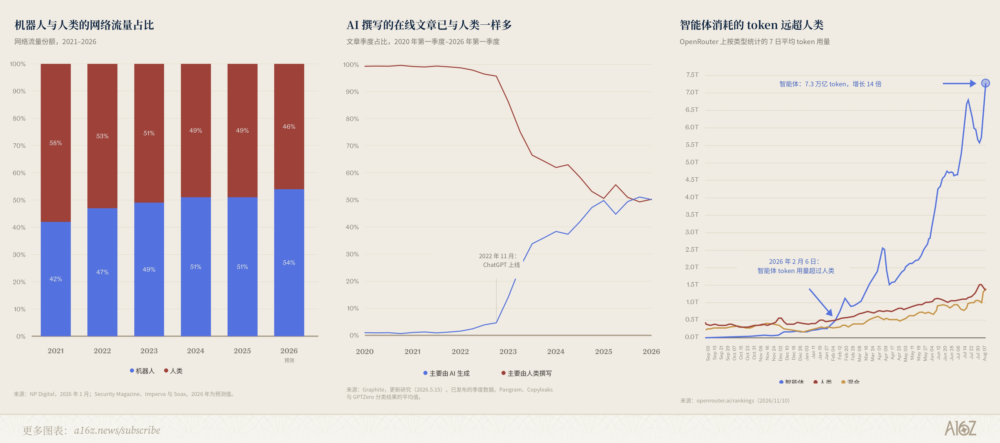
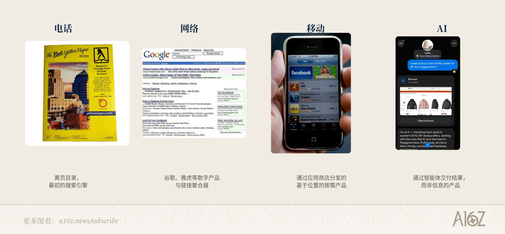
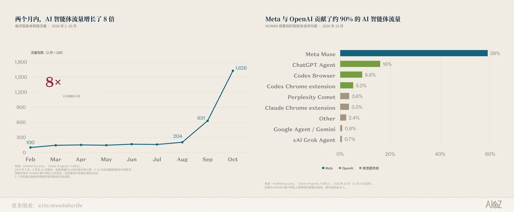
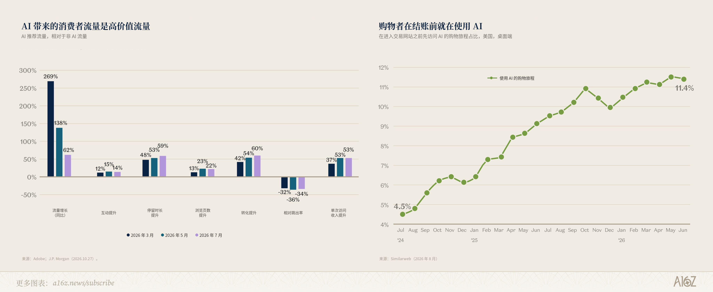
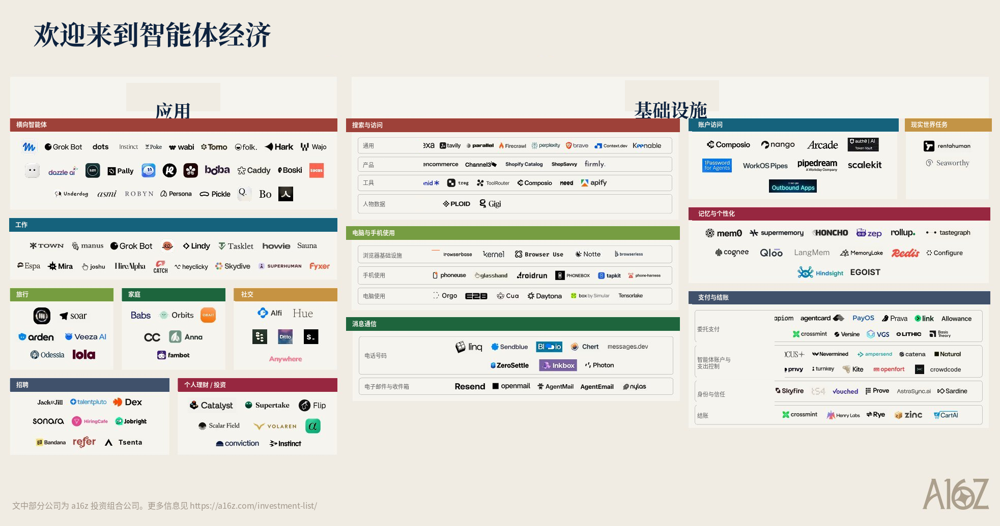

# 欢迎来到 B2A 经济

作者：Olivia Moore（[@omooretweets](https://x.com/omooretweets)）、Justine Moore（[@venturetwins](https://x.com/venturetwins)）
原文：[Welcome to the B2A Economy](https://x.com/omooretweets/status/2120554019177611668)
翻译 Url：[欢迎来到 B2A 经济](https://github.com/samz406/local_wenzhang/blob/main/docs/欢迎来到%20B2A%20经济/欢迎来到%20B2A%20经济.md)

互联网的主要用户已经不再是人类，而是 AI 智能体。

智能体如今占据了网络流量的大头，写出了网上新发布文章的一半以上，还生成了进入生产环境的大部分代码。

这就是平台变迁早期该有的样子：采用率已经能量化，但它所催生的商业模式，大多还没真正显形。此前每一次变迁，既改变了人们能做什么，也改变了企业触达他们的方式。Web 让企业拥有了任何人都能造访的店面；移动互联网把这座店面放进了每个人的口袋。AI 已经改变了人们能做什么，但它对分发的改造，才刚刚开始。

随着智能体从回答问题走向完成任务，它们将越来越多地替我们决定：用哪些产品、订哪些服务、钱花向何处。

把智能体当作一等客户来对待的企业，有机会抓住一波增长；做不到的，则可能自身难保。多年来，零售商和平台筑起高墙，把机器人挡在门外——而现在，它们将不得不争夺这些机器人的生意。

如果智能体真正打入消费端、拿到真实使用量，它们就会打开 AI 里尚未兑现的最大机会：一次真正的平台变迁。此前每一次平台变迁（Web、移动）都是新产品能力与新分发机制成对出现。AI 在前者上表现超预期，在后者上却远远不够——这也是除了 ChatGPT 之外，消费端采用一直如此有限的一个重要原因。

分发变迁的早期信号已经出现。ChatGPT、Claude、Grok 这类大模型，已经成为许多企业规模可观、质量很高的流量来源。[Shopify 曾披露](https://www.shopify.com/blog/how-agentic-commerce-works)，2026 年第一季度，AI 为店铺带来的流量同比增长了八倍，来自 AI 搜索的订单则增长了近十三倍。而且还在加速：Human Security 观察到，8 月到 10 月间，智能体浏览器流量增长了 8 倍，其中 Muse 贡献了最大份额（60%），OpenAI 的产品合计达到 30%。

就像网站比广告牌更能精准触达用户一样，智能体按理应是更强的推荐来源——因为它们掌握着关于用户及其需求的深度、具体的数据。目前来看，这一点正在被验证：由 AI 推荐而来的消费者流量，比非 AI 流量互动更深、也更能转化为收入，跳出率也更低。甚至在智能体兴起之前，美国已有约 11% 的购物旅程会在进入交易网站之前先访问 AI。

眼下，这类流量大多还是通过「浏览器使用」发生的——智能体要么接管用户的浏览器，要么拉起自己的虚拟机和浏览器实例，像人一样点来点去完成任务。不过，我们开始看到某种相当于「智能体版 App Store」、而且更强一档的东西正在出现：连接器、插件和 MCP，让智能体能够更直接地访问第三方工具和网站。

举个例子：我们让 ChatGPT 用 Krea、Descript 和 ElevenLabs 的插件来制作并剪辑一支视频广告。它在这些产品之间完成了协同，还向我们推销了 Descript 的付费方案，好把视频做完。

随着底层平台允许用户把身份或令牌「出借」给其他产品以完成任务（例如[用 ChatGPT 登录](https://help.openai.com/en/articles/20001410-sign-in-with-chatgpt)（Sign in with ChatGPT）），用智能体去注册或付费会变得越来越容易。最终，智能体将能够在没有人工介入的情况下自行选择并安装所需工具——Claude [已经允许](https://x.com/ClaudeDevs/status/2117680635561312732)企业管理员为整个组织接入插件。就在昨天，OpenAI [上线了](https://openai.com/index/introducing-businesses-chatgpt/) ChatGPT 中的 Businesses 功能——公司现在可以认领自己的企业主页、添加产品信息流，并查看用户如何在 ChatGPT 上与它们互动。

有几类公司可能从 B2A 经济（面向智能体的商业 / Business-to-Agent）中获益：

- 智能体 / 智能体化模型——大多数人想到「消费级智能体」，脑海里出现的是 Instinct、Muse、Wabi 这类独立的运行框架（harness）。我们相信，随着背后的模型变得更擅长采取行动，很快每一款产品都将以智能体的方式运转。ChatGPT（拥有 12 亿周活跃用户）在这里有一个尤其值得玩味的机会。
- 因智能体而成为可能的新产品——亚马逊需要互联网才能诞生，优步离开手机也不会存在。我们预期智能体也会催生属于自己的新物种。具体会是什么很难预言，但几个主题已经隐约可见：可自动运转的中小企业、由 AI 中介的市场或网络型产品，以及自动优化器。
- 为智能体做优化的在位者——大模型已经成为许多网站的重要流量来源，并由此催生了[生成式引擎优化](https://a16z.com/geo-over-seo/)（GEO）这个行业。GEO 基本上止步于被发现。智能体还会走得更远，进入评估并执行购买 / 注册选择的环节——这是一个更大的市场。
- 智能体基础设施——智能体要在真实世界里代表它们的人类去行动，就需要一套属于自己的工具。我们已经看到，即便智能体量还不算高，支付、反欺诈与身份认证，以及通信（iMessage、电话、电子邮件等）等系统已经出现了压力。

我们已经有一个可以参照的案例：编程智能体，它们彻底改变了开发者的行为。截至 2026 年 9 月，[超过 40%](https://github.blog/news-insights/octoverse/octoverse-commits-pushes-reach-new-highs-in-2026-as-developers-build-with-agents/?utm_source=chatgpt.com) 的 GitHub PR 始于智能体的草稿——而六个月前，这一比例仅为 17%。

和消费级智能体一样，编程智能体也要依赖外部工具才能把任务做完。比方说，用户让智能体搭建一个网站。要收尾，可能还需要数据库、托管、身份认证、邮件发送和监控。除了智能体化模型与运行框架本身（Cursor、Codex、Claude Code、Cognition，以及 Replit、Lovable、Base44 这类氛围编程（vibe coding）平台），许多其他玩家也看到了增长：

- Supabase [在 2026 年 6 月披露](https://supabase.com/blog/supabase-series-f)，超过 60% 的新数据库由 AI 工具创建
- Neon [在 2025 年 5 月披露](https://www.databricks.com/company/newsroom/press-releases/databricks-agrees-acquire-neon-help-developers-deliver-ai-systems)，自动化智能体部署了其 80% 的新数据库
- Stripe [在 2026 年 6 月披露](https://stripe.com/blog/stripe-projects-adds-new-agents-providers-developer-controls)，智能体贡献了近 40% 的文档流量，以及 70% 针对 API 资源的 CLI 请求
- Vercel [在 2026 年 10 月披露](https://vercel.com/blog/vercel-ship-2026-recap)，由智能体触发的部署在过去十二个月里增长了 28 倍

全球劳动力中，开发者占比不到 1%——当剩下的 99% 也开始使用智能体，会发生什么？

这是我们探索智能体经济的系列文章的第一篇。把它叫成「AI 电商」会低估这次机会——没错，智能体将为实体产品和服务带来交易量。但它们同样会改写流量、token 和收入流向数字产品的方式。出于对欺诈和拒付的担忧，大多数企业仍在拦截智能体流量，但我们相信，它们终将不得不拥抱这波日益值钱的浪潮。

接下来几周，[@venturetwins](https://x.com/venturetwins) 和我将发布更多洞察与数据，围绕：消费级智能体的当前使用情况，智能体如何决定把流量导向哪些网站和产品，围绕智能体的基础设施如何演进，以及智能体完成交易还剩哪些障碍。

这个领域每天都在变化——下面是我们目前对市场的最佳梳理。其中既包括智能体本身，也包括让它们得以存在的基础设施。

