# 科技就业市场现状：2026 年末

作者：Lenny Rachitsky
原文：[State of the tech job market: late 2026](https://www.lennysnewsletter.com/p/state-of-the-tech-job-market-late)
翻译 Url：[科技就业市场现状：2026 年末](https://github.com/samz406/local_wenzhang/blob/main/docs/科技就业市场现状：2026%20年末/科技就业市场现状：2026%20年末.md)

产品经理在赢，工程师需求见顶，设计师承压，而这一轮最大的 AI 招聘热并不在软件岗。

---

*👋 你好，我是 Lenny。每周我会分享经过深入调研的产品、增长与职业建议。更多内容：[Lenny’s Jobs](https://www.lennysjobs.com/) | [Lenny’s Podcast](https://www.lennysnewsletter.com/podcast) | [Lennybot](https://www.lennybot.com/) | [How I AI](https://www.youtube.com/@howiaipodcast) | [Become an AI-Native Builder](https://maven.com/tech-for-product/become-an-ai-native-builder)，以及我推荐的其他 [AI/PM 课程](https://maven.com/lenny)。*

[立即订阅](https://www.lennysnewsletter.com/subscribe)

*P.S. 成为 Insider 订阅者，即可免费获赠一年的 Cursor、Notion、Replit、Lovable、Wispr Flow、Linear、ElevenLabs、PostHog、Granola、Brain.fm、Waking Up 等工具（赠完即止）。[了解详情](https://www.lennysproductpass.com/)。*

---

欢迎来到我最新一期就业市场报告，这也是我 2026 年的第二篇。过去几年我一共写过五篇，这一篇最出乎意料，也最有意思。

眼下我们看到的是：

1. **产品经理似乎正在 AI 时代胜出**
2. **工程岗位需求已经停滞**
3. **设计岗位跌至历史最低**
4. **人人都得会 AI**
5. **科技岗位正在向湾区集中**
6. **远程岗位跌至历史最低**
7. **科技就业市场在快速增长，但增长大多不在软件岗（没想到吧！）**

这份分析基于我很喜欢用的两套独家数据：[TrueUp](https://trueup.io/)，它支撑着 [Lenny’s Jobs](https://www.lennysjobs.com/)，追踪全球科技公司的开放职位（覆盖 9,000 多家公司）。第二套数据来自 [Live Data Technologies](https://www.livedatatech.com/insights/us-tech-hiring-2026?utm_source=lennysnewsletter.com&utm_medium=referral&utm_content=job_market_post)，追踪 1.24 亿名职场人的工作变动（入职、离职与晋升），下文中的招聘数据仅针对美国。两套数据对照来看，既能相互印证趋势，彼此之间的差异本身也很能说明问题。感谢 [Amit Taylor](https://www.linkedin.com/in/amittaylor/) 和 [Alex Hamilton](https://www.linkedin.com/in/luisalexanderhamilton/) 与我们分享这些精彩的数据。🙏

我们开始吧。

*P.S. 如果你正在找工作，不妨去看看 [Lenny’s Jobs](https://www.lennysjobs.com/)！*

---

## 要点 1：产品经理似乎是 AI 时代最大的受益者

关于 AI 会取代产品经理的说法已经很多了（「还要他们干什么！」）。但到目前为止，数据呈现的恰恰相反。现在的[产品经理开放职位](https://www.lennysjobs.com/jobs/product)比近四年来的任何时点都多，较 2023 年 3 月的低点上涨了 75%；自 2023 年初以来，产品经理开放职位的增速也快于其他所有核心科技岗位（+56%，工程岗位为 +43%）。

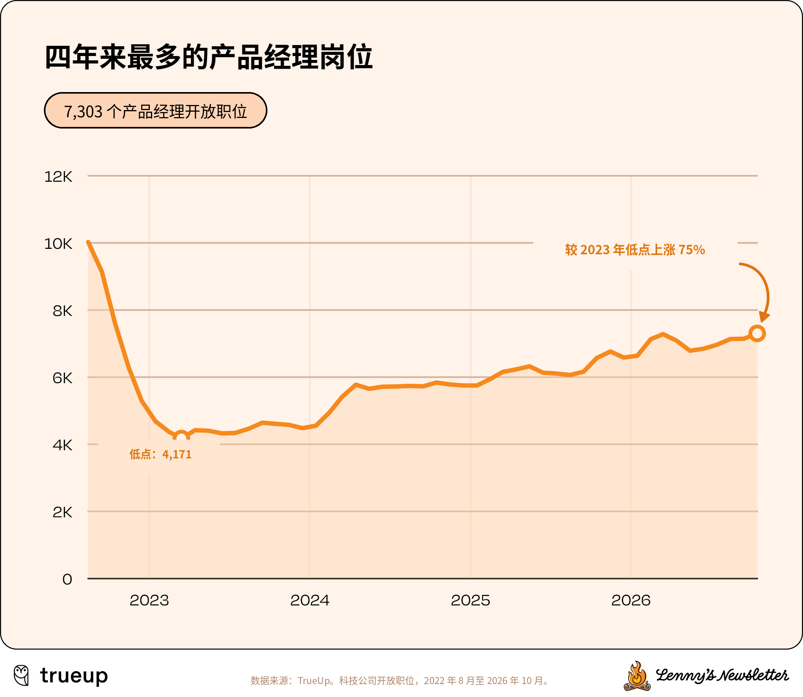

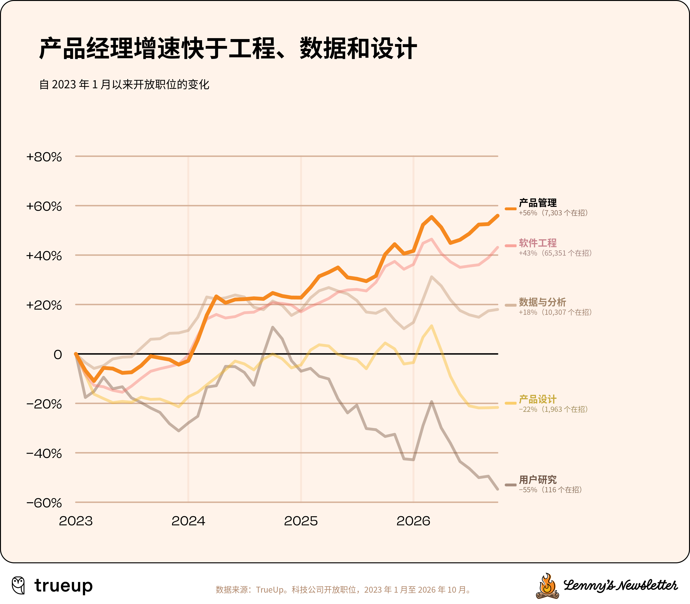

如果看实际招聘人数，而不只看开放职位，故事会更有意思。尽管开放职位在增加，过去几年里，每一个核心产品岗位的实际招聘都是持平或下降的（哪些岗位现在增长最快，见要点 7）。但产品经理的招聘是撑得最好的（而且是遥遥领先）。在五个核心岗位里，也只有产品经理的招聘占比在*上升*（从 2021 年的 16% 升至如今的 21%）。

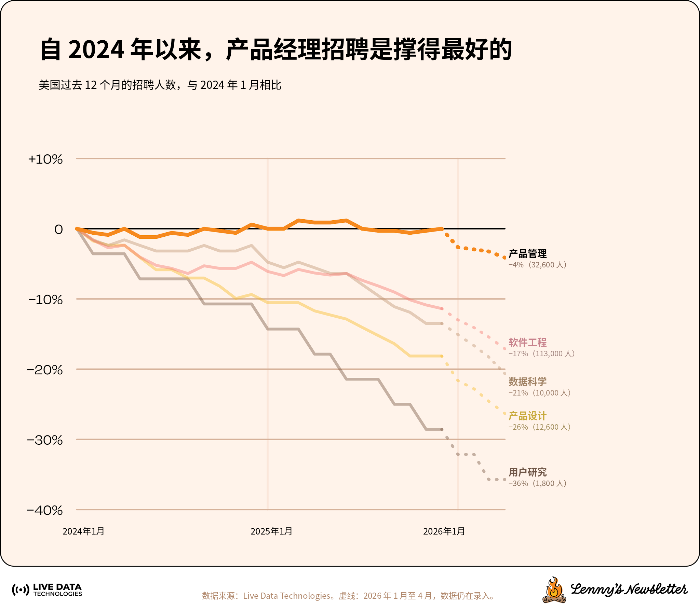

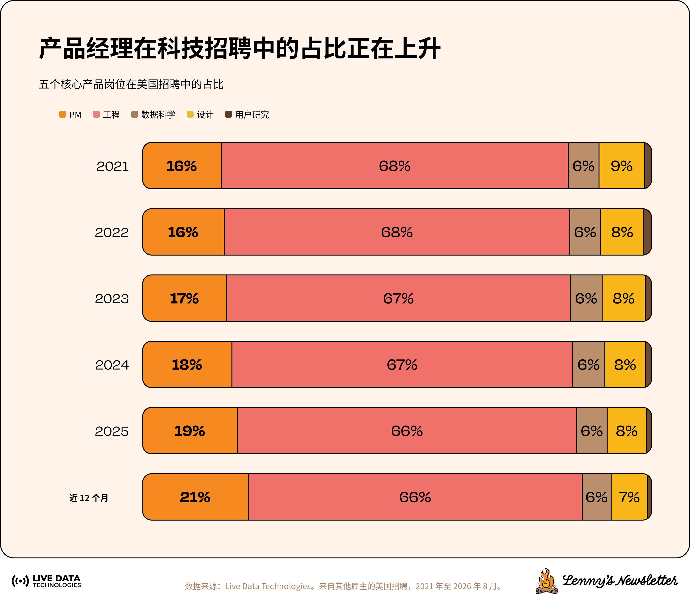

开放职位在增长（第一组图），实际招聘却走平甚至下滑（第二组图）——这让我觉得：对产品经理的需求在增加，但要招到优秀的产品经理，正在变得更难。

## 要点 2：工程师需求正在见顶

在这份报告的历史上，工程岗位的开放职位第一次停滞了。工程开放职位在 2024 年增长了 29%，2025 年增长了 15%，而*过去一年只增长了 2.5%*。**今天科技公司的工程开放职位，甚至比今年 3 月还要少。**

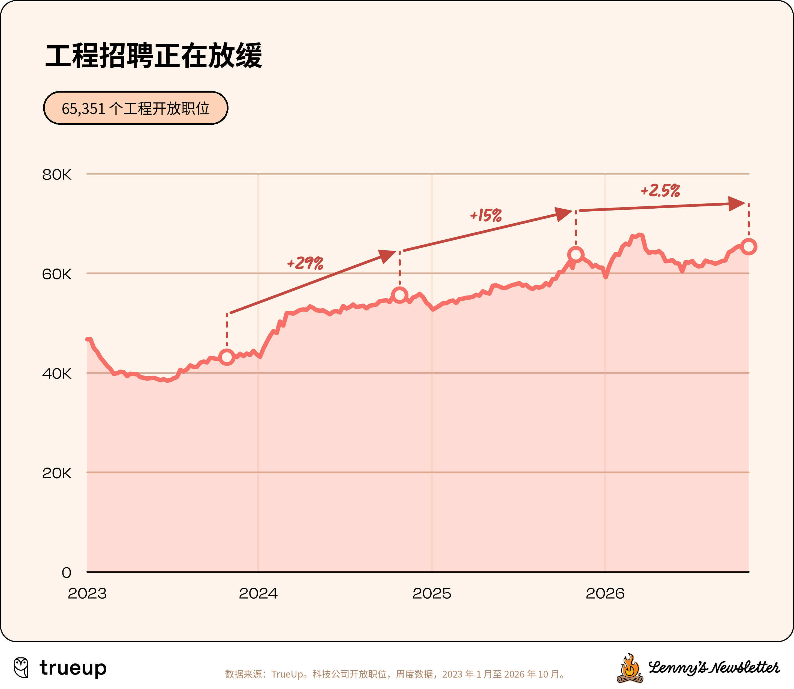

招聘数据也显示出同样的放缓。过去 12 个月（2025 年 5 月至 2026 年 4 月），美国公司大约招聘了 113,000 名软件工程师——不到 2022 年峰值（239,000）的一半。而且自 2022 年以来，这个数字每年都在下降。

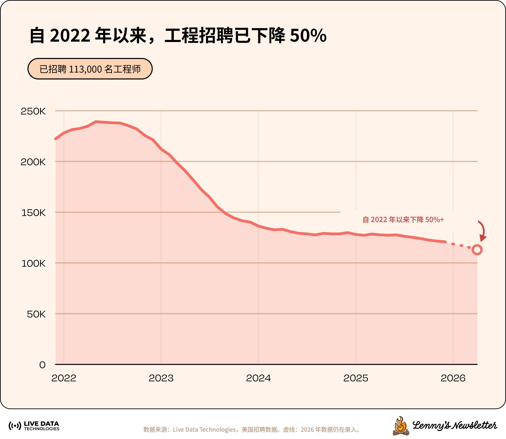

和产品经理一样，工程岗位的*开放职位*在增加，实际*招聘*却在下降（自 2024 年 1 月以来分别是 +44% 和 −17%）。所以即便需求在放缓，要招到优秀的工程师，也变得更难了。

**工程师这边也有两个亮点：** 其一，科技招聘岗位的需求简直是在狂奔。我们已经创了历史新高：招聘开放职位自 2023 年年中以来上涨了将近 300%。这或许是工程招聘即将重新加速的领先指标，我们会密切跟踪。

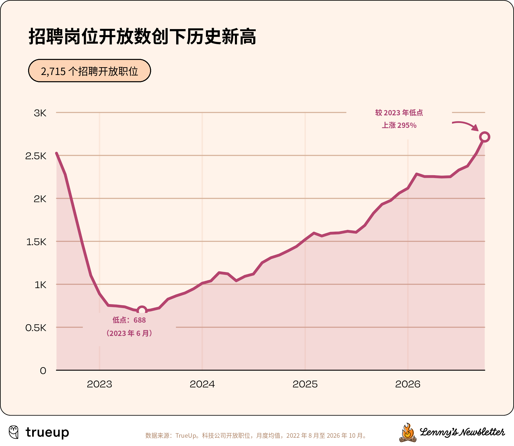

另一个亮点是，从绝对数量来看，工程依然是科技招聘里最大的一类，而且遥遥领先。仅 2025 年，美国就招聘了超过 120,000 名工程师。外面也仍然有大量不错的工程岗位。[确切地说，超过 65,000 个](https://www.lennysjobs.com/jobs/engineering)。

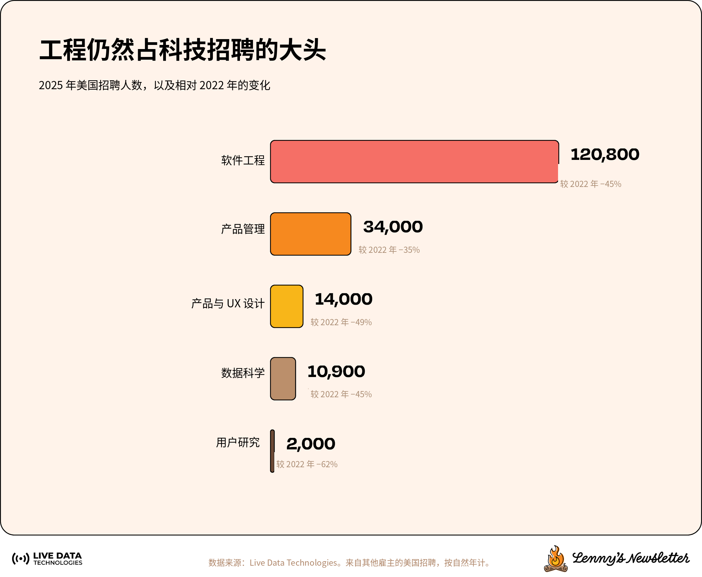

工程职能内部还有一个值得关注的新趋势：**前线部署工程师（FDE）的崛起**。FDE 开放职位正在爆发。历史上，全球通常只有几十个 FDE 开放职位（大多在 Palantir）；但从 2025 年开始攀升，过去一年就涨了 **4.6 倍**！目前大约有 [1,500 个 FDE 开放职位](https://www.lennysjobs.com/jobs/fde)。需要说明的是，这一增长很可能既来自这一岗位本身的需求上升，也来自其他岗位类别（比如「销售工程师」）被重新包装成了「FDE」。不管怎样，FDE 现在就是很火。

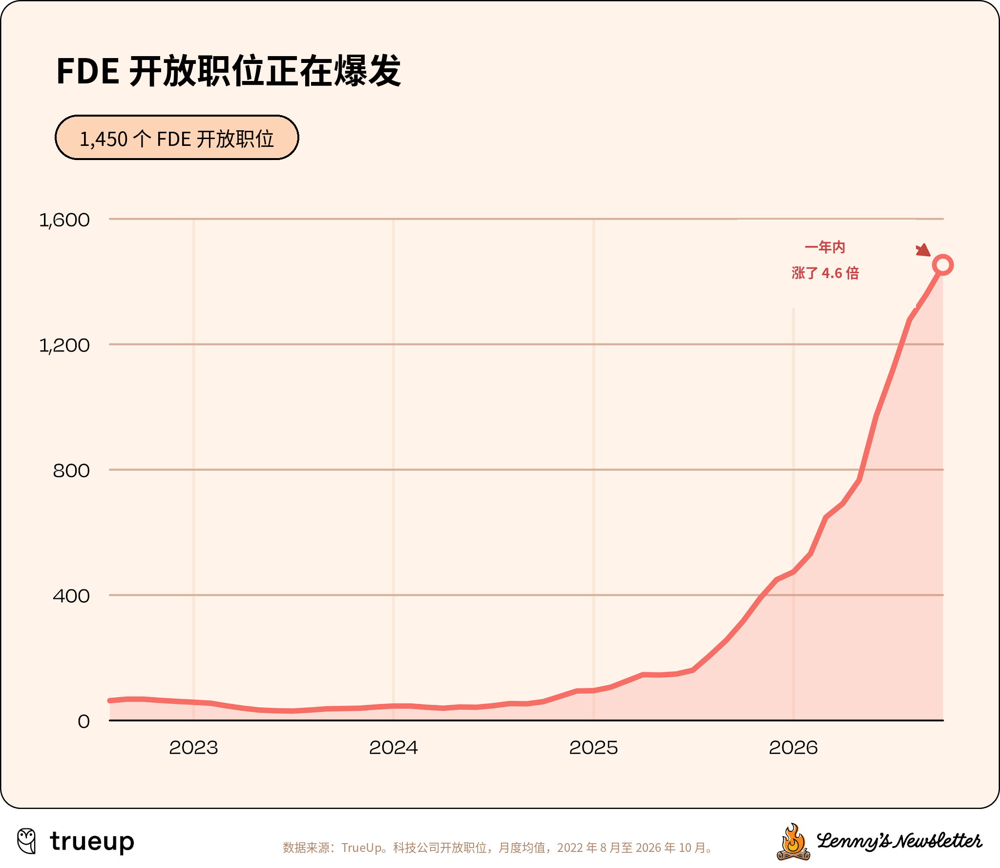

还有一个很能说明问题的趋势：安全工程是增长最快的专业方向之一，紧随 FDE 之后。另一面，移动和前端工程师的需求在过去一年几乎腰斩。这很惊人。我觉得，故事的核心是专业化、烟囱式的工程分工正在瓦解，更小的工程团队开始承担更广的职责（这要感谢 AI）。

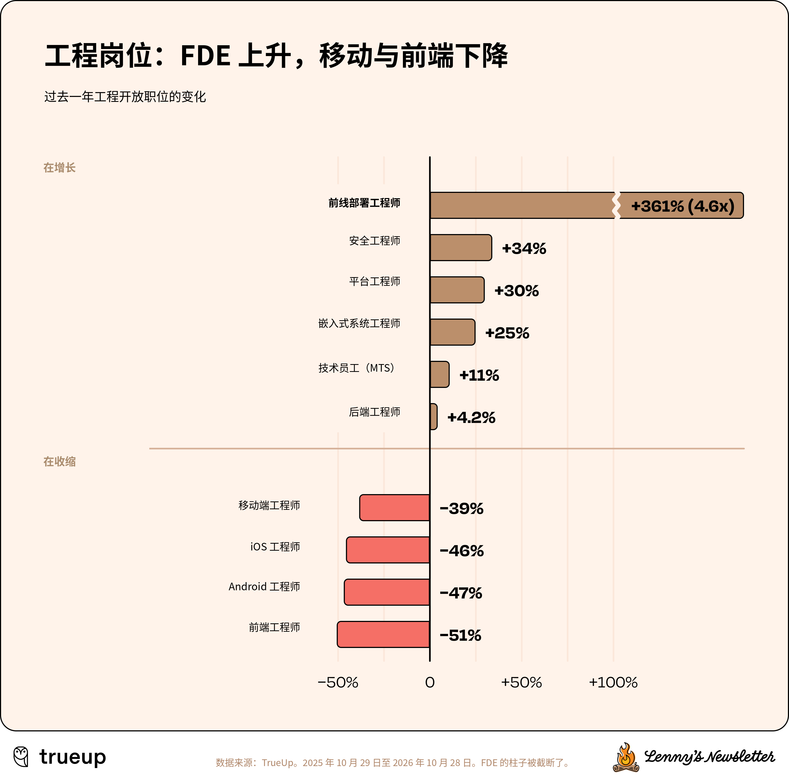

## 要点 3：设计师需求继续刷新历史低点

可惜了我那些做设计的朋友，设计岗位还在继续下滑。全球科技公司目前大约只有 [1,900 个产品设计开放职位](https://www.lennysjobs.com/jobs/design)，比 FDE 开放职位高不了多少。这是我们开始追踪以来的最低水平，比一年前下降了 28%。😥

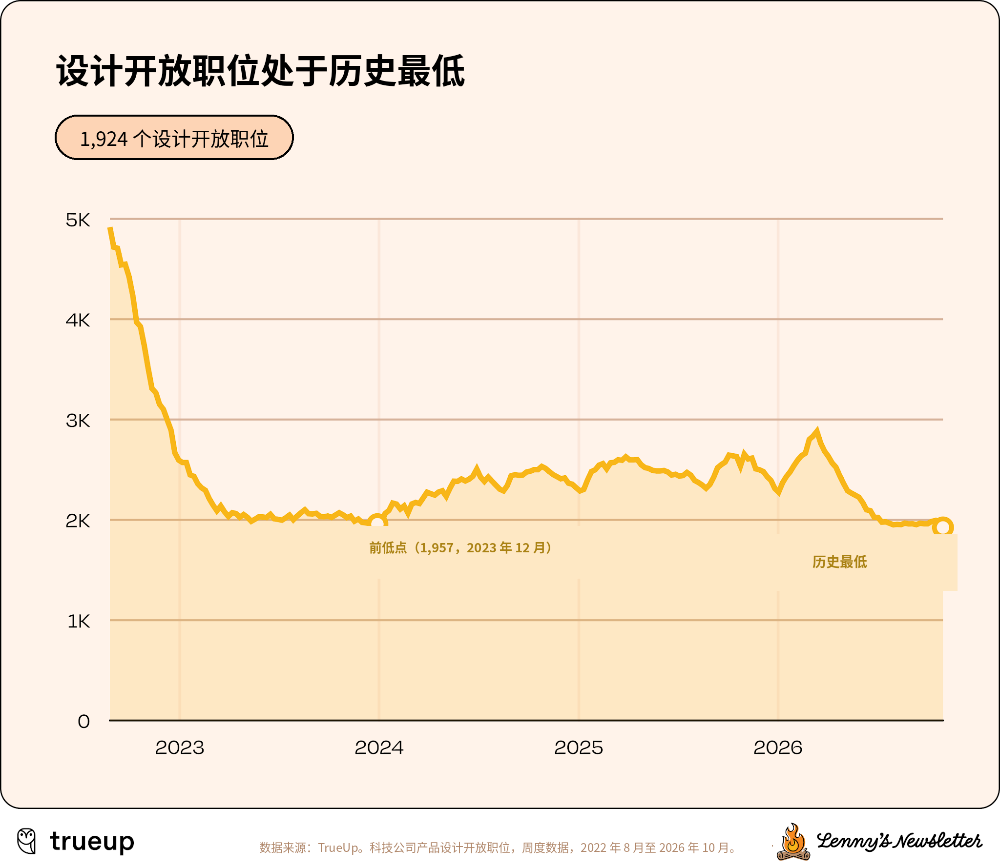

Live Data Technologies 的实际招聘数据讲的是同一个故事。过去 12 个月，美国公司大约招聘了 12,600 名产品设计师，不到 2022 年（27,600）的一半，而且自那以后每年都在下降。

更能说明问题的是，产品经理开放职位与设计开放职位的比率，还在进一步向产品经理倾斜。**现在每 1 个设计开放职位，对应 3.8 个产品经理开放职位。** 今年早些时候还是 2.6，2023 年初则是 1.9。

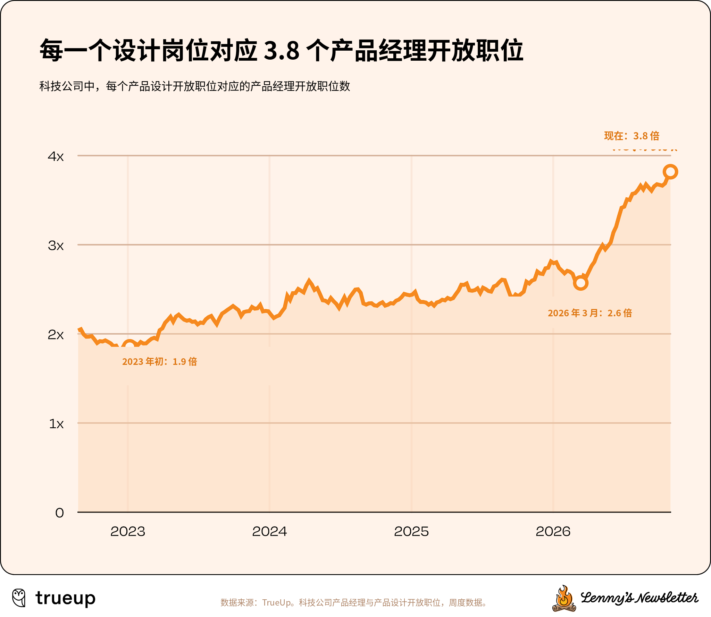

*LDT 的招聘数据呈现出同样的趋势，只是数字略有不同：过去 12 个月，美国雇主大约每招聘 1 名设计师，就会招聘 2.9 名产品经理，而 2022 年这一比例是 1.9。*

我仍希望这一趋势能扭转。当公司意识到，优秀的设计可以成为巨大的差异化优势，帮助产品在越来越嘈杂（也越来越满是 AI 糟粕）的市场里脱颖而出，情况也许会改观。[Katie Dill 那场关于 AI 与设计的演讲](https://www.youtube.com/watch?v=GLvFTMtw4Jk)，最近成了我[有史以来播放量最高的视频](https://x.com/lennysan/status/2118773191703511524?a=a7cZ5IKJlJ1mqerTyr4&s=20)，所以还是有希望的。

更遗憾的是，用户研究（UXR）受到的冲击比设计还要大。过去一年，美国大约只招聘了 1,800 名用户研究员，比 2022 年的 5,300 人下降了 66%，是我们看过的所有岗位里降幅最陡的，而且比前一年又再降了 22%。剩下的招聘还集中在少数几家大公司。2025 年，仅 Meta 和 Google 就占了美国全部用户研究招聘的大约八分之一；而到 2026 年目前为止，只有 Google 一家招聘了 50 人或以上。目前全球科技公司[只有 108 个 UXR 开放职位](https://www.lennysjobs.com/jobs/ux-research)。

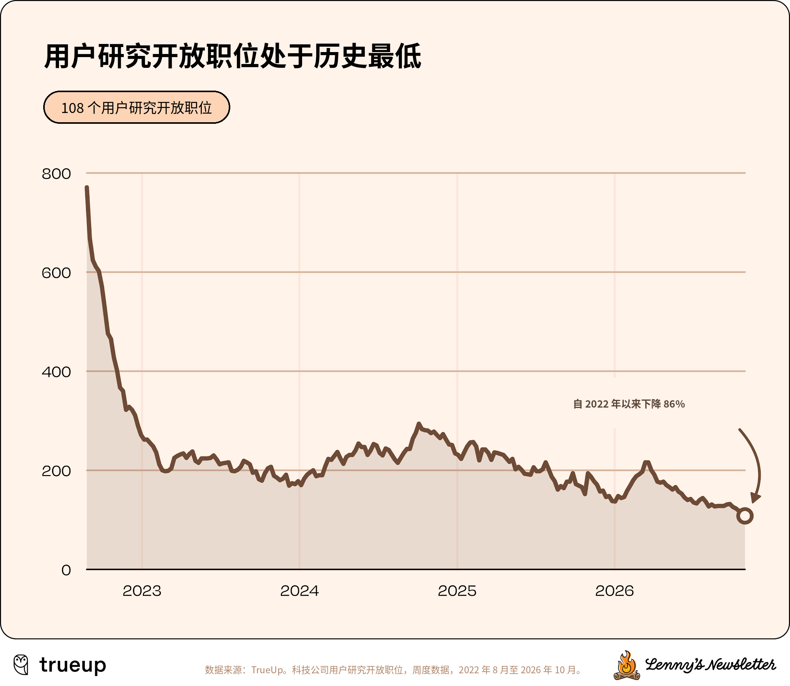

我的判断是，产品开发节奏不断加快，要对此负责。就像[传统设计流程已经越来越挤不出时间](https://www.youtube.com/watch?v=eh8bcBIAAFo)，传统用户研究流程同样越来越没有时间（也越来越没人感兴趣）。无论好坏，团队越来越能接受更早发布产品，以免落后，再在上线之后学习、迭代，而不是靠用户研究先做功课。此外，更好的 UXR 工具（比如 [Listen Labs](https://listenlabs.ai/)、[Simile](https://www.simile.com/)）也让非 UXR 的人自己就能做用户研究。我甚至在想，UXR 作为一个独立职能，是不是正在走向消亡……🫣

## 要点 4：人人都得会 AI

两年前我们做这期报告时，产品经理职位描述里被提及最多的技能还是 SQL、Jira、AWS 和 Python。**而今天，「LLM」已经是产品经理职位描述里被提及最多的技能。**

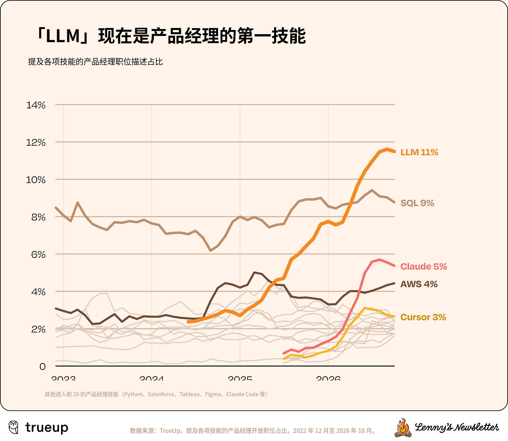

不仅如此，许多其他 AI 相关词汇，现在也跻身产品经理职位描述中最常出现的技能之列。「**Claude**」是被提及第三多的词，Cursor、OpenAI 和 MCP 都进了前八。与此同时，SQL 仍然站得住；不过正如最近一期播客嘉宾 [Emmanuel Ameisen 所指出的](https://www.youtube.com/watch?v=JHo-aiePjoM&t=2961s)，我们再也不可能比 AI 更擅长 SQL 了。所以这一项还能撑多久，我们走着瞧。另外，「评估（evals）」也在蓄势（已进入前十）——我预计这个数字还会继续涨。

对**工程师**来说，「Python」多年来一直是被提及最多的技能，而且还在继续涨！看看 2025 年初那道拐点。工程师这边还有三个趋势特别突出：（1）「LLM」刚刚在工程职位发布中超过了 Java；（2）过去一年 Java 整体在走弱；（3）Kubernetes 依然很稳。

简单说：Python 和 AI 📈，Java 📉。

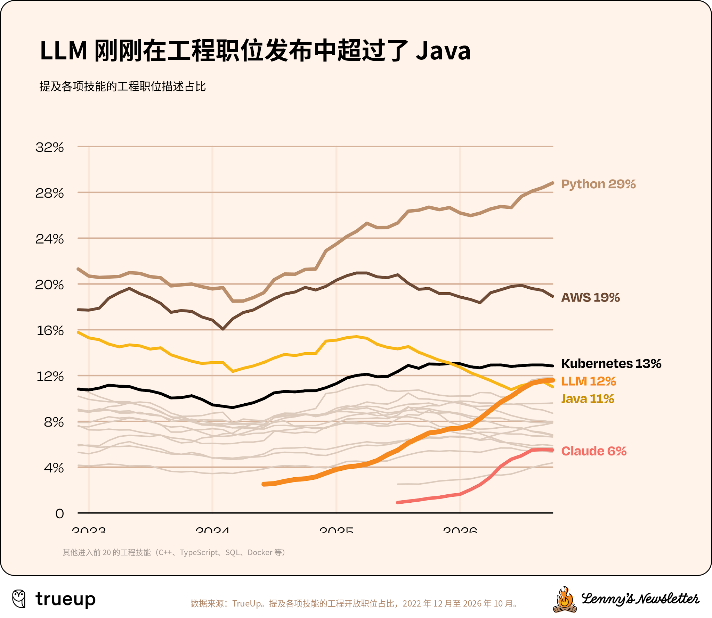

对**设计师**来说，Figma 已经连续多年碾压其他所有技能。而且有一个打破惯常叙事的发现：对 Figma 经验的需求，在过去三年里其实还*在增长*。

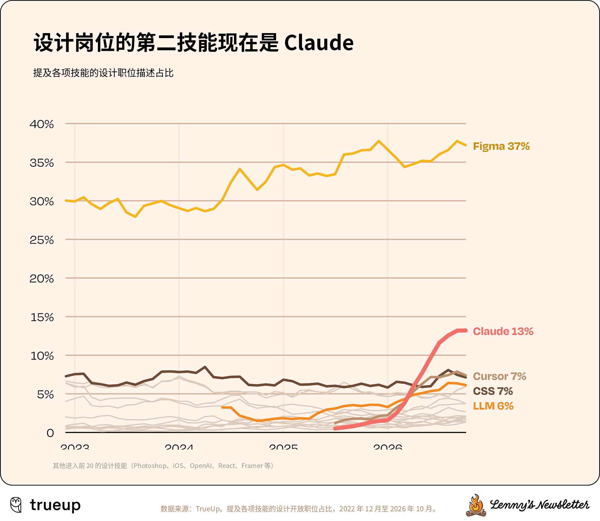

但和其他所有岗位一样，AI 正在上升。「**Claude**」今年春天成了设计师职位描述里被提及第二多的技能（超过了 CSS！）。值得注意的是，这里具体是 Claude，而不是「LLM」或 ChatGPT。Anthropic 似乎正在赢得设计师的心。Cursor 也已经略微超过了 CSS。时代，正在改换。

这或许可以回答一个问题：如果对 Figma 的需求还在增长，为什么 [Figma 的股价却跌了](https://www.google.com/finance/quote/FIG:NYSE?sa=X&ved=2ahUKEwjc8_LusvGXAxXvCYAAHRubAIcQ3ecFKAR6BAgoEAU&window=5Y)？设计师未必在抛弃 Figma，但这么长时间以来第一次，设计师也越来越多地伸手去拿别的工具。而设计作为一个职能，本身并没有在增长。

## 要点 5：顶尖科技岗位继续向湾区集中

今天，科技开放职位中位于湾区的比例创下了新高。这是个大数字。如今科技公司所有开放职位中，有 15% 设在湾区（大约七分之一），而湾区开放职位的数量，**仅比一年前就增长了 43%**！

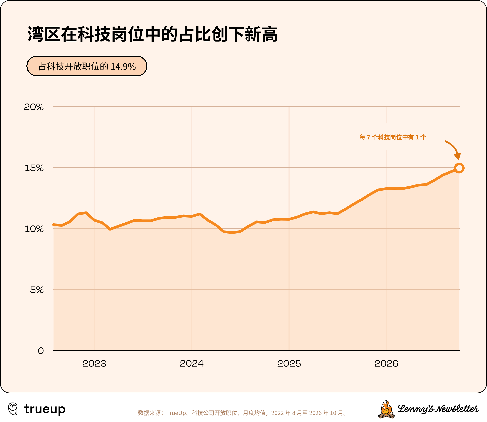

这一趋势在核心产品岗位上更加明显。**现在，四分之一的产品经理和设计开放职位在湾区，工程岗位则是五分之一。** 这三个岗位都创了历史新高，各自的占比自 2022 年以来几乎都翻了一番。

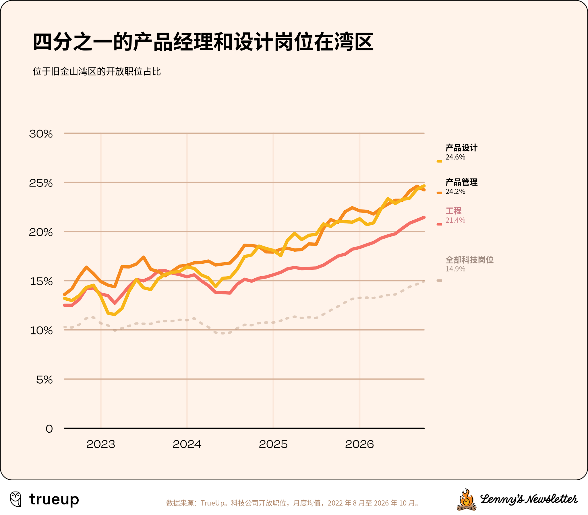

## 要点 6：远程岗位继续下降

科技岗位向湾区集中的另一面，是远程岗位数量继续下降。现在只有 14% 的科技开放职位提供远程选项，这是有记录以来的最低水平，低于 2022 年底的 21%。

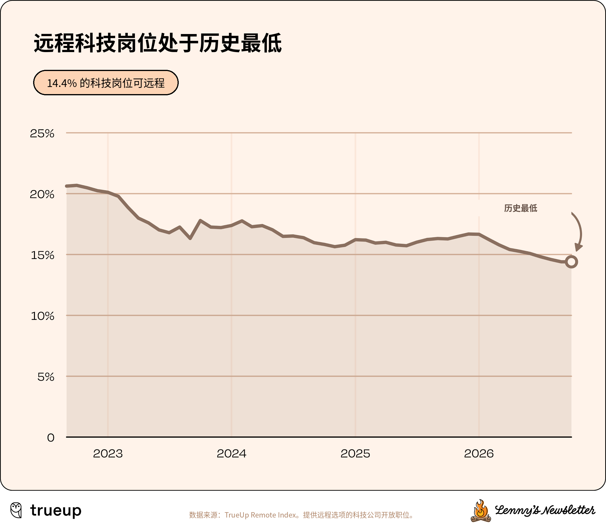

工程远程岗位同样处于历史最低，目前为 14%，低于我们在 2022 年底看到的 25%。设计也是同一条路：19% 的设计开放职位是远程的，低于此前的 34%。产品经理则是个例外，过去两年一直稳定在大约五分之一（21%），但仍然接近历史低点。

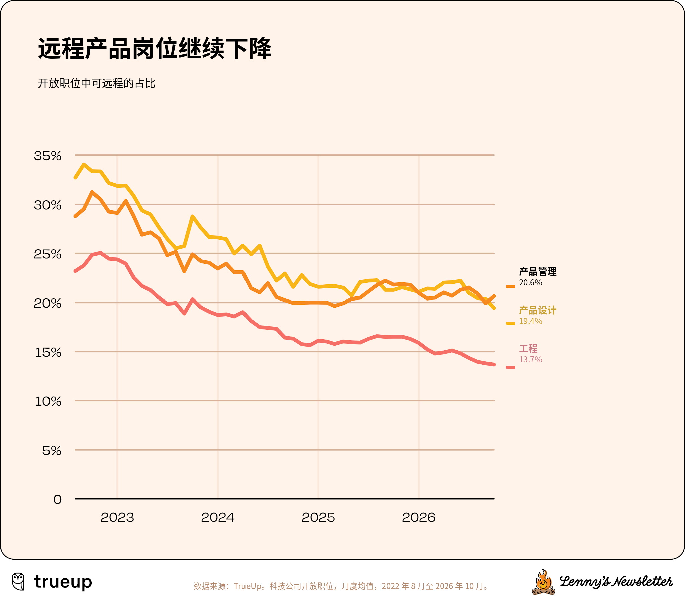

把这些放在一起看，大约从去年某个时候开始，我们跨过了一个节点：**现在，设在湾区的产品经理、工程和设计开放职位，已经多于全球范围内的远程职位。** 而四年前，远程还几乎以 2 比 1 领先。

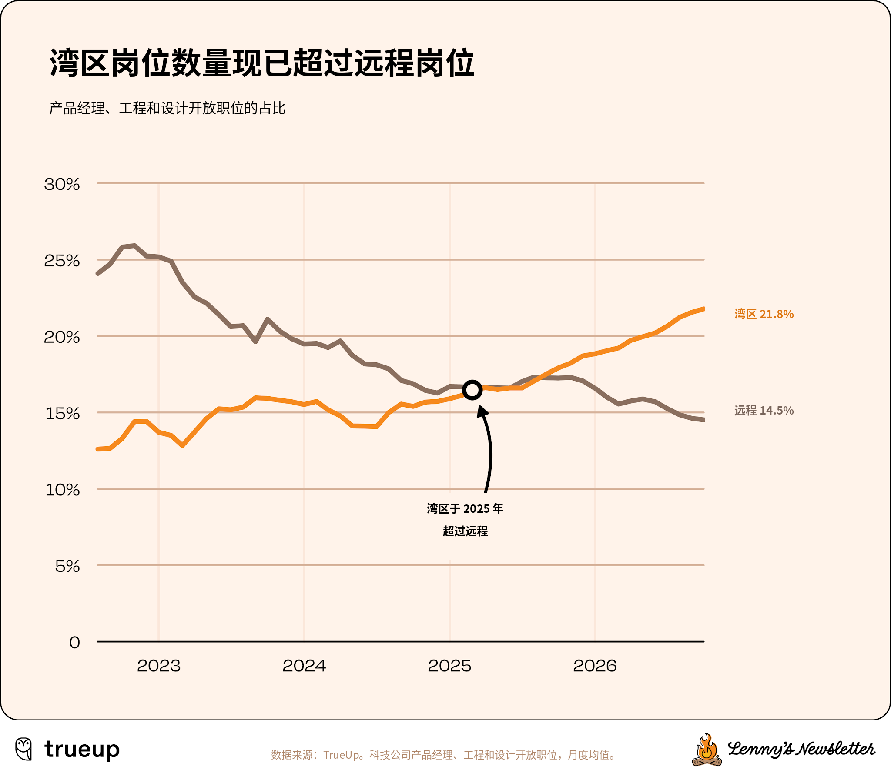

## 要点 7：总体来看，科技就业市场在增长——只是增长在软件岗位之外（没想到吧！）

我把或许最有意思的一条，留到了最后。

> **说明：** 原文这一节的其余部分（以及可能配有的图表）在付费墙之后，公开预览中未能收录。以下几段依据作者 Lenny Rachitsky（[@lennysan](https://x.com/lennysan)）本人在 X 上的公开帖文整理，并非通讯原文剩余部分的译文。需要注意的是：这些帖文与上文要点 1–6 所用的统计口径、时间窗口并不完全相同（例如用户研究的降幅），数字可能因此不一致。此处沿用 X 帖原文中的表述，不作折算或调齐。

科技就业市场是多年来最好的状态。但增长几乎都不来自软件岗位。

科技公司现有 281,000+ 个开放职位，比一年前增加 17%，比 2023 年 3 月的低点增加 73%。

但产品经理、工程和设计的开放职位只增长了 2%。设计（−28%）和用户研究（−45%）实际上还在收缩。

那么增长从哪来？硬件工程开放职位翻了一番。业务运营新增了约 4,200 个开放职位。供应链上涨了 63%。增长最快的许多岗位是偏实体、偏现场的：数据中心技术员、安装人员、现场服务工程师。

AI 热潮确实在创造岗位，但大多是在建设和运营物理基础设施（芯片、数据中心、硬件），而不是做软件。

时代，正在改换。

——Lenny Rachitsky，[X 帖文](https://x.com/lennysan/status/2120574811038691488)（2026 年 11 月 12 日 01:50，Asia/Shanghai）

眼下科技岗位里变化最大的是：

**在下降的：**

- 前端工程师：−51%
- iOS/Android 工程师：−46%
- 用户研究员：−45%
- 产品设计师：−28%（历史最低）

**在上升的：**

- 前线部署工程师：4.6 倍
- 硬件工程师：2 倍
- AI 工程师：+46%
- 安全工程师：+34%

做好相应的打算。

（依据：过去一年开放职位的百分比变化）

——Lenny Rachitsky，[X 帖文](https://x.com/lennysan/status/2120640209779884381)（2026 年 11 月 12 日 06:10，Asia/Shanghai）

眼下增长最快的工程岗位：

1. FDE
2. 硬件工程师
3. AI 工程师
4. 安全工程师

这是时代的征象。

——Lenny Rachitsky，[X 帖文](https://x.com/lennysan/status/2120547244953031043)（2026 年 11 月 12 日 00:00，Asia/Shanghai）
