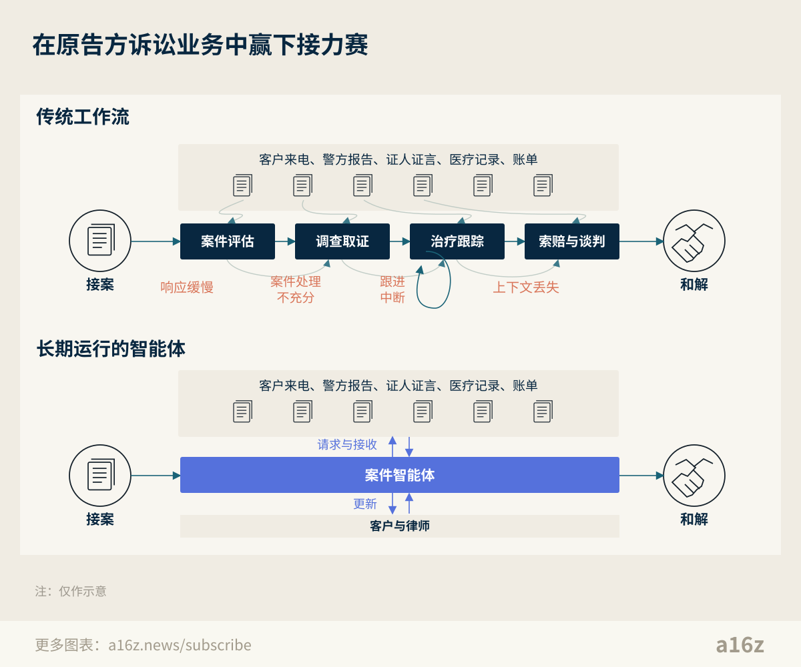
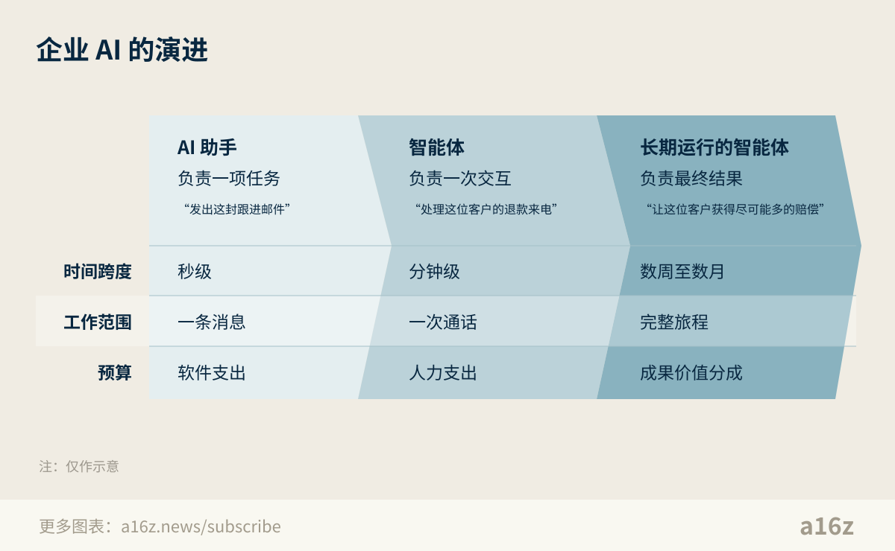
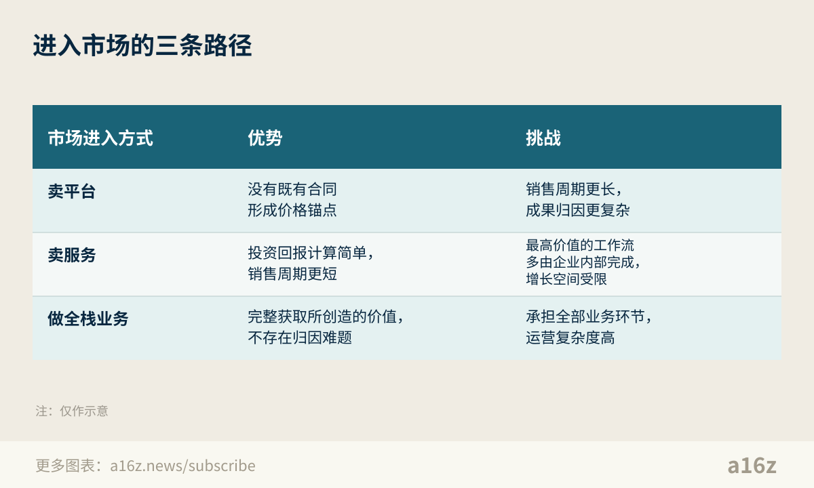

# 赢下接力赛：长期运行的智能体如何贯穿高价值客户旅程

> 作者：David Haber（[@dhaber](https://x.com/dhaber)）  
> 原文：[Winning the Relay Race: Long-Running Agents in High-Value Customer Journeys](https://x.com/dhaber/status/2110370065870680236)  
> 翻译 Url：[https://github.com/samz406/local_wenzhang/blob/main/docs/长程智能体与客户旅程/赢下接力赛-长期运行的智能体如何贯穿高价值客户旅程.md](https://github.com/samz406/local_wenzhang/blob/main/docs/长程智能体与客户旅程/赢下接力赛-长期运行的智能体如何贯穿高价值客户旅程.md)  
> 发布日期：2026 年 10 月 14 日

过去，家里断网后打电话给宽带运营商报修，过程大致是这样的：先是一段机械的语音，客气地称你为尊贵的客户，接着让你花好几分钟在电话菜单里打转：“技术支持请按 3，宽带业务请按 2，其他问题请按 4。”然后你被转入等待，感觉自己已经被遗忘。好不容易有位客服接听，又得报姓名、账号，解释出了什么问题。如果重启路由器没用，你就得再次等待，再向另一位客服从头讲一遍，最后才约上技术人员上门。

AI 已经开始改变这样的客服体验。你不用再和机械语音、好几位客服周旋，AI 智能体可以立即接听，查看你的账户，检查所在区域是否还有其他用户遇到同样的问题，然后直接解决简单故障，或者预约技术人员。不再有“我们的客服目前都在忙”，也不用再听等待音乐。直到不久前，技术所能做到的也就止于此了。

如今，新的能力正让智能体能够沿着任务线索持续跟进，在更长的时间跨度里执行工作。我们认为，这会让 AI 公司走出一次次孤立的客户交互，重新思考如何处理持续数周乃至数月的复杂客户旅程。AI 可以陪保险客户从首次来电一路走到赔付，陪房贷申请人从贷款预审批走到交易交割，也可以把企业销售线索从第一次产品演示推进到合同签署。这不仅会让客户得到更好的结果，还会让 AI 服务商有机会从由此带来的收入增长中获得回报，而不只是靠替客户节省成本来收费。

## 价值，要跑完整场接力赛才会兑现

许多业务要经过好几个步骤，花上数周甚至数月，才能为客户创造价值。拿传统的原告方诉讼案件准备流程来说：潜在案件往往以电话咨询的形式进入律所，接案专员收集关键事实，再交给律师评估是否接受委托。正式接案后，就开始调查取证。律师助理调取警方报告，设法联系证人，向被告发送证据保全通知函，同时向客户通报进展。接下来，律所等待客户完成治疗，再整理诊疗时间线，把材料交给律师，最终完成索赔函。

过去，我们会把这样的流程称为“接力赛”：一路很长，每次交接都有客户流失或价值损耗的风险。潜在客户通常会同时致电几家人身伤害索赔律所，最后往往选择回复最快的那家。如果电话只接进了语音信箱，或者是否接案迟迟没有结论，案件就可能从业务漏斗中流失。正式接案后，取证工作又会同时拉开多条线索。如果给一位潜在证人打了四次电话都没人接，律所未必还有耐心打第五次。此外，人力有限，律所很难逐一细看每份证据，尤其是那些看起来常规、索赔金额不大的案件。明明仔细读一读医生的记录，就可能发现脑损伤的迹象，争取更高的和解赔偿，律所却可能直接接受了对方的首次报价。最后，案件可能持续数月，需要许多人参与，信息又散落在各种文档、相关人员和系统之间，几乎不可能始终掌握每位客户的完整情况。结果，一些重要账单可能没有写进索赔函，治疗间断的原因也可能没有得到解释，最终压低了和解赔偿金额。

## 长期运行的智能体，机会在哪里

直到不久前，AI 智能体主要处理边界明确的任务，比如“发出这封跟进邮件”“总结这次通话”“创建这份文档”，以及范围有限的交互。客服之所以成为 AI 最早落地的好场景之一，就是因为它的问题范围清晰，既能做到很高的可靠性，又能根据各家公司的具体政策定制。交互时间短，结果可以验证；遇到智能体处理不了的特殊情况，原有的客服团队通常也还在，可以接手升级处理。

如今，长期运行的智能体可以跨越几十个步骤、多种交互方式，在更长的时间跨度内持续追求一个目标，从头到尾跑完整场接力赛。还是拿原告方诉讼业务来说，从第一次接案来电开始，就可以为案件分配一个智能体，目标是让客户获得尽可能多的赔偿。它会按需保存、调取案件上下文，由事件或截止时间触发唤醒，主动派出子智能体联系证人、向客户通报进展，并通过电话、邮件或短信与律师沟通。随后，它会汇总调查结果、规划下一步行动、起草文书供人审核，把案件推向尽可能好的结果。在处理不同客户的案件时，它还会持续学习：每个案件都会产生数据，帮助它把下一个案件办得比这一个更好。

这样的智能体能够堵住当下接力赛中的几处关键价值漏洞。在旅程起点，客户不再因为案件评估太慢而流失，因为智能体不分几点、也不分工作日还是周末，随时可用，几乎可以立刻完成评估。取证也不再受人力限制：案件智能体随时可以再派出一个子智能体，打第五通、第十通，甚至第二十通电话。由于智能体几乎可以无限扩展，即使是看似常规的案件，也能得到充分处理，每份证据都能被仔细审阅，从而发现那些原本可能被漏掉的脑损伤线索。最后，从证人的通话记录到警方报告、医疗记录，智能体都会保留完整的案件档案，确保信息不会在流转中丢失。

## 按结果获得回报

除了堵住这些漏洞，掌握完整的客户旅程，还能改变智能体服务商的盈利逻辑。智能体能更快地交付更高质量的结果，就能为客户带来收入增长，而不只是降低成本。更关键的是，这种影响可以观察，也能归因到智能体，因此服务商可以按工作交付物或业务结果收费，分享自己创造的增量价值。比如在原告方诉讼业务中，一个案件就是一个独立的工作单元，而最终结果的价值，也就是和解赔偿金额，是清楚可辨的。同时，智能体承担的工作占最终交付物的比重越大，就越容易把结果与它关联起来。这样一来，服务商就可能分享客户的收入增长，拿到过去单靠降本根本无法企及的合同金额。

当然，转向按结果定价并非毫无阻力。在原告方诉讼业务中，美国大多数州禁止非律师参与律师费分成，因此，定价需要与和解赔偿金额挂钩，却不能直接从中抽成。在其他行业，采购团队可能因为没有按结果签约的先例而提出异议。即使智能体越来越接近独立承担最终结果，初期也很可能出现成果归因上的争论。因此，要成功部署长期运行的智能体，商业上的挑战不会比技术上的挑战少。

不过，在高价值客户旅程中按结果获得回报，并不是什么新想法。

## 为什么值得打造一家 AI 原生的 Red Ventures

Red Ventures（简称 RV）就是一个很好的历史案例。Ric Elias 和 Dan Feldstein 创立了这家公司，率先围绕面向消费者的长期合同，提供从头到尾的线上销售外包服务。以保险为例，RV 通过运营 [homeinsurance.com](https://homeinsurance.com/) 这样的网站，在客户搜索保险产品时收集他们的信息，随后主动联系，讲解不同保障方案，最终促成投保。由于完整负责了这段旅程，每卖出一份保单，RV 就能从保险公司获得一笔报酬。这套模式曾经非常奏效：据标普全球披露，RV 在 2022 年实现了[约 14 亿美元销售收入和约 3.7 亿美元息税折旧摊销前利润（EBITDA）](https://www.spglobal.com/ratings/en/regulatory/article/-/view/type/HTML/id/3363913)。

如今，这套模式似乎正面临结构性的威胁。在漏斗顶端，消费者发现产品的方式正在改变。他们不再一定要靠谷歌搜索或比价网站了解、比较产品，而是可以直接向 Meta 的 Muse 或 Instinct 这样的个人智能体寻求推荐，拥有这类传统导购网站的价值因此下降。再往下游看，长期运行的智能体可以处理远比线性漏斗复杂的客户旅程，取代数百人沿着一条条线性流程推进的方式。它们可以跨产品、跨沟通渠道，并行工作，使用任何语言，大规模运转，而且始终坚持跟进。受客户流失和广告支出疲软影响，RV 在 2025 年的 EBITDA [预计降至约 1.6 亿美元](https://www.spglobal.com/ratings/en/regulatory/article/-/view/type/HTML/id/3363913)。这已经初步显露出这套模式的脆弱性，而 AI 还会在未来进一步改变这个行业。

## 进入市场的三条路径

长期运行的智能体，可以通过不同方式进入市场。

1. **卖平台：**服务商把长期运行的智能体作为软件出售，帮助企业开展现有业务。前面提到的诉讼案件智能体，融入律所既有团队和工作流，就是一个很好的例子。卖平台往往能打开更大的收入空间，因为通常没有可比的软件或外包服务合同来充当价格锚点。但这也会拉长销售周期：客户需要新增预算科目；而智能体要与企业多个部门协作，也会让成果归因变得更难。

2. **卖服务：**服务商接管一项已经外包的服务，更有效地交付客户想要的结果，就像 Red Ventures 为保险公司包办整个获客旅程。这条路径能缩短销售周期，因为买方的投资回报账很容易算清楚，也已经有了业务流程外包（BPO）的预算。不过，AI 出现前形成的定价模式，未必能反映长期运行的智能体所创造的真实价值；而且，如今许多高价值客户旅程仍由企业内部团队完成，也限制了这条路径能覆盖的市场。

3. **做全栈业务：**采取全栈路线，就是通过纵向整合，亲自成为一家 AI 原生的行业经营者。比如，不把长期运行的智能体卖给催收公司，而是自己买下债务资产组合，自己催收。这样既能完整获取 AI 创造的增量价值，也能解决成果归因的问题。但这也意味着，你要承担经营许可、合规等不属于客户旅程本身的业务环节，从而增加额外牵扯和运营复杂度。

现在还很难判断，哪条路径最终会胜出。但我们相信，长期运行的智能体将大规模赢下这场接力赛，把 AI 能够触及的市场，从企业人力预算的一部分，扩展到收入的一部分。原告方诉讼案件准备只是一个例子。我们期待智能体在房贷发放、保险理赔、复杂企业销售，以及无数其他高价值客户旅程中，推动最终结果的实现。如果你正在把握这样的机会，我们很愿意听听你的想法！
